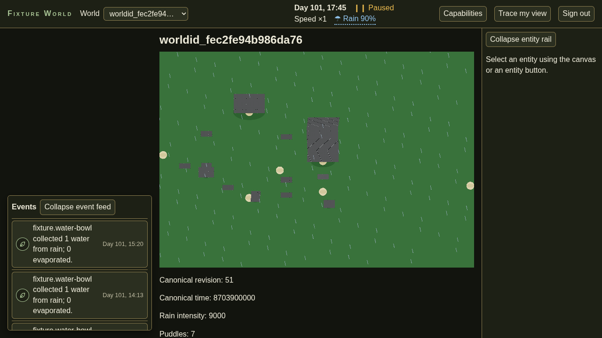

# Clockgrove


Clockgrove is an open-source platform for persistent worlds: places that keep time, change while nobody is watching, remember what happened, and can tell you why. It is for developers who want to build such a world, or to study how one is put together.

A world's physical facts (weather, food, movement, growth) come from a deterministic simulation and are stored as a journal of events. Its inhabitants perceive, decide and, in later work, converse. Language models may reason and propose, but they never decide what is physically true.

Clockgrove is the platform, not a particular world. [Raccoon World](https://github.com/clockgrove/raccoon-world), the first reference world, lives in its own repository; this one carries only a plain fixture world for testing.

Clockgrove is an engine you deploy yourself, not a hosted service. The unit of deployment is a world: your world pack plus a pinned Clockgrove, deployed into your own cloud account. Nobody signs in to Clockgrove itself. It has two kinds of user:

- **Developers** clone Clockgrove, write a world pack and configure their own cloud and identity provider. Clockgrove supplies the runtime (one Cloudflare Worker with World, Space and ActorAgent Durable Objects, queues, workflows, a Neon PostgreSQL journal and R2), the default React + Three.js web client and the world MCP server. Its deploy tooling targets only this repository's qualified commit, for the `development` and validation environments; deploying a developer's world pack, and any `production` deployment, are not built yet.
- **Players** will sign in to a world's deployment. Google is the decided first sign-in provider, through the Better Auth reference adapter, with Clerk as an optional adapter. Neither Google sign-in nor the Clerk adapter is built yet: today the Better Auth adapter only verifies sessions (bearer tokens, the MCP OAuth provider and API keys). Owner tools such as approvals and run inspection live inside that deployment, for its owner role.

> Build persistent worlds from deterministic physical truth plus subjective, agentic cognition.

**Before you go further:**

- Clockgrove is in active development, with no release and no hosted demo. Everything here runs on your own machine. See [Status](#status).
- The supported setup is Linux with Node.js 24.21.0 and pnpm 12.9.1, both exact. The browser view also needs PostgreSQL 18.6 with pgvector 0.8.7, also exact.
- Local use needs no account, API key or cloud resource, and costs nothing.
- Pull requests from outside contributors are not accepted before 1.0. Issues are welcome. See [Help, security, contributing and license](#help-security-contributing-and-license).

## What it does today

| You can | With | Status |
| --- | --- | --- |
| Run a world headlessly: seed it, send commands, advance time, replay and verify it | `packages/simulator` and its `clockgrove` CLI | Built |
| Write a world pack and check it against the engine | `packages/world-pack-sdk`, pack conformance | Built |
| Keep a world's history in PostgreSQL and replay it | `packages/persistence`, `db/migrations` | Built |
| Run a world on the actor runtime (Cloudflare Workers; workerd locally) | `apps/runtime` | Built locally; hosted qualification pending |
| Watch a world in a browser and ask why something happened | `apps/web`, `pnpm dev:world` | Wave 4, underway |
| Try a world pack locally as its owner, in the neutral playground or with your own pack | `pnpm playground`, `worlds/playground` | Local host, pack panel, owner-only world debugger and coding-agent access over MCP (#327); the optional cloud check follows the world-scope deploy tooling (#402) |
| Talk with inhabitants and connect tools over MCP | `apps/runtime`, `packages/model-gateway` | Wave 5, in progress; not in the local world below |
| Memory and learning, authoring through preview timelines, the Raccoon World demo, hosted and shared worlds | See the wave plans | Planned, Waves 6 to 12 |

A *wave* is one large, mostly sequential stage of the delivery plan. There are thirteen, numbered 0 to 12, and each has a plan in [`docs/waves/`](docs/waves/).

## Quick start

This path goes from a clean clone to a world you have changed, advanced and verified. It needs Linux, Git, [Node.js 24.21.0](https://nodejs.org/) and Corepack, which ships with Node.js. If you use [mise](https://mise.jdx.dev/), `mise install` provides the Node.js and pnpm pinned in `mise.toml`.

```bash
git clone https://github.com/clockgrove/clockgrove.git
cd clockgrove
corepack enable
pnpm install --frozen-lockfile --ignore-scripts
```

The install deliberately runs no dependency lifecycle scripts. Now seed the fixture world (`worlds/fixture/reference`, a neutral test world with a den, a porch, a cedar and three inhabitants), make it rain hard, and let an hour pass:

```bash
cg() { node packages/simulator/cli/clockgrove.mjs "$@" 2>/dev/null; }
STATE="$(mktemp -d)/hall.state"

cg simulate seed --pack worlds/fixture/reference --out "$STATE" > /dev/null
cg simulate command --state "$STATE" \
  --command '{"type":"world.weather.set","version":2,"payload":{"rainIntensity":9000}}' > /dev/null
cg simulate advance --state "$STATE" --to 8643600000 > "$STATE.hour.json"
```

Each command prints one JSON document and takes a few seconds; `2>/dev/null` hides a Node.js warning about loading TypeScript. This world's clock starts at simulation time `8640000000` milliseconds, so `8643600000` is one hour later. Rain intensity runs from 0 to 10000.

Ask what everyone decided, and why:

```bash
node -e '
const { result } = JSON.parse(require("fs").readFileSync(process.argv[1], "utf8"));
for (const { decision: d } of result.decisionTraces) {
  console.log(d.objectId, "->", d.selectedAction?.kind ?? "none", d.selectedAction?.targetObjectId ?? "");
  for (const c of d.candidates.filter((c) => c.action.kind === "seek-shelter"))
    console.log("   shelter", c.action.targetObjectId, c.excludedReason ?? "considered");
}
console.log("final state", result.finalStateHash);' "$STATE.hour.json"
```

```text
fixture.companion -> seek-shelter fixture.den
   shelter fixture.cedar-hollow not-perceived
   shelter fixture.den considered
   shelter fixture.porch not-perceived
fixture.dependent -> seek-shelter fixture.den
   shelter fixture.cedar-hollow not-perceived
   shelter fixture.den considered
   shelter fixture.porch not-perceived
fixture.keeper -> stay
   shelter fixture.cedar-hollow not-perceived
   shelter fixture.den not-perceived
   shelter fixture.porch not-perceived
final state a6140315b31ec6595a34af08d9cf8fa21d7b82683d950b3516c0d90629a3e883
```

Two inhabitants head for the den. The keeper stays out in the rain, and the record says why: it perceived no shelter, so none was a choice it could make. Every decision keeps its candidates, their scores and the reason each one was excluded.

Your final state hash should equal the one above. The simulation reads no wall clock and no unseeded randomness, so the same pack and the same steps give the same bytes. `verify` checks that by replaying the recorded steps:

```bash
cg simulate verify --bundle "$STATE"
```

It exits 0 and prints `"status":"ok"` with the same `finalStateHash`.

**Try one change.** Seed a second state, skip the weather command, advance to the same time and print the decisions again: `fixture.dependent` no longer chooses shelter. `cg simulate diff <a> <b>` lists where two state files differ. The [CLI reference](packages/simulator/docs/cli.md) covers every command, output field and exit code.

### See it in a browser

`pnpm dev:world` serves the same fixture world to the web client. It also needs PostgreSQL 18.6 with pgvector 0.8.7 on `PATH`; no other version is accepted. On Ubuntu 26.04, `scripts/ci/toolchain.sh postgresql pgvector` installs that exact set.

```bash
pnpm dev:world
```

It starts a temporary PostgreSQL cluster, the runtime in workerd and the web client, then prints:

```text
Living world: <pack>@<version> (<world> / <space>)
  Open:    http://127.0.0.1:5173/worlds/<tenant>/<world>/<timeline>/<space>
  Sign in: local session credential "hall-observer" (observation only)
  Stop:    Ctrl-C; the database and runtime storage are temporary and removed on exit.
```

Open the URL and sign in with `hall-observer`. Success is the status line `Arrival: scene ready at revision 0.` with the scene below it. If port 5173 is taken, the URL names the next free port.

This is a local checkpoint with firm limits. The credential can only observe: it cannot send commands, run the clock or start a conversation, and a new world starts paused. Nothing persists after Ctrl-C, and a session ends after 4 hours (`CLOCKGROVE_DEV_WORLD_HOURS` sets another bound). The [development reference](docs/runbooks/development.md#local-living-yard-checkpoint) has the details.

### The playground

`pnpm playground` is the local host for world packs. It serves the neutral playground pack (`worlds/playground`: a plane, a rock that carries a weather exposure and the capability its scenario changes the weather through, a cube and a puddle) and signs you in as the world's owner. You can Talk to the rock through its disclosed object perspective; with no model key a scripted reply answers. The shell's **Pack** panel shows the loaded pack's metadata and conformance checks, loads another pack from a local directory as a fresh world beside it, switches between them and previews what a newer version's migration would change. It needs the same PostgreSQL set as `pnpm dev:world`, and no cloud account or model key; on a fresh clone it installs the workspace first.

```bash
pnpm playground
pnpm playground --pack path/to/your-pack   # your own pack, as a fresh world from its declared seed
```

It prints the URL, the owner credential, `playground-owner`, and the world's MCP URL and token for your coding agent (Claude Code, Codex or Copilot), which can then answer why something happened from the world's own evidence, with links into the owner-only **World debugger** beside the scene. The [development reference](docs/runbooks/development.md#playground) has the details.



*The web client on the fixture world, from the repository's reviewed visual captures ([`tests/visual/`](tests/visual/README.md)). The captured world has been advanced by its test, which the local credential cannot do. The fixture's art is plain placeholder shapes on purpose; a real world brings its own.*

## How it fits together

The words this repository uses:

| Term | Meaning |
| --- | --- |
| World | One persistent place with its own clock, history and inhabitants. |
| World pack | The immutable, versioned definition a world is born from: spaces, actors, rules, policies and assets. |
| Actor | A durable, addressable inhabitant or object. An actor is an identity, not a running process or a model. |
| Command | A typed request to change the world. It is authorized and validated, then accepted or refused with a reason. |
| Event | A recorded fact that an accepted command produced. |
| Journal | The ordered event history in PostgreSQL. It is the one durable truth; everything else can be rebuilt from it. |
| Timeline | One line of a world's history. |

The parts and what each does:

| Part | What it does |
| --- | --- |
| [`packages/kernel`](packages/kernel/README.md) | The deterministic core: commands, events, movement, perception, weather, ecology, decisions, lifecycle. No I/O. |
| [`packages/simulator`](packages/simulator/README.md) | Seeds worlds from packs, runs scenarios and checks packs. Home of the `clockgrove` CLI. |
| [`packages/world-pack-sdk`](packages/world-pack-sdk/README.md) | Validates and builds world packs. |
| `packages/persistence`, `db/` | The PostgreSQL journal, replay and migrations. |
| `packages/application`, `packages/contracts`, [`packages/domain`](packages/domain/README.md) | Typed application authority, shared contracts and domain vocabulary. |
| [`packages/model-gateway`](packages/model-gateway/README.md) | The one path from cognition to a language model. |
| [`apps/runtime`](apps/runtime/README.md) | The world runtime for Cloudflare Workers: commands, scheduling, realtime scene delivery. |
| [`apps/web`](apps/web/README.md) | The browser client: scene, event feed, Why inspector and a complete text path. |
| [`worlds/fixture`](worlds/fixture/README.md) | Clockgrove's own test worlds. Platform code names no other world. |
| `infra/` | Environment and deployment configuration (OpenTofu, Wrangler). Not needed locally. |

A few boundaries are intentionally strong:

- **The simulation kernel owns physical semantics.** Models may reason, speak, plan and propose actions, but canonical mutations pass typed authorization and validation.
- **PostgreSQL is canonical durable world truth.** Runtime actors, queues, caches, indexes and client state are recoverable execution or projection state.
- **Logical identity is not runtime placement.** An actor or object does not imply a permanently resident process or model.
- **Objective state and subjective cognition remain distinct.** Perception, testimony, belief and memory are evidence-bearing, actor-relative state rather than disguised global facts.
- **Replay and explanation are product features.** Important behavior should be causally inspectable.
- **Provider boundaries stay replaceable.** Cloud, authentication, model, tool, renderer and infrastructure SDKs remain behind project-owned contracts where they affect durable semantics.

### Related repositories

- [`clockgrove/raccoon-world`](https://github.com/clockgrove/raccoon-world): Raccoon World, the first reference world. It holds its own pack, art and style bible, and builds against a pinned Clockgrove commit through the [external-world commands](docs/protocols/world-presentation.md#external-local-session).
- [`clockgrove/pendulum`](https://github.com/clockgrove/pendulum): Clockgrove Pendulum, formerly Pendulum, the agent tooling used to develop Clockgrove through GitHub Issues, pull requests and checks. This repository's `.github/workflows/pendulum.yml` still runs it under its old name, `clockgrove/pendulum@v0.9.37`. Clockgrove does not need it to build or run. Agent skills for working in this repository live in `.agents/skills/`, with `.claude/skills/` linking to them.
- `clockgrove/.github`: the organization profile and shared GitHub metadata.

## Accounts and secrets

Local development and CI need none: the local world runs on a temporary database and fixture models. `.env.example` and `.dev.vars.example` list only the *names* a hosted environment needs, with no values. Real values live in the operator's secret manager, never in the repository. Setting up a hosted environment is an operator task, described in the [infrastructure runbook](docs/runbooks/infrastructure.md#setting-up-a-hosted-environment).

## When something goes wrong

| Situation | What you do |
| --- | --- |
| A `cg` command prints nothing | Run it without `2>/dev/null` to see the error it wrote. |
| Your hash differs, or a check refuses your Node.js or pnpm version | Install exactly Node.js 24.21.0 and run `corepack enable`, so pnpm 12.9.1 comes from `package.json`. |
| Install fails with `ERR_PNPM_IGNORED_BUILDS` | Install with `--ignore-scripts`, as shown. See [dependency install scripts](docs/runbooks/development.md#dependency-install-scripts). |
| `simulate seed` exits 2 with `OUT_EXISTS` | `--out` never overwrites. Choose a new path or delete the old state file. |
| `simulate advance` exits 1 with `TARGET_NOT_AFTER_CURRENT` | `--to` is an absolute simulation time. Use a value after the world's current time. |
| The CLI printed JSON with a `refusal` | Look up `refusal.code` in the [CLI reference](packages/simulator/docs/cli.md#exit-codes) and the [refusal codes](packages/simulator/docs/refusal-codes.md). |
| `pnpm dev:world` fails with `PostgreSQL 18.6 is required` | Every PostgreSQL tool must report 18.6, with pgvector 0.8.7. See [local prerequisites](docs/runbooks/database.md#local-prerequisites-and-isolation). |
| The browser shows **World not available.** | Open the exact URL that `pnpm dev:world` printed, then sign in with `hall-observer`. |
| A temporary database is left behind | Only a SIGKILL of the launcher causes this. Stop with Ctrl-C instead, and delete the leftover directory from your temporary folder. |

## Documentation

Start with the [documentation index](docs/clockgrove-documentation-index.md). It says which document wins when two disagree, and lists the accepted decisions and the wave plans.

| To | Read |
| --- | --- |
| Understand the product and its scope | [PRD v0.5.10](docs/clockgrove-prd-v0.5.md) |
| Understand the architecture | [Implementation plan v3.12](docs/clockgrove-cloudflare-implementation-plan.md), [accepted ADRs](docs/adr/) |
| See what each wave delivers | [`docs/waves/`](docs/waves/), [incremental-delivery ADR](docs/adr/clockgrove-adr-incremental-wave-delivery-and-evidence.md) |
| Drive the simulator from the command line | [CLI reference](packages/simulator/docs/cli.md), [scenarios](packages/simulator/docs/scenarios.md) |
| Write a world pack | [Source and compatibility](packages/world-pack-sdk/docs/source-and-compatibility.md), [pack conformance](packages/simulator/docs/conformance.md) |
| Build a world in its own repository | [External worlds from a pinned checkout](packages/simulator/docs/conformance.md#external-worlds-from-a-pinned-checkout), [theme and presentation](docs/protocols/world-presentation.md) |
| Set up tools and run the checks | [Development reference](docs/runbooks/development.md), [testing rules](docs/runbooks/testing.md) |
| Work with the database, journal and replay | [Database runbook](docs/runbooks/database.md), [journal and replay](docs/runbooks/journal-replay.md) |
| Operate the runtime | [Runtime runbook](docs/runbooks/runtime.md), [infrastructure runbook](docs/runbooks/infrastructure.md) |
| Find a package's contract | The [documentation map](AGENTS.md#documentation-map) in AGENTS.md |
| Read how residents write field guides and how "why" comparisons work | [Field guides and counterfactual Why ADR](docs/adr/clockgrove-adr-field-guides-and-counterfactual-why.md) |
| Follow the brand and visual direction | [BRAND.md](BRAND.md), [STYLE.md](STYLE.md), [DESIGN.md](DESIGN.md) |
| Learn how AI-made content is disclosed to players | [AI content disclosure policy](docs/policy/ai-content-disclosure.md) |

## Working on Clockgrove

The quick start is enough for the simulator. The full check set also needs Python 3, Git LFS, PostgreSQL 18.6 with pgvector 0.8.7 and OpenTofu 1.13.1. The [development reference](docs/runbooks/development.md#tools) lists each tool and has a script that verifies them. Before proposing a change, run:

```bash
pnpm format            # apply formatting and safe fixes
pnpm check             # read-only: formatting, lint, types, package boundaries, doc links
pnpm test              # offline tests
pnpm run verify:docs   # ADR and wave-plan validation
```

`node scripts/bootstrap.mjs /absolute/owned/evidence-directory` runs the complete local set (install, checks, tests, database, runtime, infrastructure validation) and records its evidence in that directory, which you keep outside the checkout. It needs no hosted credentials.

## Clean-room and publication boundary

Clockgrove is independently developed. Do not copy private source code, repository history, credentials, data, prompts, proprietary assets or implementation artifacts from unrelated projects or employers into this repository.

Canonical repository content is written as if it may be public. Personal deployment details, private account and recovery information, credentials and unpublished working history do not belong here.

## Status

There is no release line and no version to depend on yet: the root package is `0.0.0` and private, and a world repository pins a Clockgrove commit. The foundation, deterministic kernel, journal and replay, and actor runtime (Waves 0 to 3) are built. The visual projection and web client (Wave 4) are underway, and qualification on the validation deployment is still pending. Conversations, models, capabilities and MCP (Wave 5) are in progress, and not yet part of the local world. Later waves add memory and learning, authoring, the reference-world demo and the open-source release. GitHub Issues hold the live state of each wave.

## Help, security, contributing and license

- **Questions and bugs:** search the [GitHub issues](https://github.com/clockgrove/clockgrove/issues), then open one with the matching form.
- **Security:** report a vulnerability privately, as [SECURITY.md](SECURITY.md) describes, never in a public issue.
- **Contributing:** [CONTRIBUTING.md](CONTRIBUTING.md) explains how the maintainers work. Outside pull requests open after 1.0.
- **License:** [MIT](LICENSE). The Clockgrove name and logo are trademarks and are [not covered by it](assets/brand/clockgrove/README.md). [provenance.json](provenance.json) and [THIRD_PARTY_NOTICES.md](THIRD_PARTY_NOTICES.md) record content that is not original Clockgrove work.
