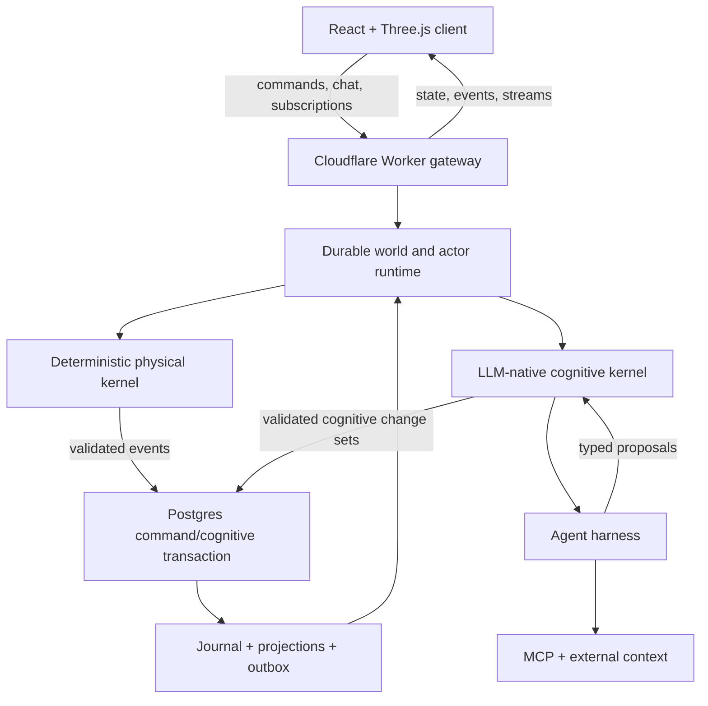

# Clockgrove

## Product Requirements Document

**Status:** Working product and technical specification
**Version:** 0.5.10
**Date:** October 19, 2026
**Working name:** Clockgrove
**Product type:** Open-source persistent artificial-life world and conversational actor platform
**Initial client:** Browser
**Primary implementation language:** TypeScript

### Revision note

Version 0.5 is the reconciled product baseline after the full Waves 0–12 editorial and fact-check review. It preserves the two-kernel, TypeScript-first, Cloudflare-native architecture from version 0.4 while incorporating the shared-world model that emerged during wave planning: provider-neutral identity, world-specific personas, foundational action attribution, world-local personal inventory, inherited object-mobility policy, activity-driven spatial partitioning, and optional Management-owned prepaid credits allocated to Runtime through bounded world leases.

Version 0.5.1 through 0.5.3 introduced and refined Director/Keeper development automation. Version 0.5.7 moves that software-factory architecture and implementation authority to the separate `clockgrove/factory` project. Factory may operate this repository through ordinary source, issue, review, and CI interfaces, but it is not a Clockgrove product/runtime dependency or authority. This repository does not prescribe Factory deployment topology or operator-specific execution hosts.

Version 0.5.4 pressure-tests every initial-release non-goal so 2D rendering, quadtree indexing, bounded reactive runs, and current provider choices cannot become accidental ceilings on full 3D, alternative engines, selectively long-running actor processes, or other deliberately deferred capabilities.

Version 0.5.5 closes the end-to-end Raccoon World demo gaps: immutable world-pack artifacts install through an explicit idempotent provisioning lifecycle; genesis pins time, randomness, cognition, schedules, and provenance; browsers enter through a declared readiness contract; observer view navigation is distinct from embodied movement; and the unrendered Caretaker’s private conversation channel is explicitly separated from public speech, influence, and physical commands.

Version 0.5.6 accepts a formal logical Management Plane / World Runtime Plane boundary and a shared-wallet credit-lease model. One billing account owns one authoritative wallet across its worlds; Management alone owns money, Stripe, rating and accounting, while Runtime originates attributed usage and enforces bounded world-local leases, quotas and execution modes. Both planes may initially ship in one modular CLI/process.

Version 0.5.9 is authoritative for product intent. Version 0.4 and earlier documents remain historical artifacts. The accepted ADRs `clockgrove-adr-world-personas-and-object-mobility-policy.md` and `clockgrove-adr-management-plane-world-runtime-plane-and-shared-wallet.md` are normative.

Version 0.5.8 accepts substantial sequential wave workstreams with numerous capability Objectives, early product checkpoints, explicit local-readiness exceptions, and proportionate qualification. The accepted `clockgrove-adr-incremental-wave-delivery-and-evidence.md` governs these delivery changes. It also reconciles the accepted privacy categories and assigns cognitive-document/policy and external-observation proofs to their owning waves; full wave exits and foundation/GA gates remain required.

Version 0.5.9 accepts resident-authored field guides and counterfactual Why under `clockgrove-adr-field-guides-and-counterfactual-why.md`. Guides expose attributed, evolving knowledge through existing cognitive documents and governed sharing. Counterfactual Why compares one declared hypothetical input on a reproducible deterministic decision through existing isolated preview/evaluation. Waves 6–7 own the capabilities, Wave 8 the integrated experience, and Wave 9 their release evidence.

### 0.1 Accepted baseline decisions

The following decisions resolve earlier open questions and control if later historical wording in this document is ambiguous:

1. **Clockgrove is the platform for any world; Raccoon World is the reference world.** Raccoon World lives in its own repository, [clockgrove/raccoon-world](https://github.com/clockgrove/raccoon-world), and builds against Clockgrove at a pinned commit. Platform code names no world's content. Clockgrove keeps `worlds/fixture` as its own test world, the platform's portability proof. The product is not defined by one game genre or art treatment.
2. **Shared worlds follow MUD/MOO semantics.** Workspace membership grants administrative ownership; world membership grants participation. A visitor may join a world without joining its owning workspace.
3. **Authentication is provider-neutral.** Better Auth is the reference open-source adapter. Clerk may be offered as an optional hosted adapter. Neither provider owns Clockgrove tenancy, authorization, world membership, personas, attribution, or billing semantics.
4. **Every participant has a world persona.** The durable chain is `Principal -> WorldMembership -> WorldPersona -> Presence`. A persona may be unrendered, represented, or embodied, and may optionally control a world actor. Raccoon World begins with a disclosed, unrendered Caretaker persona.
5. **Attribution is foundational.** Every mutating command and derived event carries an immutable `AttributionEnvelope` that distinguishes initiator, effective actor, authority decision, causal root, immediate cause, session, world, timeline, and correlation identifiers. Billing consumes attribution later; it never defines authorship or causation.
6. **Personal inventory is world- and timeline-local.** An item may move among rooms, containers, actors, and a persona inventory inside one world. Runtime object portability between worlds is out of scope. Export/import of world data is a separate administrative concern.
7. **Object mobility uses sparse inherited policy.** Effective permission is the intersection of world defaults, space restrictions, role/persona restrictions, archetype ceilings, and instance restrictions. Descendants may narrow policy but may not silently widen a parent. Deny wins. Pickup, drop, give, move-within-space, cross-space, place, remove, and object-use capabilities are evaluated separately.
8. **Scale is activity-driven.** One million logical actors in a world is a qualification target, not a promise of one million simultaneously active or visible actors. The initial 2D/isometric runtime uses a loose quadtree with epoch-scoped opaque cell references, hot/warm/dormant tiers, leaf summaries, scoped event cursors, and measured promotion of hot leaves. An octree or another 3D index is deferred until a world requires authoritative 3D movement; no quadtree code enters durable actor/object identity.
9. **Canonical truth remains in PostgreSQL.** Durable Objects serialize active work but are reconstructible. Runtime instance identifiers are Clockgrove diagnostic identifiers, not Cloudflare platform identities.
10. **Commercial hosting is optional.** Waves 0–9 form the technical/open-source track, Waves 10–11 add self-service and shared-world participation, and Wave 12 adds optional metering and billing.
11. **Hosted variable-cost work is metered against prepaid credits.** One `BillingAccount` owns one authoritative wallet shared across its worlds. Management uses PostgreSQL for immutable accounting and Redis for atomic allocation; worlds receive bounded, expiring credit leases rather than separate Stripe customers, subscriptions, or authoritative wallets.
12. **Failure is explicit.** Runtime enforces epoch/versioned `active`, `credit_restricted`, `frozen`, `read_only`, or `archived` execution modes. Empty credit normally blocks variable-cost work; nonpayment may freeze a world at a safe journal boundary without accumulating unbounded catch-up debt.
13. **A world has an explicit birth.** A validated immutable pack installs through an idempotent `WorldProvisioningCase`; it pins provenance, commits genesis/seed commands, verifies projections, and emits `WorldReady` before ordinary entry or simulation begins.
14. **Genesis is reproducible.** A pack installation pins the simulation epoch and clock mapping, named random-stream algorithm/state, initial cognitive artifacts and policies, schedules, asset manifest, and expected seed hash.
15. **Browser arrival is a product contract.** Authorization, presence, snapshot/backfill, critical assets, reducer state, renderer readiness, and text fallback have visible states; a partial or incompatible world never masquerades as ready.
16. **Caretaker communication is explicit.** Initial `Talk` is a private, attributed Caretaker-to-actor channel rather than spatial sound. Public speech, Influence, gifts, operator inspection, and authoring are separate actions with their own authority and audience semantics.
17. **Viewing is not embodiment.** Camera movement and authorized observer space changes affect presence/interest only. Moving a controlled actor or world object always uses ordinary physical commands.
18. **Management and Runtime are separate logical planes.** Management owns identity/tenancy, world catalog and desired lifecycle, pack registry, provisioning cases, quotas, wallets, rating, accounting, money and Stripe. World Runtime owns journals, simulation, actors, cognition, world participation, attribution and projection. They may initially compose inside one modular CLI/process but cannot write through each other's persistence boundary.

---

## 1. Executive summary

Clockgrove is a persistent, living simulation platform in which every meaningful character, place, object, and system can behave as a durable actor. Its first reference world, Raccoon World ([clockgrove/raccoon-world](https://github.com/clockgrove/raccoon-world)), is a cozy, cartoonish, isometric Seattle neighborhood inhabited by raccoons. Time passes, weather changes, trees grow and yield food, resources move and decay, relationships develop, babies are born, actors age and die, and the world continues whether or not a player is watching.

The game is not the primary product thesis. The raccoon world is an accessible, emotionally legible test environment for a new interaction model:

> A persistent artificial world where users can talk to anything, investigate why it behaves as it does, influence it through natural language, and reshape the world itself through conversation.

The experience combines aspects of artificial life, a text adventure, The Sims, tycoon games, MUDs, and an eventually multiplayer shared world. A graphical world makes state and consequences visible. Conversation reveals the subjective inner world of each actor. The event journal makes the simulation inspectable and rewindable. Natural-language authoring lets an operator change the world without directly editing tables or code.

The initial world is intentionally small: one shared yard, a few raccoons, a handful of environmental objects, a clock, weather, needs, memories, conversations, and a searchable event journal. It must nevertheless establish the architectural invariants needed for much larger worlds:

- A deterministic physical kernel and an LLM-native cognitive kernel
- Authoritative, event-sourced world state
- Durable actor identities and scheduled behavior
- Dynamic compilation of persistent actors into bounded, harness-driven agent runs
- A project-owned agent harness built over replaceable model, tool, MCP, and hosting adapters
- Deterministic compiled-policy fast paths distilled from stable cognition
- Separation of objective world truth from subjective perception and belief
- Multiple durable conversation sessions per actor
- Versioned Markdown cognitive workspaces, including actor-authored `SKILL.md` files
- Explainable memory, learning, and decision traces
- Typed, secured agent tools and installable MCP capabilities
- Provenance-preserving ingestion of external observations and data
- Rewindable timelines and preview branches
- Real-time projection to connected clients
- End-to-end telemetry and replay-based debugging
- Local-first development and open-source portability
- An approachable TypeScript reference implementation with explicitly replaceable performance boundaries

If successful, Clockgrove becomes both a compelling world in its own right and a reusable runtime for persistent conversational worlds containing arbitrary characters, spaces, institutions, communities, and economies.

---

## 2. Origin and intellectual lineage

### 2.1 Independent foundation

Clockgrove is designed from its own world-simulation requirements and from public standards and established software patterns. Relevant patterns include:

- Searchable agent runs and tool traces
- Durable ingested context
- Structured entity and fact extraction
- Context graphs
- MCP tool discovery and execution
- Scoped retrieval for agents
- Observable, inspectable agent workflows

The project should prefer standards-based components and clean implementations tailored to persistent worlds. Model and harness integrations remain behind project-owned actor, session, context, memory, and capability contracts.

### 2.2 V-Worlds and MUD lineage

The architecture consciously extends ideas from Microsoft Research's V-Worlds work and *The Architecture of a Distributed Virtual Worlds System* by Manny Vellon, the maintainer Marple, Don Mitchell, and Steven Drucker (COOTS 1998).

The continuity is direct:

| V-Worlds concept | Clockgrove interpretation |
| --- | --- |
| Thing | World object with stable actor identity |
| Exemplar | Versioned archetype |
| Dynamic property | Typed component or instance override |
| Dynamic method | Capability, tool, behavior, or MCP operation |
| Room | Space actor and containment scope |
| Portal | Traversal edge, including nonphysical transitions |
| Avatar | Embodied character actor |
| Container and contents | Spatial containment hierarchy |
| Peer/content/container events | Perception and audience routing |
| Bystander algorithm | Interest, visibility, and perception resolution |
| Master object and cached proxy | Authoritative server state and client projection |
| Local/volatile properties | Projected, derived, or ephemeral state |
| Property log and serialization | Event journal, snapshots, and replay |
| Runtime editing | Natural-language live world authoring |
| Owner/setuid security | Principal, provenance, grants, and delegated execution |

The modern extension is subjective cognition. World actors do not merely receive consistent events; they perceive them selectively, form memories and beliefs, make bounded decisions, communicate, learn socially, and can explain the causal chain behind their behavior.

Reference: [The Architecture of a Distributed Virtual Worlds System](https://www.usenix.org/legacy/publications/library/proceedings/coots98/vellon/vellon_html/vellon.html)

---

## 3. Product vision

### 3.1 Vision statement

Create a living, persistent, inspectable world where every meaningful thing can become an actor, every action has history and consequences, and natural language is a native interface for playing, understanding, and authoring the world.

### 3.2 Core thesis

The product tests seven connected ideas:

1. **Every meaningful thing can expose an actor interface.** Characters, houses, rooms, trees, trash cans, weather systems, and neighborhoods can receive messages, expose capabilities, retain state, and participate in the world without requiring each to be a continuously running process.
2. **Conversation is a universal inspection and influence interface.** A user can ask Stevie why she avoided a house, ask a tree about its condition, ask a yard what happened overnight, or ask the world to add a pond.
3. **Subjective memory makes a world feel inhabited.** Actors remember different things, form imperfect beliefs, learn from others, inherit traditions, and change behavior because of experience.
4. **A journal makes generative systems trustworthy.** Events, perceptions, decisions, model calls, tool calls, memory changes, and rules are searchable and causally connected. The world can be replayed, forked, previewed, and repaired.
5. **The same primitives can support arbitrary worlds.** Raccoons and yards constrain the first implementation, but actor, space, memory, event, capability, and authoring abstractions must not encode raccoon-specific assumptions into the kernel.
6. **Actor cognition is an agent run, not a bespoke game-AI subsystem.** When an actor wakes, Clockgrove compiles its persistent identity, Markdown cognition, current perceptions, scoped context, conversation state, and MCP capabilities into a bounded run executed by an agent harness.
7. **Persistent worlds can incorporate external reality.** Provenance-preserving observations such as weather, news, markets, public data, or synthetic feeds can enter the world as evidence and influence actors without bypassing world authority.

### 3.3 Product principles

- **Two kernels, one world.** The deterministic physical kernel determines what can happen and what did happen. The LLM-native cognitive kernel determines what an actor notices, believes, remembers, wants, says, learns, and proposes to do.
- **Cognition is model-native and event-driven.** LLM reasoning is core to cognitive actors, including interpretation of behavioral rules, memory formation, planning, tool use, conversation, and learning. Actors wake for meaningful work rather than invoking a model on every simulation tick.
- **The LLM is a semantic compiler, not an authority.** It compiles Markdown cognition and injected context into typed proposals. Only validated commands and atomic cognitive change sets become canonical state.
- **Reason freshly when needed; materialize what becomes routine.** Stable learned cognition may be distilled into a governed deterministic policy that executes cheaply, remains inspectable, and falls back to the LLM outside its validity envelope.
- **Every claim has provenance.** The system distinguishes fact, observation, testimony, inference, belief, memory, and summary.
- **Actors learn by writing.** Human-readable, versioned Markdown is the primary representation for actor rules, plans, reflections, memories, and skills; structured records index and govern those documents rather than replacing them.
- **Own the harness; reuse the plumbing.** Clockgrove owns the cognitive-turn state machine, model policy, tool orchestration, context handling, checkpoints, evidence, and run semantics. MCP, model SDKs, gateways, and cloud runtimes provide lower-level protocol, transport, inference, and hosting capabilities behind project-owned ports.
- **TypeScript is the reference implementation.** The initial system is implemented entirely in TypeScript for approachability, inspectability, open-source contribution, and agent-assisted development. Stable contracts and conformance fixtures permit measured hotspots to gain alternative implementations later without splitting the product model.
- **History is additive.** Material changes append semantic events. Correction normally means a new event, compensating action, or alternate timeline—not silent mutation of the past.
- **The server is authoritative.** Clients render projections and submit intents. They do not own canonical simulation state.
- **The world can sleep.** Actors are activated by messages, timers, or relevant events rather than consuming continuous compute.
- **Scale with activity, not population.** A world may contain millions of persistent actors while only a bounded subset is materialized into concurrent agent runs.
- **Strong bones, narrow surface.** Build the smallest compelling world on foundations that do not need to be discarded.
- **Local operation is a feature.** Contributors must be able to run a useful version without paid cloud accounts.
- **Observability is part of the product.** The event and decision inspector is both a debugging system and a user-facing way to understand the world.
- **Generated behavior remains bounded.** LLMs propose typed operations subject to capability, policy, consistency, and safety checks.

### 3.4 Falsifiable thesis tests

The project should be evaluated as a series of product hypotheses rather than only as an engine implementation:

1. **Universal conversation creates useful discovery.** Users find value in asking actors, objects, and spaces about themselves rather than treating chat as decoration.
2. **Subjective memory produces legible behavioral change.** Users can observe and correctly explain a later decision that changed because of experience or social learning.
3. **Grounded traces increase trust.** Users prefer explanations tied to real perceptions, beliefs, utility features, and causal events over unconstrained character narration.
4. **Conversational authoring is materially easier.** An operator can describe, preview, validate, and apply a bounded world change faster than editing raw scene and simulation data.
5. **The abstractions generalize.** Clockgrove's own fixture world (`worlds/fixture`) uses the same actor, space, event, memory, rule, and capability contracts as the reference world without kernel changes, and the reference world runs from its own repository on an unmodified platform.
6. **Harness-driven cognition produces coherent autonomy.** The same agent-run machinery supports perception, research, action, conversation, reflection, and learning without separate behavior implementations that disagree about actor identity.
7. **External context creates meaningful world consequences.** A recorded weather, news, market, or synthetic observation can alter an actor or system in a way that remains provenance-grounded and replayable.

Each milestone should identify which hypothesis it tests and what evidence would falsify it. The second fixture is a test world, not a second product or art project.

Evidence must come from observable behavior and reproducible scenarios rather than attractive transcripts. The thesis is weakened if conversation remains decorative, retrieved memory does not change later action, explanations cannot be reconstructed from stored inputs, authoring is not safer or faster than structured editing, the non-raccoon fixture requires kernel branches, harness-driven runs fragment actor identity, or external inputs cannot be replayed with provenance.

---

## 4. Goals, non-goals, and success criteria

### 4.1 Product goals

The first meaningful release should demonstrate that:

- A small world persists and evolves over real and simulated time.
- Multiple browser clients see consistent, timely world updates.
- A user can select and converse with any important visible entity.
- The same event can produce different actor perceptions and memories.
- An actor's learned belief can alter later behavior.
- An actor can write and later apply a versioned Markdown skill derived from experience.
- A stable learned skill can compile into a replayable deterministic fast path, avoid a model call in familiar situations, and return to fresh cognition when its assumptions no longer hold.
- An external observation can enter through MCP or a world sensor, retain provenance, and influence the simulation without gaining mutation authority.
- A user can inspect why a behavior occurred through a grounded causal trace.
- A user can describe a bounded world change in natural language, preview it on a branch, and apply it safely.
- A process can crash and resume without losing committed world history or durable scheduled work.
- A developer can search and replay events, model calls, tool calls, rules, memories, and failures.
- The system runs locally with documented setup and replaceable infrastructure adapters.

### 4.2 Long-term goals

- Persistent shared worlds with many simultaneous users
- Multiple neighborhoods and world packs
- User-created characters, places, archetypes, rules, and capabilities
- Quests, emergent stories, and optional tycoon/game mechanics
- Cultural and generational learning across populations
- Composite actors and shared cognitive workspaces for households, organizations, communities, markets, and institutions
- Installable MCP servers and context sources per actor, room, or world
- Live, historical, and synthetic external data feeds for environmental, community, and economic simulation
- Millions of durable logical actors with bounded concurrent cognitive execution
- Large-scale graph and vector projections
- Offline counterfactual simulation and policy experimentation
- Community-contributed assets, behaviors, archetypes, and world packs
- Renderer-neutral presentation that can support 2D, 2.5D, full 3D, and immersive clients without changing world identity or history
- Selectively long-running actor processes for characters or institutions that justify continuous goals, subscriptions, research, or external responsibilities
- Optional specialized physics, learned-policy, economy, combat, and quest modules behind the same command, event, capability, authority, and replay boundaries

### 4.3 Initial-release non-goals and future-capability guarantees

These are sequencing decisions, not accidental architecture ceilings. Except for the permanent safety/authority invariants explicitly identified below, a non-goal means “do not build this for the first release,” not “make this impossible.” Initial implementations may be narrow, but durable IDs, schemas, events, authority boundaries, exports, and adapter contracts must let later capabilities arrive additively or through a versioned migration rather than a rewrite of world identity or history.

| Initial-release non-goal | Future capability deliberately preserved |
| --- | --- |
| Building a full MMO backend before a single yard is compelling | Tenant/world/persona identity, interest-filtered projections, opaque runtime placement, routing epochs, authority fencing, spatial subdivision, explicit handoff, rate-limit, moderation, and privacy seams support later large shared worlds. |
| High-fidelity 3D graphics or a freely rotating 3D camera | Semantic spatial frames, versioned 2D/3D coordinates and regions, opaque spatial-index cells, renderer-neutral presentation bindings, and a scene-adapter contract permit a 3D renderer, octree/BVH, navmesh, and volumetric perception later. The initial loose quadtree is rebuildable runtime/index state, never object identity. |
| Photorealistic art | Asset identity, provenance, source formats, renditions, animation state, and presentation bindings are independent of the initial cartoon sprites. A future renderer may select photorealistic or generated renditions without changing semantic objects. |
| A full economic or tycoon simulation | Structured ownership, commitments, institutional actors, rules, capabilities, event streams, attribution, and optional accounting projections allow economies and management mechanics to be added as world-pack/domain modules. |
| Combat, competitive balance, or a complex quest system | Actor capabilities, typed actions, effects, health/resources, rules, schedules, relationships, authority decisions, and quest composition are generic enough for later opt-in modules without making combat a kernel assumption. |
| Continuously resident processes or continuously running LLM loops for every world actor | Actor identity is already independent of execution residency. A future `ActorProcess` may be reactive, scheduled, or continuously eligible; it persists objectives, event cursors, checkpoints, leases, budgets, and run segments and may be promoted to dedicated compute. “Long-running” is a durable logical process, not a requirement that one isolate or model connection remain alive forever. |
| Unrestricted natural-language code generation in the live world | Typed changesets remain the safe default. Later reviewed/sandboxed code extensions, generated behaviors, or WASM/native plugins may be installed through explicit capability, signing, preview, migration, and rollback policy. **Permanent invariant:** untrusted prose never receives direct mutation or execution authority. |
| General-purpose physics | Spatial/body/collision components and a versioned physics adapter may later produce deterministic or recorded typed outcomes. **Permanent invariant:** a third-party physics engine cannot bypass the journal or silently become a second source of world truth. |
| Neural reinforcement learning for initial behavior | Decision-policy and compiled-policy artifacts are versioned behind a common proposal/evaluation interface. Later learned policies may train offline, run in shadow/preview, and become governed proposal sources with evidence and fallback. |
| A graph database as the canonical source of truth | Graph stores may become specialized derived projections or bounded read authorities behind ports. Storage IDs and query languages do not leak into domain contracts, so a deliberate ADR-backed storage migration remains possible. **Current invariant:** the semantic journal remains the portable historical authority. |
| Cache or presence infrastructure as canonical state | Caches may grow, shard, or become durable operational projections. If durable social presence/history becomes a product fact, it is modeled as journaled domain state rather than declaring a cache authoritative. **Permanent invariant:** loss of a cache or socket cannot rewrite world truth. |
| Perfect deterministic reproduction of live external model providers without recording their outputs | Seeded/local models and recorded-output replay may be exact; future providers and model classes can be added behind the same gateway. **Permanent invariant:** consequential nondeterministic outputs must be recorded before exact replay can claim to reproduce them. |
| Supporting every browser, device, database, runtime, and model provider in version one | Protocol schemas, accessible text projection, conformance fixtures, and provider/runtime/storage ports allow support to expand from evidence. No single vendor SDK type becomes a public domain contract. |

The acceptance test for this section is architectural: adding one full-3D world pack or one selectively long-running actor process should require new implementations and migration/configuration, but should not require new actor IDs, a second journal, a new authorization model, or reinterpretation of existing history.

### 4.4 North-star demonstration

The canonical vertical slice is:

1. A provenance-recorded live, historical, or synthetic Seattle weather observation indicates rain.
2. A deterministic adapter begins rain in the yard; food availability and actor comfort change.
3. Stevie receives a bounded perception frame and wakes into an agent run.
4. The context compiler loads her current needs, memories, rules, plans, room context, and applicable foraging `SKILL.md`.
5. The harness lets Stevie retrieve evidence and, when useful, call a weather or route MCP tool before proposing an action.
6. Other actors receive different frames and may notice or interpret different things.
7. The physical kernel validates Stevie's proposed investigation of a trash can or house-related opportunity.
8. A user asks Stevie why she went there.
9. Her answer is grounded in the recorded context manifest, tool evidence, cognitive-document versions, and decision trace rather than invented rationale.
10. The experience creates or patches a Markdown episode, belief, plan, or learned skill.
11. Stevie later teaches or demonstrates the behavior to a kit.
12. The kit writes a tentative, attributed lesson rather than receiving a copied firsthand memory.
13. Overnight consolidation compacts experience and may revise summaries, beliefs, relationships, or skills.
14. Once the procedure is stable, a governed compiler may materialize it as a deterministic cognitive policy with explicit fallback conditions.
15. On a later familiar day, the compiled policy changes a choice without a model call; novelty or contradictory evidence returns the actor to fresh cognition and may revise the policy.
16. Two connected clients see consistent results.
17. The runtime can crash during the scenario and resume safely.
18. A developer can search the complete causal chain, inspect document and policy diffs, and fork a preview from any point.

---

## 5. Users and modes of interaction

### 5.1 Initial user roles

| Role | Primary need |
| --- | --- |
| Visitor/player | Watch the world, inspect entities, converse, and exert limited influence |
| World operator | Author objects and rules, control time, inspect hidden state, fork timelines, and repair problems |
| Developer | Build behaviors and capabilities, replay failures, inspect telemetry, and extend the engine |
| World-pack author | Define archetypes, assets, spaces, initial state, rules, and presentation bindings |

A single person may occupy all four roles during development, but the authorization model must distinguish them.

#### World persona and participation model

Human identity and in-world identity are deliberately separate:

```text
Principal
  -> WorkspaceMembership (administration and resource ownership)
  -> WorldMembership (participation in one world)
  -> WorldPersona (the participant's durable in-world identity)
  -> Presence (ephemeral connection in a space)
  -> optional controlledActorId (embodiment)
```

A principal may hold different personas, roles, relationships, reputation, and inventory in different worlds. A world persona has a stable `personaId`, display name, disclosure mode, optional presentation binding, policy roles, and a world/timeline-scoped personal inventory. Persona state is not stored in the authentication provider.

Raccoon World begins with a disclosed **Caretaker** persona: the raccoons can attribute messages and gifts to a participant, but the participant is not rendered as a raccoon or omniscient deity. Later packs may allow visible Visitors, Residents, avatars, spirits, vehicles, or direct control of an existing actor without changing the identity model.

### 5.2 Chat modes

“Talk to anything” must not imply that every object literally speaks like a human. The UI should disclose the interaction mode:

| Mode | Example | Semantics |
| --- | --- | --- |
| Embodied dialogue | Talk to Stevie | The actor communicates in character using its knowledge and capabilities |
| Interpreted perspective | Ask a tree how it is doing | The system narrates nonverbal state from the object's modeled perspective |
| Operator inspection | Inspect the rain system | Authorized view of canonical and derived state |
| Influence | Encourage Stevie to visit the porch | A user intent enters the actor's decision process; it is not guaranteed control |
| Authoring | Ask the yard to add a pond | Produces a draft, validated world change rather than immediate arbitrary mutation |

For the initial unrendered Caretaker persona, **Talk** is a private, attributed Caretaker-to-actor channel. The addressed actor recognizes the named Caretaker and may remember or act on the message, but nearby actors do not hear it as spatial sound. A public speech act, Influence intent, gift/object command, operator inspection, and authoring request are separate operations with separate audience and authority semantics.

### 5.3 Core user journeys

#### Observe

- Open the world and see the current simulated date, time, weather, and activity.
- Pan and zoom an isometric yard.
- Change the viewed space only through an authorized observer-navigation action; camera/view presence is distinct from moving an embodied actor or object.
- See actors moving, resting, eating, interacting, and responding to weather.
- Review notable events that occurred while away.

#### Converse

- Select any important actor, object, or space.
- Start a new conversation or resume one of several prior sessions.
- Ask about current state, history, relationships, memories, plans, or reasons.
- Receive responses limited by the entity's perspective and permissions.

#### Investigate

- Ask “Why did you avoid the green house?”
- Expand a grounded decision trace showing relevant needs, observations, beliefs, candidate actions, chosen action, and resulting events.
- Move from a decision to its evidence, perceptions, memories, model/tool calls, and rule firings.

#### Influence

- Suggest an action, teach an actor something, provide an object, or change an environmental condition within granted capability.
- Observe whether and how the world incorporates the intervention.

#### Author

- Describe a change: “Add a small rain-fed pond behind the cedar. Let frogs use it and raccoons drink from it, but don't block the den path.”
- Review the system's assumptions and typed operations.
- Validate and render the change on a preview branch.
- Fast-forward the preview to detect side effects.
- Approve, revise, or reject the change.

#### Rewind and branch

- Select an event in the timeline.
- Inspect the world at that point.
- Fork a mutable preview timeline.
- Try a different rule, object, or intervention.
- Promote only validated authored intent back to the live timeline.

---

## 6. Initial world and visual experience

### 6.1 Setting

The demo world is a stylized Pacific Northwest residential yard near Seattle's Green Lake. It should feel cozy, rainy, slightly mischievous, and alive rather than fantastical or photorealistic.

Initial spaces may include:

- Green Lake Neighborhood
- Living Yard
- Porch
- Raccoon den
- Garden
- Cedar tree area
- Fence line
- Green house or neighboring food source
- Street-edge safety buffer

Initial inhabitants:

- Stevie, an adult raccoon
- Gracie, an adult raccoon
- A small number of kits
- Optional background wildlife represented as dormant or aggregated actors until individual cognition becomes relevant

Initial objects and systems:

- One or more trees
- Trash can
- Porch and house facade
- Den
- Food and water holders with declared physical causes
- Shrubs, garden, and decorative props
- Weather system
- Day/night clock
- Spatial regions and navigation anchors

Resource creation follows Kirk's closed-world decision of 2026-11-09 (issue 187), for food and
water alike: rain collects in open holders, plants yield food, and characters or explicitly
declared world processes move resources through journaled commands. Off-screen people have no
implicit refill authority. Genesis quantities are initial inventory; every later increase needs
an attributable cause. The platform enforces per-holder journal accounting, finite plant-stage
yield, rain collection/evaporation and explicitly scheduled process transfers through the ordinary
command validator. Durable runtime wakes include process deadlines, including actorless worlds.
Scheduled ecology sources are removed; pack validation refuses legacy declarations and commands
cannot mint resources through unbacked offers or positive-inventory object creation. An actor or
household fills a bowl by debiting an existing holder. See the
[kernel ecology contract](../packages/kernel/docs/ecology.md).

### 6.2 Visual direction

- Isometric or isometric-like 2.5D view
- Cartoonish, warm, readable shapes
- Pacific Northwest palette with rain, greenery, wood, and soft lighting
- Strong silhouettes at small screen size
- Expressive but economical animation
- Weather and time conveyed visually
- No requirement for photorealism or physically accurate rendering

The camera does not need arbitrary 3D rotation. A fixed isometric projection keeps asset production and scene composition tractable and highly automatable.

### 6.3 Screen layout

The primary screen should combine:

- Three.js-rendered world canvas
- Current time, date, simulation speed, and weather
- Actor/object selection
- Entity panel with status, relationships, and available interaction modes
- Entity actions such as Talk, Observe, Remember, Influence, and Why, filtered by capability and permission
- Conversation panel with session selector
- World-level natural-language command/adventure input for observation, influence, and authorized authoring
- Event feed showing notable world changes
- “Why?” entry point for decisions and actions
- Timeline/branch controls for authorized operators
- Optional developer inspector exposing raw traces and projections

React owns application chrome, chat, inspectors, timelines, menus, and forms. The Three.js adapter owns scene rendering, camera, animation, selection hit-testing, weather effects, and local presentation state.

### 6.4 Asset pipeline

The initial art budget should be deliberately small:

- One coherent environment asset set
- One raccoon base design
- Three recognizable raccoon variants
- Approximately five animation families: idle, walk/run, eat/interact, sleep, emote
- Four rendered directions plus mirroring where acceptable
- A small number of weather and time-of-day effects

Blender may be used to create rigged source assets and render directional sprite sheets. Blender MCP or repository-owned Blender scripts may automate modeling, rigging, camera setup, directional renders, and atlas export, but the Blender source and deterministic export settings remain the durable inputs.

Phaser Editor v5 may be used to assemble scenes, atlases, animations, and tilemaps. Its local MCP tools can accelerate agent-driven scene and asset work, but they are treated as optional authoring tools while their coverage and stability mature. Phaser Game Agent may be used for rapid hosted prototypes, code, art, music, or preview experiments; it is not the build authority for the open-source repository. Committed assets, scene data, and source code must build without Blender MCP, Phaser Editor MCP, or the hosted Game Agent installed.

Raccoon World's generated concept image, kept in its repository, is that world's visual north star: a cozy isometric Pacific Northwest yard, readable raccoon characters, visible weather and world activity, an event feed, and a selected-actor panel with conversation and explanation affordances. It is a direction reference, not a pixel-perfect specification.

Every asset must carry provenance metadata including author/generator, source, prompt or source file where applicable, license, modification history, and export settings.

### 6.5 Spatial representation

The semantic world uses continuous local coordinates and regions. The isometric renderer projects those coordinates; tile placement must not become the authoritative domain model.

Every pose and region belongs to a versioned semantic frame:

```ts
interface SpatialFrame {
  frameId: SpatialFrameId;
  version: number;
  dimensions: 2 | 3;
  unit: FixedPointUnit;
  axes: AxisConvention;
  parentFrameId?: SpatialFrameId;
  parentTransform?: FixedPointTransform;
}
```

Movement commands target semantic destinations, anchors, routes, regions, or poses in a declared spatial frame. They do not expose Phaser coordinates, quadtree Morton codes, navmesh polygon IDs, or renderer-specific nodes as durable object identity. The initial world pack uses a 2D ground-plane frame with discrete elevation for presentation; later world packs may use true 3D poses and volumes without changing actor, object, command, event, or attribution identity.

Initial locomotion can use an authored navigation-anchor graph such as:

- `den-mouth`
- `porch-step`
- `trash-front`
- `tree-base`
- `garden-edge`
- `fence-gap`

This avoids premature navmesh work while supporting meaningful route choice and replayable movement. A later navigation implementation can preserve the same higher-level movement commands.

The physical containment hierarchy is separate from the portal/adjacency graph. Portals may eventually represent physical movement, social access, information access, or dream/cognitive transitions.

For large spaces, the initial authority index is a loose quadtree over the semantic 2D plane. Its index-specific cell reference contains `(indexKind, indexVersion, indexEpoch, level, mortonCode)` and stores bounded membership and aggregate summaries. Cells are classified as hot, warm, or dormant from measured visibility, mutation, scheduling, and fanout pressure. A cell reference is stable only within that index epoch; it is rebuildable routing/index state and never a world-object, space, or actor identity.

Spatial lookup and placement sit behind a versioned `SpatialIndex`/placement port. A future world may use an octree, BVH, scene graph, 3D navmesh, volumetric partition, or provider-specific accelerator. Rebuilding or migrating an index creates a new epoch and uses ordinary routing/authority fencing; canonical position, containment, movement history, and logical IDs remain unchanged. Start with one authority owner for a small space and promote only demonstrably hot cells to runtime owners.

---

## 7. Simulation model

### 7.1 World time

The world has a durable simulation clock independent of any one client.

Requirements:

- Store simulation time and wall-clock relationship explicitly.
- Support running, paused, and accelerated time.
- Support scheduled events and actor wakeups.
- Define behavior while no server process is active.
- On restart, choose between deterministic catch-up, coarse aggregation, or pause according to world policy.
- Keep simulation time visible in every event and trace.
- Make clock policy timeline-specific so preview branches can fast-forward independently.

The first release should avoid simulating every missed second. Catch-up should process durable deadlines and aggregate low-value continuous changes using deterministic functions.

#### Simulation scheduler contract

Wall-clock durable timers do not define simulation time. Each timeline owns a deterministic simulation-time scheduler with:

- A priority queue or due-time index of scheduled items
- Stable item IDs and idempotency keys
- Simulation due time
- Deterministic tie-break order for items due at the same time
- Cancellation and supersession semantics
- Serialized PRNG state or named random-stream references
- Catch-up classification: exact, aggregatable, skippable, or externally blocked

For a live timeline, a timeline coordinator maps only the next relevant simulation deadline to a wall-clock wakeup according to the current pause/speed policy. Pausing, resuming, or changing speed recalculates that wakeup. A Durable Object alarm or Workflow may durably wake the coordinator, but runtime timers are not the canonical schedule.

Preview fast-forward drains the timeline's simulation queue through the pure kernel without waiting for wall time. Long offline intervals may use deterministic aggregation functions for low-value continuous systems, but every material threshold or life event must still produce semantic events.

### 7.2 Environment

Initial environmental systems:

- Day/night cycle
- Weather states and transitions
- Temperature or comfort band
- Rain accumulation and drying
- Tree and plant growth stages
- Food availability and decay
- Water availability
- Seasonal hooks, even if only one season is implemented initially

Environmental systems emit semantic events when thresholds or state transitions matter. They should not flood the journal with imperceptible numerical changes.

An environmental system may operate in one of three explicit modes:

- **Synthetic:** conditions are generated entirely by the deterministic simulation.
- **Live-linked:** recorded external observations influence or drive simulation conditions according to a versioned adapter policy.
- **Scenario:** an authored or historical observation stream drives a replay, test, or preview branch.

For example, a Seattle world may periodically ingest real Seattle weather. The provider response is captured with provenance before a deterministic adapter converts it into world inputs. Replays consume the captured observation rather than querying the current internet.

#### External time mapping

Live data has wall-clock validity while the simulation may pause, accelerate, rewind, or fork. Every live-linked system therefore declares a versioned time policy:

- How wall-clock `observedAt` and `effectiveAt` map to simulation time
- Whether the source drives the world, influences it, or is merely available as evidence
- Refresh, expiration, interpolation, and missing-data behavior
- What happens when the timeline pauses or changes speed
- Which recorded or synthetic feed replaces live data during fast-forward and preview

A wall-clock-linked timeline may consume current Seattle weather according to this policy. An accelerated or preview timeline must not repeatedly query “current weather” as though it represented successive simulated days; it uses a recorded historical series, a synthetic series, or an explicitly authored scenario. The selected policy and observation versions become replay inputs.

### 7.3 Life cycle

Characters may have:

- Birth and parent relationships
- Life stages such as newborn, juvenile, adult, elder, and dead
- Needs such as hunger, thirst, rest, safety, social connection, and curiosity
- Health and comfort
- Traits and preferences
- Relationships and trust
- Reproduction policy and gestation timers
- Death, remains/retirement, and knowledge consequences

Initial reproduction can be scripted or rules-based. It does not require a full genetic simulation. Parentage and social transmission must be represented explicitly so later generational learning is possible.

### 7.4 Physical and cognitive execution

Clockgrove separates objective simulation from subjective cognition:

1. **The deterministic physical kernel** advances time, needs, lifecycle, resources, movement, containment, weather effects, and hard world invariants. It decides what actions are physically and administratively valid and records what happened.
2. **The LLM-native cognitive kernel** interprets perceptions, behavioral rules, injected context, memories, goals, relationships, and skills. It decides what an actor notices, believes, remembers, wants, says, learns, and proposes to do.

Reflexes may handle immediate safety responses, and deterministic calculations may be exposed to cognition as tools or evidence. They do not replace the cognitive kernel for meaningful actor behavior. A utility calculation for comparing food sources, for example, may provide inspectable evidence:

\[
U = E(food) - danger - travelCost + socialComfort + uncertaintyBonus
\]

The calculation retains its inputs and may be consulted by the actor's agent run alongside qualitative memories, current weather, social obligations, and learned `SKILL.md` instructions. The LLM may accept, reinterpret, or reject the utility recommendation, and the complete decision remains inspectable.

The cognitive kernel is LLM-native but may execute through either nondeterministic fresh cognition or a deterministic compiled policy. Every behavior-affecting cognitive execution records its compiled-policy artifact/binding or model/harness versions, captured inputs, cognitive-document versions, structured outputs, proposals, and resulting commits. Fresh runs additionally retain their context manifest, retrievals, and tool calls. Exact historical replay reuses recorded nondeterministic outputs and reevaluates recorded deterministic artifact/binding versions; counterfactual replay may rerun or recompile cognition explicitly.

### 7.5 Compiled cognition and deterministic policy fast paths

The LLM does not need to reconsider every familiar decision forever. When a cognitive actor discovers a stable, repeatedly useful procedure, Clockgrove may distill the relevant Markdown cognition, evidence, and prior outcomes into a bounded deterministic policy. That policy acts as a materialized cognitive fast path: it evaluates known inputs cheaply, produces typed proposals, and falls back to fresh cognition when the situation is novel, ambiguous, stale, or outside its declared validity envelope.

This does not create a third kernel and does not move subjective authority into the physical kernel. Both fresh model reasoning and compiled policy execution belong to the cognitive kernel:

```text
Cognitive activation
        |
        v
Does an active compiled policy cover the captured situation?
        | yes                              | no
        v                                  v
Evaluate deterministic DSL       Execute bounded LLM/tool run
        |                                  |
        +----------> typed proposals <-----+
                           |
                           v
                  authoritative validation
```

The LLM remains responsible for interpreting novel situations, reconciling memories, learning, conversation, research, reflection, and proposing policy revisions. A compiled policy accelerates familiar cognition; it never fabricates an actor's inner life, grants capabilities, bypasses perception or context authorization, or mutates canonical state directly.

The policy language is a deliberately small, total, versioned DSL or typed AST supporting operations such as:

- Predicates over explicitly supplied physical and cognitive inputs
- Decision tables and bounded state machines
- Arithmetic and inspectable scoring functions
- Ranking or selection from bounded candidate sets
- References to versioned beliefs, goals, skills, and capability bindings
- Typed action, schedule, or cognitive-activation proposals
- Explicit abstain, uncertainty, and fallback-to-cognition outcomes

It does not support arbitrary generated TypeScript, JavaScript, network access, unbounded loops, dynamic imports, direct tool invocation, or database writes. Effectful capabilities remain ordinary governed proposals or harness tool calls.

For example, a learned foraging procedure might compile to the conceptual form:

```text
policy choose_food_source v3

eligible when:
  hunger > 0.65
  known_food_sources.count > 0

score each source:
  expected_food
  - known_danger * 1.3
  - travel_cost * 0.4
  + social_comfort * 0.2

choose highest_score

fallback_to_cognition when:
  source_is_novel
  evidence_conflict > 0.3
  top_scores_within 0.1
  policy_confidence < 0.7
```

Clockgrove separates the immutable executable artifact from its scope-specific adoption. This permits safe sharing without confusing common code with an actor's private learning history:

```ts
interface CompiledPolicyArtifact {
  id: CompiledPolicyArtifactId;
  policyHash: string;
  compilerVersion: string;
  compilerModelPolicy?: ModelPolicyRef;
  inputSchema: SchemaRef;
  program: CognitivePolicyAst;
  fallback: CognitiveFallbackPolicy;
  requiredCapabilities: CapabilityRef[];
  complexity: PolicyComplexity;
}

interface CompiledPolicyBinding {
  id: CompiledPolicyBindingId;
  tenantId: TenantId;
  worldId: WorldId;
  timelineId: TimelineId;
  scope: ScopeRef;
  version: number;
  artifactId: CompiledPolicyArtifactId;
  sourceDocumentVersions: VersionedDocumentRef[];
  sourceRunIds: AgentRunId[];
  validity: PolicyValidityEnvelope;
  confidence: number;
  status: "proposed" | "probationary" | "active" |
    "stale" | "retired";
  effectiveFrom: SimTime;
  expiresAt?: SimTime;
}
```

Each attempted fast path creates a run-like evaluation record even when it abstains:

```ts
interface PolicyInputManifest {
  id: PolicyInputManifestId;
  tenantId: TenantId;
  worldId: WorldId;
  timelineId: TimelineId;
  actorId: WorldObjectId;
  activationId: ActivationId;
  policyBindingId: CompiledPolicyBindingId;
  bindingVersion: number;
  policyArtifactId: CompiledPolicyArtifactId;
  capturedWorldRevision: number;
  capturedCognitiveRevision: number;
  inputs: Array<{
    name: string;
    sourceRef: VersionedInputRef;
    valueHash: string;
  }>;
  manifestHash: string;
}

interface CompiledPolicyEvaluation {
  id: PolicyEvaluationId;
  tenantId: TenantId;
  worldId: WorldId;
  timelineId: TimelineId;
  actorId: WorldObjectId;
  activationId: ActivationId;
  policyBindingId: CompiledPolicyBindingId;
  bindingVersion: number;
  policyArtifactId: CompiledPolicyArtifactId;
  policyHash: string;
  inputManifestId: PolicyInputManifestId;
  inputManifestHash: string;
  status: "evaluated" | "abstained" | "invalidated" | "failed";
  fallbackReason?: string;
  proposalIds: ProposalId[];
  resultHash: string;
  correlationId: string;
}
```

Operationally, compiled cognition is a compute cache. Semantically, an accepted behavior-affecting binding is versioned cognitive state: the content-addressed artifact, adoption, source revisions, confidence, validity, and retirement are retained through canonical private events. In-memory evaluators, optimized bytecode, and lookup indexes are disposable projections. Exact replay evaluates the recorded artifact and binding versions against the recorded inputs; counterfactual replay may deliberately recompile or bypass them.

Policy adoption follows the same proposal boundary as other cognition. A model, consolidation run, or deterministic compiler may propose a policy candidate, but Clockgrove validates its schema, source versions, permitted input fields, capability references, complexity, totality, fallback coverage, examples, and policy-specific tests before activation. Each policy declares a restricted output set, normally typed world actions, schedules, or a request for fresh cognition. It cannot author novel prose memory, conversation, or skill changes without returning to the LLM-native path, and it receives no additional authority.

Reevaluation occurs when evidence contradicts assumptions, outcomes diverge from expectations, relevant cognitive documents or capabilities change, confidence decays, the validity envelope expires, a compiler/model policy changes, or scheduled reflection becomes due. A small configurable sample of eligible decisions may run fresh cognition in shadow mode; disagreement is an evaluation signal and cannot silently change the live action or golden result. Policy revisions are inspected as semantic diffs and may be tested on a preview timeline before promotion.

Bindings may be scoped to an archetype, culture, household, institution, or individual actor. Identical policy hashes share one immutable artifact and compiled executable projection, while bindings, source access, confidence, and outcome history remain timeline- and scope-specific. This allows common learned behavior to serve large populations without eliminating individual variation.

The resulting learning loop is:

> experience → LLM interpretation → Markdown learning → compiled policy → repeated deterministic execution → observed outcomes → reflection and revision

### 7.6 Actor activation

Not every object runs continuously. A world object may expose an actor interface while being dormant most of the time.

The runtime distinguishes two wakeup classes:

- A **simulation wakeup** advances deterministic physical state, evaluates due schedules or rules, and may finish without model execution.
- A **cognitive activation** requires subjective interpretation, conversation, planning, research, learning, or another cognitive decision. It may execute an eligible compiled policy or compile the actor into a fresh agent run.

A cognitive actor may activate when:

- It receives a direct message or command.
- A committed event or scoped-event cursor yields a relevant perception frame.
- A durable timer or scheduled wakeup fires.
- A conversation turn needs its snapshot.
- A need, goal, rule, or relationship crosses a meaningful threshold.
- A capability or external observation requests bounded work.
- A reflection, learning, or compaction policy becomes due.
- An operator explicitly invokes its interpreted or cognitive interface.

Each cognitive activation captures the actor's relevant state and first determines whether an active compiled policy covers the situation. An eligible fast path executes deterministically and records its inputs, version, result, and fallback decision. Otherwise the activation compiles the actor's persistent state into a bounded agent run. Multiple events may be coalesced into one perception window when policy permits. Pure inspection of canonical state does not need to wake a mind. This distinction is necessary for worlds with thousands or millions of logical actors and for local affordability.

### 7.7 Population scale and simulation fidelity

Clockgrove scales with active cognition rather than total population. A logical actor may remain dormant indefinitely without losing identity or history. The runtime uses layered fidelity:

- Interactive actors receive immediate cognitive runs.
- Nearby, visible, or consequential actors receive event-driven runs.
- Familiar bounded decisions may use an eligible compiled cognitive policy without a model call.
- Background actors advance through deterministic coarse simulation.
- Dormant actors apply deterministic elapsed-time effects when reactivated.
- Regions or populations may remain aggregated until individual detail becomes relevant.

Coarse or elapsed-time progression may calculate safe physical consequences, but it cannot invent consequential subjective choices, conversations, promises, memories, or relationships. When an unresolved meaningful decision is reached, the actor receives a cognitive activation or remains explicitly waiting for cognition.

The scheduler applies world, tenant, actor, provider, and job-class concurrency budgets. It may queue or delay optional cognition, use an authorized lower-cost model route, or defer consolidation. Fairness and deadline aging prevent perpetually busy actors from starving the rest of a population. The runtime must not silently fabricate a deterministic personality as a substitute for an LLM-native actor.

### 7.8 Canonical movement and presentation motion

The journal must not record a world event for every rendered position or animation frame. Canonical movement is represented as a deterministic movement segment or plan:

- `MovementStarted` with origin, destination, route/anchor path, start time, speed policy, and movement ID
- Material region crossings emitted at deterministically calculated simulation times
- `MovementInterrupted` or `MovementReplanned` when the plan changes
- `MovementCompleted` on arrival

Position at a simulation time is derived from the active movement segment. The client interpolates visual poses and animations from authoritative segment data. Ephemeral render coordinates may update frequently through the projection lane without entering the canonical journal.

This policy keeps event volume bounded while preserving replay, geofence correctness, reconnection, and “where was the actor at this event?” queries.

---

## 8. World object and actor model

### 8.1 Core distinction: interface versus process

“Everything is an actor” means every meaningful entity has stable identity, addressability, state, capabilities, and message semantics. It does not mean every leaf or chair owns a resident process, mailbox, LLM, or database connection.

Three concepts must not be collapsed:

- A **world object** has stable identity and versioned state.
- An **actor interface** makes that object addressable through messages and capabilities.
- A **cognitive actor** additionally owns or resolves a cognitive workspace and may execute governed compiled policies or be compiled into harness-driven agent runs.

Any meaningful object may acquire a cognitive interface when conversation, autonomy, or learning requires one. A non-cognitive object can still support canonical inspection or an explicitly labeled interpreted perspective supplied by its containing space or world; it does not need a fabricated private mind.

A persistent actor, a compiled-policy evaluation, and an agent run are different things:

- The **actor** is a durable world entity with identity, state, history, capabilities, sessions, future commitments, and—when cognitive—private or shared cognitive documents and relationships.
- An **activation** is a reason for that actor to perform cognitive work.
- A **compiled-policy evaluation** is a temporary deterministic execution of a previously accepted cognitive procedure.
- An **agent run** is the temporary harness execution produced from one activation.

Actors are not deployed as individually coded agents. A policy-input compiler materializes only the declared, authorized inputs needed by an eligible deterministic policy. When fresh cognition is required, the full context compiler dynamically models the run from the actor's current world and cognitive state. The same actor may resolve different policies, memories, tools, rules, plans, model routes, and budgets across successive activations while retaining one continuous identity.

### 8.2 World object

A conceptual world object includes:

```ts
interface WorldObject {
  id: WorldObjectId;
  tenantId: TenantId;
  worldId: WorldId;
  archetype: {
    id: ArchetypeId;
    version: number;
  };
  traits: TraitRef[];
  overrides: ComponentPatch[];
  owner?: PrincipalId;
  containerId?: WorldObjectId;
  components: ComponentMap;
  capabilities: CapabilityBinding[];
  revision: number;
}
```

`WorldObjectId` is the stable logical identity of an object within a world. Timeline-relative state is keyed by `(worldId, timelineId, objectId)` and is not embedded in the logical identity. Objects inherited by a branch retain their logical IDs. Objects created only on a branch receive new globally unique IDs and do not exist on sibling timelines unless an authored creation operation is later applied there.

The effective object is:

> versioned archetype + reusable traits + instance overrides

Archetype version is recorded so replay does not silently reinterpret an old object using a newer template.

### 8.3 Initial object categories

The kernel should avoid a closed inheritance hierarchy. The first world nevertheless needs only two broad behavior profiles:

- **Mobile social creature:** moves, perceives, chooses, relates, remembers, and converses.
- **Stationary environmental object:** occupies space, exposes state/capabilities, receives events, and may have interpreted conversation.

Spaces and systems are also world objects with specialized components.

The same composition later supports a **collective actor** such as a household, business, neighborhood council, market, or institution. A collective actor owns shared state, roles, permissions, commitments, and scoped cognitive documents; it does not pretend that every member shares one private mind. Economic balances, ownership, votes, contracts, and other enforceable facts remain structured physical or institutional state, while strategy, policy interpretation, research, and organizational memory may use the cognitive kernel.

### 8.3.1 World-local inventory and mobility policy

A persona inventory is a logical container inside one `(worldId, timelineId)`. Items may move among a persona inventory, actor inventory, room, container, or fixture only through authoritative commands. The same object ID and provenance survive valid room-to-room movement. No runtime command may move an object into another world.

Mobility scopes are:

- `anchored`: the object cannot be picked up through ordinary participant actions;
- `space`: the object may move within its current space but not cross a portal;
- `world`: the object may cross permitted spaces inside the current world.

Effective mobility permission is computed from sparse policy at five levels:

1. world default;
2. containing space or room restriction;
3. persona/role restriction;
4. archetype ceiling;
5. object-instance restriction.

Each descendant can narrow but cannot silently widen its parent; deny wins at the effective intersection. `pickup`, `drop`, `give`, `move_within_space`, `cross_space`, `place`, and `remove` are distinct capabilities. Using an item is separately authorized (`tool.chop`, `food.consume`, and so on). Every allow or deny produces an `AuthorityDecision` linked to the action attribution and resulting events.

### 8.4 Authority ownership

Physical authority and cognitive ownership are separate:

- A **zone or yard actor** serializes physical mutations such as position, containment, inventory, and object state.
- An **entity mind** owns personality, goals, beliefs, private perceptions, and private memory.
- A **conversation session** owns transcript, participants, authorization scope, and turn ordering.
- An **agent run** owns one bounded model/tool execution and its checkpoints, artifacts, proposals, and trace.
- A **world or timeline coordinator** owns clock policy, branch metadata, and cross-zone coordination where needed.

Conversation and long-running model calls must not block the zone's authoritative command processing or an entity's mailbox.

Postgres event streams are the canonical source of both physical and behavior-affecting cognitive world state. Cloudflare Durable Objects own serialized active execution; project-owned harness checkpoints plus Workflows and Queues own reconstructible run progress, long work, and asynchronous delivery. Optional Cloudflare agent utilities remain adapters and own no domain semantics. None may maintain an independent authoritative copy of the world. Runtime state may contain cursors, invocation status, idempotency references, working context, and cached snapshots that can be discarded and reconstructed.

The authoritative command path is:

1. A durable invocation receives a command with a stable command ID.
2. A Postgres transaction loads the required projection/snapshot and expected stream revisions.
3. The pure kernel validates the command and returns semantic events.
4. The transaction appends events, advances revisions, updates synchronous projections, writes idempotency records, and records outbox work.
5. The invocation stores only the resulting IDs/progress and schedules any next durable step.

There is no distributed transaction between Durable Object, Agent, Workflow, or Queue state and Postgres canonical state. Retried orchestration calls return the previously committed command result by idempotency key.

### 8.5 Commands and validation

All canonical mutations enter as typed commands. The responsible authority:

1. Checks principal and grants.
2. Loads the expected revision.
3. Validates world invariants.
4. Produces zero or more semantic events.
5. Appends events and required state/outbox changes atomically.
6. Returns accepted/rejected status with reason.

LLM output, client input, MCP tool output, and trigger actions all use this path.

### 8.6 Initial component catalog

The first implementation should use a concrete component catalog rather than attempting a completely generic entity framework:

| Component | Purpose |
| --- | --- |
| Identity | Stable object ID, display name, aliases, ownership |
| Archetype | Pinned archetype and trait versions |
| SpatialTransform | Local position, orientation, footprint, zone |
| Containment | Container, contents, capacity, containment policy |
| Portal | Adjacency edge, traversal requirements, target |
| Presentation | Asset, layer, animation-state mapping, interaction bounds |
| Lifecycle | Birth/creation, stage, health, retirement/death |
| Needs | Hunger, thirst, rest, safety, social, curiosity |
| Mobility | Speed, route policy, current movement segment |
| Perception | Senses, range, attention, visibility profile |
| Personality | Traits, preferences, aversions, communication style |
| Social | Canonical and subjective relationship references |
| Cognition | Goals, actor policy, beliefs, decision state |
| Memory | Episode/summary references and retrieval policy |
| Conversation | Communication mode and session capability |
| Resource | Food/water quantity, quality, availability, decay |
| Growth | Stage, rate, environmental requirements, next threshold |
| WeatherExposure | Shelter, wetness, temperature/comfort effects |
| Schedule | Durable simulation-time wakeups and routines |
| CapabilityBindings | Installed tools, MCP providers, grants, versions |

World packs may define additional components, but the kernel acts only on registered, versioned schemas.

### 8.7 Structured world model versus cognitive prose

Markdown reduces premature schema design, but it is not a substitute for enforceable world state. Data belongs in a typed component, ledger, relationship, command, or event when it requires:

- Deterministic validation or simulation
- Atomic transfer, accounting, scarcity, or ownership
- Referential integrity across actors or timelines
- Authorization or privacy enforcement
- Scheduling, geofence, lifecycle, or trigger evaluation
- A demonstrated cross-actor query that cannot rely on an eventually consistent projection

Subjective interpretation, strategy, local procedure, plans, lessons, and narrative summaries normally remain cognitive Markdown. Extracted entities, facts, confidence, vectors, and graph edges are projections until one of the criteria above promotes a concept into the structured world model. For a future economy, balances, inventory, contracts, and completed trades are deterministic ledger state; an actor's market thesis, negotiation plan, and lessons learned are cognitive documents.

---

## 9. Space, containment, perception, and audiences

### 9.1 Spatial hierarchy

Spaces are first-class actors and context scopes. The initial hierarchy is:

```text
World
└── Green Lake Neighborhood
    └── Living Yard
        ├── Porch
        ├── Den
        ├── Garden
        └── Cedar Area
```

This hierarchy represents containment and contextual scope, not every movement route.

### 9.2 Regions and geofences

A `SpatialRegion` may use a circle, rectangle, or polygon in local coordinates. Movement compares an actor's prior and new position to regions and emits transition events such as:

- `ActorEnteredRegion`
- `ActorExitedRegion`
- `RegionStayQualified`

“Remain for ten minutes” is implemented by scheduling a durable timer on entry and canceling it on exit, not by polling every actor continuously.

### 9.3 Audience resolver

Each committed event passes through an audience/perception resolver inspired by the V-Worlds bystander model.

Candidate audiences can include:

- Direct target
- Event actor or initiator
- Container/space
- Contents of the container
- Nearby peers
- Ancestor spaces
- Explicit subscribers
- Connected clients with relevant interest

Visibility, sensory range, access policy, occlusion, and privacy deterministically determine:

- Which actors receive a perception frame
- What each actor is physically capable of perceiving
- Which clients receive a projection
- Which facts may be disclosed in later conversation

The cognitive kernel then interprets the frame, applying attention, salience, expectations, identity, goals, skills, and prior memory. It may ignore the input, notice only part of it, misunderstand it, create a durable subjective perception, or initiate research. One canonical event may therefore produce several different subjective experiences without duplicating objective truth.

Perception frames are private canonical cognitive inputs, not informal prompt text:

```ts
interface PerceptionFrame {
  id: PerceptionId;
  tenantId: TenantId;
  worldId: WorldId;
  timelineId: TimelineId;
  observerId: WorldObjectId;
  sourceEventId: EventId;
  perceivedAt: SimTime;
  modality: "sight" | "sound" | "smell" | "touch" |
    "social" | "system" | "interpreted";
  entities: EntityRef[];
  observation: StructuredObservation;
  renderedEvidence?: RenderedPerceptionRef[];
  certainty: number;
  locationId?: WorldObjectId;
  access: AccessPolicy;
}
```

The audience resolver is a deterministic projection from committed event plus objective observer state to zero or more perception frames. The LLM-native cognitive turn determines attention and subjective interpretation but cannot retroactively grant the actor information outside the authorized sensory frame. Behavior-affecting interpretations and ignored/noticed decisions are recorded with the run.

Audience delivery has two modes:

- **Direct delivery:** targeted, urgent, interactive, or currently relevant events enqueue perception frames or activations for specific actors.
- **Scoped lazy delivery:** broad events such as rain, daylight, neighborhood news, or market changes advance a scope cursor without immediately creating one record or agent run per dormant actor. When an actor wakes, the deterministic resolver derives the permitted frames from relevant scoped events since that actor's cursor, subject to retention and aggregation policy.

This prevents a world-scale event from causing million-actor fanout while preserving what each actor could have encountered. A lazy frame retains the original event IDs and the scope/cursor range from which it was derived. If missing the event itself has consequences, deterministic elapsed-time logic records those physical effects separately from subjective awareness.

### 9.4 Rendered perception as cognitive evidence

A cognitive turn may optionally receive an actor-authorized rendering of its scene alongside structured spatial truth. The image supplies visual gestalt and appearance—crowding, apparent obstruction, visual condition, grouping, atmosphere, or unfamiliar visual features—that may be cumbersome to encode completely as relations. It can support actor questions such as “what do you see?” and can detect divergence among canonical state, spatial projections, assets, and the rendered client.

The image is supplementary evidence, never spatial authority. Exact positions, distances, containment, adjacency, visibility, occlusion, reachability, identity, and permissions come from structured perception and spatial tools. No physical rule, collision decision, authorization check, or canonical mutation may depend on interpreting pixels.

A rendered observation should be derived from the same authorized `PerceptionFrame`, not captured indiscriminately from an omniscient player camera. It may contain:

- An actor-centered or explicitly labeled derived isometric view
- A content-addressed RGB scene artifact
- Optional object-ID or segmentation overlay
- Optional depth, visibility, or occlusion mask
- Stable entity IDs linking pixels to structured entities
- Camera transform, renderer and asset versions, world/timeline revision, and access scope

Rendered perception is requested selectively for visual questions, ambiguous or novel scenes, policies that require appearance, and sampled render/world consistency evaluation. It is not generated or sent to a multimodal model on every activation. The render request, artifact hash, model route, interpretation, and source frame are retained with run evidence. Exact replay reuses the recorded artifact and consequential output; counterfactual evaluation may deliberately rerender under a pinned renderer and asset set.

### 9.5 Client interest management

Connected clients subscribe to a spatial and semantic interest set based on:

- Current camera/zone
- Selected object
- Active conversation
- Timeline/event inspection
- Explicit operator subscriptions

The server sends only relevant synchronized state and events. This becomes the foundation for later zone sharding and large shared worlds.

---

## 10. Cognitive kernel, conversations, and agent execution

### 10.1 Multiple sessions per actor

Every conversational actor supports multiple durable conversation sessions. A session is not the actor's memory.

Each session stores:

- Session identity and title
- Participants and authorization scope
- Target actor and timeline
- Ordered user, actor, tool, and system turns
- Model and prompt versions
- Tool/MCP bindings available for each turn
- Context retrieval references
- Token, latency, and cost telemetry
- Completion, interruption, failure, and resume state

A user may begin a fresh conversation, continue an old one, or inspect a prior session without merging its full transcript into the actor's identity.

### 10.2 Actor activation and cognitive-turn execution

Conversation is one cognitive-activation source among many. Every admitted activation is traced. A policy-eligible activation may complete through compiled cognition; every activation requiring fresh cognition becomes an agent run:

1. Capture versioned physical and cognitive revisions for the actor and relevant world partitions.
2. Resolve the activation cause, such as perception, message, wakeup, goal, external observation, or reflection.
3. Select candidate compiled policies by activation kind, scope, source revision, validity envelope, and current binding.
4. For an eligible candidate, compile only its declared authorized inputs into a versioned policy-input manifest and evaluate it deterministically.
5. If the policy emits an allowed proposal, proceed to validation. If no policy applies or it abstains, invalidates, or requests fresh cognition, retain that decision and continue.
6. Resolve authorized session, actor, relationship, space, neighborhood, world, and external scopes and gather versioned candidates.
7. Compile applicable perceptions, rules, plans, memories, and `SKILL.md` files into one versioned context manifest.
8. Bind allowed internal tools and installed MCP capabilities.
9. Execute the bounded model/tool loop through the agent harness outside the physical authority's mailbox.
10. Produce typed session-message, world-action, public-speech, commitment, schedule, and atomic cognitive-change-set proposals.
11. Validate proposals against capability grants, schemas, expected revisions, cognitive-write policy, and physical invariants.
12. Durably record the completed policy evaluation or agent run, then submit each proposal to its authoritative commit lane.
13. Persist acceptance/rejection receipts, resulting events and document or policy versions, usage, artifacts, outcomes, and next-wakeup request.

```ts
interface CognitiveTurnResult {
  messages: MessageProposal[];
  proposedActions: ActionProposal[];
  cognitiveChangeSet?: CognitiveChangeSetProposal;
  requestedWakeup?: SimTime;
  decisionTrace: DecisionTrace;
}
```

Subjective goals and plans are cognitive documents within the change set. Enforceable commitments, schedules, speech acts, and physical effects are typed action proposals. `requestedWakeup` is a scheduling hint that still passes through ordinary schedule policy and command validation.

For conversational activations, response tokens and transient status may stream to the client while authoritative effects remain proposals. The system must disclose whether an answer represents the actor's subjective belief, an interpreted object perspective, or operator-visible canonical state.

A private session reply and public in-world speech are distinct. The session may stream a provisional response and later mark it completed or interrupted. A public `Say`, promise, invitation, or teaching act becomes visible to world audiences only after its speech command commits; the UI must not present an uncommitted stream as something nearby actors heard.

### 10.3 Agent-harness boundary

Clockgrove owns its agent harness because an actor run is a core product abstraction rather than an incidental model call. The harness defines the cognitive-turn state machine, step and tool budgets, semantic model routing, MCP and native-tool orchestration, checkpoint and resume behavior, context-window management, approvals, streaming, evidence capture, retry policy, and terminal run states. These semantics must remain consistent across providers, deployment environments, and future optimized implementations.

The harness reuses lower-level SDKs and protocols for provider transport, model streaming, structured-output parsing, tool-call encoding, and MCP connectivity. The initial implementation may build these mechanics over the Vercel AI SDK and Cloudflare services, but neither dependency defines Clockgrove's `Agent`, `Actor`, `Session`, `Memory`, `Thread`, `Run`, or `ToolGrant` domain concepts. Provider-, SDK-, gateway-, and runtime-specific objects are translated inside adapters and do not enter canonical contracts.

The project-owned entry point remains narrow:

```ts
interface AgentHarness {
  run(input: AgentRunInput): Promise<AgentRunResult>;
}
```

The harness does not own actor identity, world state, durable cognitive documents, world scheduling, permissions, replay, branching, or canonical commits. Those remain Clockgrove domain responsibilities. Provider- or harness-specific message formats must not enter the physical kernel or canonical cognitive contracts.

The harness itself depends on narrow ports such as `ModelExecutionPort`, `ToolExecutionPort`, `McpTransportPort`, `RunCheckpointStore`, and `HarnessTelemetrySink`. A direct provider adapter, a gateway-backed adapter, a local-model adapter, or a recorded test adapter must be interchangeable without changing actor policy or cognitive documents. Semantic model routes are resolved by Clockgrove before provider invocation; infrastructure gateways may enforce budgets, execute fallbacks, and collect telemetry but do not own the meaning of a route.

Harness-level context compaction is an execution optimization inside a run. It may summarize prior steps to stay within a model window, but it cannot silently become actor memory or replace the versioned context manifest. Durable learning occurs only through an accepted cognitive change set.

### 10.4 Model and cognition policy

LLM execution is core to cognitive actors but is triggered by meaningful activation, not by every simulation tick. It is responsible for:

- Interpreting actor rules and resolving contextual conflicts among them
- Attention, salience, and perception interpretation
- Planning, goal formation, and plan revision
- Conversation and social interaction
- Research, MCP tool orchestration, and evidence synthesis
- Memory formation, belief revision, and relationship interpretation
- Reflection, skill writing, and consolidation
- Natural-language world-change and rule compilation
- Grounded explanation rendering from recorded evidence

The physical kernel remains deterministic for time, movement constraints, needs, resource mechanics, lifecycle transitions, containment, permissions, and other objective invariants. Deterministic calculations may be tools available to the cognitive run.

Model routes are policy aliases rather than provider names embedded in actor state. Profiles may distinguish routine cognition, interactive conversation, extraction, reflection, or complex research and may route to hosted, open-weight, or future local models. A scripted harness remains a test double and failure-isolation tool, not the intended personality implementation.

#### Project-owned model policy router

Clockgrove owns a versioned `ModelPolicyRouter` inside the harness boundary. Actor policies and `SKILL.md` files request semantic routes such as `economy.extract`, `economy.summarize`, `balanced.actor-turn`, `frontier.deliberate`, `research.deep`, or `vision.scene`; they never embed provider model IDs. A registry resolves each semantic route to an exact provider, model revision, reasoning effort, capability profile, and fallback policy that has passed Clockgrove's scenario evaluations.

Routing begins only after deterministic reflexes and eligible compiled cognition have been considered. The router uses deterministic policy over operation kind, modality, consequence, novelty, ambiguity, context size, latency class, tool and structured-output requirements, privacy constraints, qualification results, and actor/world budgets. A routing LLM is not required.

Low-consequence classification, extraction, salience, memory-candidate selection, and simple summaries should use the least expensive qualified open-weight, hosted, or local route. Routine conversation, planning, and consolidation use a balanced route. Consequential negotiation, contradictory-memory repair, policy synthesis, difficult world authoring, and deep research may require a frontier route. Scene interpretation uses a qualified vision route. These categories describe service levels, not permanent vendor assignments.

The harness may escalate when a route fails schema validation, cannot use a required tool, lacks necessary modality or context capacity, encounters conflicting evidence, reports inadequate grounding, or crosses an explicit consequence threshold. Cross-provider fallback is allowed only among models qualified for that semantic route. High-impact cognition may queue or fail visibly rather than silently substitute an unqualified model.

Every run records the requested semantic route, routing-policy and registry versions, resolved provider and model revision, reasoning configuration, gateway route, fallback and escalation history, qualification/evaluation version, latency, tokens, and cost. Model or provider upgrades are evaluated on replay or preview branches before promotion; aliases must not silently change historical interpretation. Cloudflare AI Gateway may execute provider fallback, accounting, rollout, and telemetry, but Clockgrove remains the authority for route meaning and admissible substitutions.

### 10.5 Failure behavior

- A failed model call must not corrupt canonical state.
- Tool and model steps are retryable only when idempotency semantics permit.
- Accepted canonical commands are never blindly resubmitted.
- Partial response streams may be marked interrupted and resumed or restarted explicitly.
- Model output used for exact replay is recorded.
- A scripted/fake model supports deterministic local development and CI.
- An unavailable model leaves consequential cognition queued, failed, or explicitly timed out; it does not imply that the actor made a different hidden decision.
- User-visible runs expose waiting, degraded-route, interrupted, and stale states rather than masking them as successful autonomy.

### 10.6 Actor-to-actor communication

Actors must be able to communicate and teach without a user mediating every exchange. Initial social actions include:

- `Say`
- `Ask`
- `Tell`
- `Warn`
- `Teach`
- `Demonstrate`
- `Invite`
- `Lead`
- `Promise`

Communication is a world action. `ActorSpoke`, `ActorDemonstrated`, or similar events resolve through the audience system, so nearby actors may hear different fragments or miss the interaction. A complete dialogue transcript may remain a private session artifact; speech acts, extracted claims, commitments, and actor perceptions are private or public canonical events as appropriate.

Social communication may use cheap model routes, compact context, or structured speech acts when appropriate, but meaningful interpretation remains part of the receiving actor's cognitive turn. Social learning never copies the speaker's episode into the listener; it creates attributed testimony or demonstration evidence that the listener may interpret differently.

### 10.7 Actor policy

Each cognitive actor resolves an explicit, versioned policy:

```ts
interface ActorPolicy {
  id: ActorPolicyId;
  version: number;
  personaRef: string;
  communicationStyle: CommunicationStyle;
  harnessProfile: HarnessProfileRef;
  modelRoute: ModelRoute;
  contextCompilerVersion: string;
  contextScopes: ScopeSelector[];
  capabilityPolicy: CapabilityPolicy;
  activationPolicy: ActivationPolicy;
  budgets: ComputeBudgetPolicy;
  cognitiveWritePolicy: CognitiveWritePolicy;
}
```

Archetypes provide defaults; traits and instance policy may override them. Every agent run records the fully resolved policy version so behavior remains explainable across upgrades.

### 10.8 Agent runs and steps

Searchable runs are a first-class product model rather than an observability afterthought:

```ts
interface AgentRun {
  id: AgentRunId;
  parentRunId?: AgentRunId;
  tenantId: TenantId;
  worldId: WorldId;
  timelineId: TimelineId;
  actorId: WorldObjectId;
  sessionId?: SessionId;
  activationId: ActivationId;
  activationKind: ActivationKind;
  policyVersion: string;
  harnessProfile: string;
  requestedModelRoute: ModelRouteRef;
  modelRoutingPolicyVersion: string;
  resolvedModelExecution?: ResolvedModelExecutionRef;
  inputWorldRevision: number;
  inputCognitiveRevision: number;
  contextManifestHash: string;
  status: "queued" | "waiting_capacity" | "running" | "waiting_tool" |
    "waiting_approval" | "completed" | "failed" |
    "canceled" | "timed_out" | "stale";
  correlationId: string;
}

interface AgentStep {
  id: AgentStepId;
  runId: AgentRunId;
  kind: "compile_context" | "retrieve" | "model" | "mcp_tool" |
    "approval" | "extract" | "propose_command" |
    "propose_cognitive_change_set" | "commit_result";
  status: RunStepStatus;
  inputRefs: ArtifactRef[];
  outputRefs: ArtifactRef[];
  startedAt: string;
  completedAt?: string;
}

interface ProposalReceipt {
  proposalId: ProposalId;
  authority: AuthorityRef;
  status: "pending" | "accepted" | "rejected" | "conflict";
  committedEventIds: EventId[];
  resultingRevision?: number;
  reason?: string;
}
```

Runs retain the actor/world snapshot revisions, exact context manifest, resolved cognitive-document versions, retrieved evidence, harness/model/prompt versions, tool calls, structured outputs, proposed commands and cognitive change sets, proposal receipts, usage, errors, retries, and extracted entities/claims. A completed run means the harness finished; it does not imply every proposal committed. Large or sensitive inputs/outputs may use protected artifact storage with hashes and retention policies rather than inline event payloads.

### 10.9 Concurrency and stale context

Multiple sessions may converse with one actor while the world continues to change. A turn is grounded in a recorded input revision. Proposed actions include expected revisions and may be rejected or replanned when stale.

The generated conversational response and canonical action are distinct. If Stevie says she intends to eat a snack but another actor consumes it first, the transcript remains speech that occurred, while the attempted command can fail and produce a new perception or follow-up response. The system must never rewrite the transcript to imply an action succeeded.

### 10.10 Cognitive budgets and backpressure

The world applies explicit model/tool budgets by actor, world, wall-clock window, simulated day, conversation, consolidation job, MCP provider, and preview branch. Work is prioritized approximately as:

1. User-visible conversation and approvals
2. Safety and invariant-related reasoning
3. Visible or consequential actor planning
4. Important social interaction
5. Memory extraction and belief revision
6. Scheduled consolidation and background reflection

Each policy defines maximum calls, tokens, cost, duration, concurrent runs, and tool invocations. When capacity is exhausted, the system queues work, coalesces compatible activations, uses an authorized lower-cost route, delays background cognition, or rejects optional work with an inspectable reason. Deterministic physical simulation may continue during model unavailability, but the runtime must not silently replace an actor's cognitive semantics with unrelated scripted behavior.

### 10.11 Dynamic compilation and run lifecycle

The actor definition supplied to the harness is compiled on demand:

> identity + physical condition + perceptions + cognitive documents + retrieved evidence + spatial context + session context + capabilities + policy = agent-run definition

The run operates against captured input revisions. Because model and tool calls may outlive the snapshot used to reason, every action and cognitive change set includes preconditions. The authoritative owner revalidates them against current state before commit and may accept, reject, or request replanning.

An actor may own thousands of runs and multiple concurrent conversation sessions over its lifetime. Per-actor commit serialization preserves coherent cognition while read-only research or conversation fibers may execute concurrently under policy.

### 10.12 Commit choreography

A cognitive turn may propose changes owned by different authorities. Clockgrove does not create a distributed transaction spanning an actor mind, a physical space, a conversation stream, and an external service.

1. The completed run and its proposals are durably recorded as execution evidence.
2. A cognitive change set commits atomically against one expected workspace revision or rejects as a unit.
3. Physical and speech proposals are submitted as separately idempotent commands with their own expected revisions.
4. Each authority returns a durable acceptance or rejection receipt causally linked to the run and proposal.
5. Results become new perception frames and may trigger a follow-up cognitive turn.

A pre-action cognitive change may record an intention, prediction, or plan, but it cannot record a successful outcome before the corresponding world event exists. Conflicting cognitive change sets are rejected or explicitly rebased in a new bounded step; they are never silently merged inside the canonical transaction. This preserves truthful memory without holding locks across model or tool calls.

---

## 11. Context, tools, and MCP

### 11.1 Context scopes

Retrieval walks only scopes allowed for the session and principal:

- Session
- Actor-private
- Relationship
- Space/room
- Shared group or family
- Neighborhood
- World/global

An actor standing in the yard may access current yard context without gaining another actor's private memories. A space can accumulate its own history and summaries.

Scope resolution is authorization-first and deterministic. Retrieval gathers candidates from explicitly permitted scopes, applies deny/redaction policy, and then ranks them. More local scope does not automatically override canonical fact, and global context does not override an actor's subjective belief. Conflicting claims are returned with provenance rather than flattened into one unqualified statement.

Default traversal is session → actor-private → permitted relationship/group → current space and ancestors → neighborhood → world. Each actor policy may narrow this traversal but cannot expand the principal's grants. Retrieval traces record every consulted scope, exclusion reason, and selected item.

A versioned context compiler performs this traversal for every cognitive run. It resolves precedence, authorization, relevance, freshness, token budget, source class, and reliability policy before rendering a context manifest. The exact manifest and content hashes are retained so a developer can reconstruct what the actor could see and why a document was included or excluded.

```ts
interface ContextManifest {
  id: ContextManifestId;
  tenantId: TenantId;
  worldId: WorldId;
  timelineId: TimelineId;
  actorId: WorldObjectId;
  activationId: ActivationId;
  compilerVersion: string;
  inputWorldRevision: number;
  inputCognitiveRevision: number;
  items: Array<{
    ref: ArtifactRef | CognitiveDocumentId | PerceptionId;
    scope: ScopeRef;
    role: "governance" | "identity" | "instruction" | "evidence" |
      "conversation" | "working_state";
    version?: string | number;
    contentHash: string;
    freshness?: TimeRange;
  }>;
  capabilityBindingVersions: string[];
  renderedContextHash: string;
  tokenBudget: number;
}
```

The manifest records references and classifications, not necessarily an unrestricted duplicate of sensitive content. Authorized replay resolves the exact versioned bodies; retention or privacy erasure may leave a hash and explicit unavailable marker rather than pretending the old context is still reconstructible.

### 11.2 Context ingestion and external observations

Actors, spaces, or the world may ingest durable external context that can be retrieved later. Examples include:

- A character's diary or notes
- A room's reference material
- A world lore pack
- An operator-provided document
- Data fetched through an installed MCP capability
- Live weather, news, market, economic, civic, or public-data feeds
- Historical datasets used to replay or seed a world
- Synthetic inputs supplied by a scenario or preview branch

```ts
interface ContextDocument {
  id: ContextDocumentId;
  tenantId: TenantId;
  worldId: WorldId;
  timelineId?: TimelineId;
  owner: PrincipalId | WorldObjectId;
  scope: ScopeRef;
  source: ProvenanceRef;
  sourceVersion?: string;
  contentHash: string;
  mimeType: string;
  status: "requested" | "fetching" | "processing" |
    "ready" | "failed" | "superseded" | "retired";
  renditionRefs: ArtifactRef[];
  access: AccessPolicy;
  retention: RetentionPolicy;
}
```

The ingestion lifecycle is:

1. An authorized actor, session, capability, or operator emits `ContextIngestionRequested`.
2. A durable step fetches the source and records provider, locator, content hash, source version, and execution context.
3. The original representation is retained or referenced according to policy.
4. Text, structured renditions, chunks, and metadata are produced.
5. Entity resolution and claim extraction create attributed candidates, never automatic world facts.
6. Embedding, text-search, and graph projections are built.
7. `ContextDocumentReady` makes the version retrievable within its allowed scopes.
8. Refresh, supersession, retirement, deletion, and failed processing remain explicit lifecycle transitions.

Derived chunks, embeddings, and graph nodes must point back to document version and source span. Deleting or restricting a document invalidates derived retrieval entries. Timeline-local ingestion remains branch-local unless an authorized change explicitly promotes the ingestion intent or document reference.

External content never automatically becomes canonical world truth. It may become evidence, a claim, or actor-accessible context.

Time-varying external data uses a provenance-preserving observation envelope:

```ts
interface ExternalObservation<T> {
  id: ExternalObservationId;
  tenantId: TenantId;
  worldId: WorldId;
  timelineId: TimelineId;
  source: string;
  kind: string;
  scope: ScopeRef;
  observedAt: string;
  effectiveAt?: string;
  expiresAt?: string;
  sourceClass: "first_party" | "official" | "third_party" |
    "user_supplied" | "synthetic";
  authorityScope?: string;
  reliabilityPolicyRef: string;
  contentHash: string;
  rawArtifactRef: ArtifactRef;
  normalized: T;
  provenance: ProvenanceRef;
}
```

The system preserves three layers when useful:

1. The original provider response or source artifact.
2. A normalized, typed observation usable by deterministic adapters and queries.
3. Actor- or world-authored Markdown interpreting what that observation means.

External observations enter the world through two explicit paths:

- A **world sensor** feeds a versioned deterministic adapter that may propose environment, economic, or institutional commands.
- An **actor research tool** returns evidence to one cognitive run, which may update that actor's beliefs or propose an action.

The same source may support both paths, but neither path treats the provider response as a direct database mutation. The adapter or cognitive run, authorization context, and resulting command remain separately attributable.

A live world may ingest current observations; historical replay uses the originally captured observations; scenario and preview timelines may substitute an explicit observation stream. External sources are never re-fetched implicitly during exact replay.

“Official” or authoritative means authoritative only for a declared source domain—for example, a market venue reporting its own trade or a weather service reporting its own measurement. It never grants instruction precedence or universal truth. Reliability, freshness, corroboration, licensing, and actor-specific interpretation remain explicit.

### 11.3 Capabilities and tools

A capability is a typed operation an actor or session may invoke. A capability may be:

- Built into the world kernel
- Provided by a world-pack module
- Bound to an internal service
- Exposed through an MCP server
- Installed dynamically into a permitted context

Capability metadata includes:

- Stable ID and version
- Input/output schema
- Provider identity
- Required grants
- Allowed actor/space/world scopes
- Side-effect classification
- Idempotency semantics
- Network/data access declaration
- Cost or rate limit policy
- Audit and redaction policy

### 11.4 Installable MCP servers

MCP is the standard integration surface for research tools and external context. Servers may be enabled in a platform catalog, granted to a world, narrowed to a room or organization, made available to an actor, and mounted for a particular run. This logical installation does not require a dedicated server process per actor; actors normally receive scoped capability bindings backed by shared connector infrastructure.

MCP primitives enter distinct Clockgrove contracts:

- **Tools** become governed capabilities with schemas, grants, effect classes, budgets, and audit.
- **Resources** become versioned context or external-observation artifacts with provenance and access policy.
- **Prompts** remain provider-authored templates or suggestions; they never become system policy merely because a server supplied them.

An actor may discover or request a useful binding and may write a skill describing how to use it, but it cannot install the server, supply credentials, or grant itself access without the governing authorization flow.

Installation must not imply unrestricted trust. The system needs:

- Explicit approval and ownership
- Tool allowlists or capability filtering
- Credential isolation
- Network and data-access policy
- Per-call principal and causation context
- Time, cost, and call limits
- Prompt-injection defenses
- Output validation before canonical commands
- Complete searchable audit traces
- Revocation and version pinning

The management surface should eventually expose `discoverServer`, `inspectTools`, `installBinding`, `approveGrants`, `disableBinding`, `upgradeBinding`, and `uninstallBinding`. Dynamic installation changes capability metadata and grants through canonical events; credentials remain outside the journal in an isolated secret provider.

### 11.5 Execution context

Every privileged action carries an execution context analogous to the security context in V-Worlds:

```ts
interface ExecutionContext {
  tenantId: TenantId;
  worldId: WorldId;
  timelineId: TimelineId;
  principalId: PrincipalId;
  initiatorId?: WorldObjectId;
  subjectActorId?: WorldObjectId;
  conversationSessionId?: SessionId;
  agentRunId?: AgentRunId;
  capabilityProviderId?: string;
  grants: GrantRef[];
  correlationId: string;
  causationId?: string;
}
```

The system must always be able to answer who asked, who reasoned, which capability executed, under whose grants, and which event resulted.

### 11.6 Deep-research execution pattern

The cognitive kernel uses the established deep-research pattern rather than custom game-specific orchestration:

1. Interpret the activation, question, or goal.
2. Identify missing information.
3. Retrieve memories, cognitive documents, and scoped context.
4. Discover and call permitted MCP or internal tools.
5. Compare evidence, follow useful leads, and stop within explicit budgets.
6. Synthesize a conclusion and uncertainty.
7. Propose speech, actions, beliefs, memories, plans, skills, or schedules.
8. Submit all effectful proposals to the appropriate authority.

Read-oriented tools return evidence. Effectful tools submit typed commands or external-effect requests; they never grant the model direct database or canonical mutation authority. Tool descriptions, resources, prompts, fetched documents, and outputs are untrusted content unless explicitly promoted by policy and cannot override execution context or grants.

A tool result that influences further reasoning is checkpointed with call identity, arguments, provider/version, result or error, timing, content hash, provenance, and retry classification before any resulting canonical proposal is accepted. Exact replay can therefore reuse the recorded result without repeating the call. For effectful tools, preparation and delivery are separate: the run proposes an effect, the outbox delivers it after authorization, and reconciliation records the provider outcome.

---

## 12. Memory, belief, and learning

### 12.1 Product position

Memory is core product IP and should be implemented as a first-party domain layer rather than delegated to Mem0 or Cognee. Those systems may be evaluated as baselines or used behind narrow adapters, but they must not define the epistemic model.

The memory system is not “store chat text and retrieve similar chunks.” It represents how an inhabitant of a persistent world experiences, interprets, learns, forgets, and explains.

The primary cognitive representation is a versioned, human-readable Markdown workspace. Clockgrove should not prematurely decompose every belief, lesson, rule, plan, or reflection into relational columns. Structured metadata, embeddings, extracted claims, and graph edges exist to govern, retrieve, validate, and observe the documents; they are projections around the cognitive source rather than replacements for it.

### 12.2 Cognitive filesystem and semantic categories

Each cognitive actor has a logical workspace such as:

```text
actors/{actorId}/
├── GOVERNANCE.md
├── IDENTITY.md
├── RULES.md
├── BELIEFS.md
├── RELATIONSHIPS.md
├── goals/
├── plans/
├── memories/
├── skills/{skillName}/SKILL.md
└── reflections/
```

Spaces, groups, neighborhoods, institutions, and worlds may own analogous workspaces. The context compiler traverses only authorized scopes and loads relevant documents rather than mounting an entire lifetime of prose into every run.

This workspace is the actor's legible “mini-company brain”: durable identity, operating guidance, institutional or spatial context, accumulated knowledge, current work, and reusable procedures expressed through one consistent artifact model. The same pattern can later represent the cognition of a household, business, market participant, community, or public institution.

Not every path has the same write authority:

- **System-managed governance:** capability boundaries, safety policy, disclosure rules, and context precedence. The actor can inspect relevant portions but cannot rewrite them.
- **Governed identity:** core identity, archetype commitments, developmental constraints, and durable role obligations. Changes require an explicit authorized process.
- **Actor-writable cognition:** episodes, beliefs, goals, plans, reflections, relationship interpretations, summaries, and learned skills.
- **Ephemeral working material:** temporary notes and scratch state scoped to a run or session; it is not durable cognition unless promoted through a validated change set.

The context compiler preserves these labels instead of flattening every Markdown file into equivalent prompt instructions.

A cognitive document carries minimal structured control metadata:

```ts
interface CognitiveDocument {
  id: CognitiveDocumentId;
  tenantId: TenantId;
  worldId: WorldId;
  ownerId: WorldObjectId | ScopeId;
  timelineId: TimelineId;
  path: string;
  kind: "governance" | "identity" | "rule" | "belief" | "relationship" |
    "goal" | "plan" | "episode" | "skill" | "reflection" |
    "summary" | "context";
  version: number;
  contentHash: string;
  markdown: string;
  sourceRefs: EvidenceRef[];
  access: AccessPolicy;
  writeClass: "system_managed" | "governed" | "actor_writable";
  formatVersion: number;
  status: "active" | "superseded" | "archived";
}
```

Episode, belief, summary, relationship, and skill are therefore semantic document categories. Indexers may project commonly queried fields into typed records, but the actor's canonical interpretation remains in the versioned document and its evidence links.

#### Episode projection

An actor-specific record of an experienced or perceived event.

```ts
interface Episode {
  id: MemoryId;
  tenantId: TenantId;
  worldId: WorldId;
  timelineId: TimelineId;
  ownerId: WorldObjectId;
  scopeId: ScopeId;
  occurredAt: SimTime;
  formedAt: SimTime;
  sourceEventIds: EventId[];
  participants: WorldObjectId[];
  locationId?: WorldObjectId;
  observation: StructuredObservation;
  salience: number;
  emotionalWeight?: EmotionVector;
  access: AccessPolicy;
  status: "active" | "forgotten";
}
```

#### Belief projection

A proposition held with confidence and evidence. It may be true, false, outdated, contradicted, or context-dependent.

```ts
interface Belief {
  id: BeliefId;
  tenantId: TenantId;
  worldId: WorldId;
  timelineId: TimelineId;
  ownerId: WorldObjectId;
  proposition: Proposition;
  confidence: number;
  evidence: EvidenceRef[];
  learnedFrom?: WorldObjectId;
  acquisition: "observation" | "testimony" | "demonstration" |
    "imitation" | "inference" | "innate";
  validContext?: ContextPredicate;
  status: "active" | "contradicted" | "superseded";
}
```

#### Summary projection

A derived, versioned compression of source memories for an actor, relationship, place, group, or world.

```ts
interface MemorySummary {
  id: SummaryId;
  tenantId: TenantId;
  worldId: WorldId;
  timelineId: TimelineId;
  ownerId: WorldObjectId;
  scope: ScopeRef;
  sourceMemoryIds: MemoryId[];
  text: string;
  structuredClaims: Proposition[];
  validFrom: SimTime;
  supersedes?: SummaryId;
}
```

#### Procedural skill

Actor-authored procedural learning follows the familiar `SKILL.md` pattern:

```md
---
id: find-reliable-food
version: 3
confidence: 0.82
status: active
capabilities:
  - memory.search
  - world.search_locations
  - weather.get_forecast
triggers:
  - hunger > 0.65
---

# Find reliable food

Recall places associated with food. Prefer recent firsthand evidence, but
consider trusted family testimony. Check weather and known route hazards.

## Learning notes

Maple House often has snacks, but the yard became riskier after a dog arrived.
```

Skills are cognitive procedures, not arbitrary executable code. They may explain when and how to use granted capabilities, organize a research plan, record lessons, and guide future behavior. A skill cannot grant itself a tool, expand authorization, or override physical invariants.

Skills have an inspectable learning lifecycle: proposed, probationary, active, revised, contradicted, or retired. Low-risk actor-private skills may enter probation automatically; skills that request expensive tools, shared-scope installation, or consequential effects require stronger policy or approval. Later outcomes attach evidence to the version actually used, allowing consolidation to strengthen, revise, split, or retire it. Teaching creates an attributed copy or lesson in the recipient's workspace rather than a shared mutable file.

An active, sufficiently stable skill may become a source for one or more compiled cognitive policies. The Markdown skill remains the legible procedural knowledge; the DSL is a governed execution artifact for the bounded portions that can be expressed deterministically. Revising, contradicting, retiring, or access-restricting a source skill marks dependent policy bindings stale until they are deterministically revalidated or freshly recompiled. Policy outcomes flow back as evidence for later reflection rather than silently rewriting the skill.

#### Shared epistemic contracts

```ts
interface EntityRef {
  objectId?: WorldObjectId;
  canonicalEntityId?: EntityId;
  mention: string;
  resolutionConfidence: number;
  sourceSpan?: SourceSpan;
}

interface Proposition {
  subject: EntityRef;
  predicate: string;
  object: EntityRef | ScalarValue;
  validTime?: TimeRange;
  context?: ContextPredicate;
}

interface Claim {
  id: ClaimId;
  tenantId: TenantId;
  worldId: WorldId;
  timelineId: TimelineId;
  proposition: Proposition;
  assertedBy: PrincipalId | WorldObjectId | ContextDocumentId;
  assertedAt: SimTime | string;
  source: EvidenceRef;
  confidence?: number;
}

interface Evidence {
  id: EvidenceId;
  tenantId: TenantId;
  worldId: WorldId;
  timelineId: TimelineId;
  kind: "perception" | "episode" | "testimony" |
    "demonstration" | "document" | "inference";
  sourceRef: string;
  weight: number;
  provenance: ProvenanceRef;
}
```

Entity resolution is itself attributed and reversible. A mention such as “the snack house” may resolve to the stable green-house object ID with confidence; an extraction model cannot silently create or merge canonical entities.

### 12.3 Required operations

The memory domain exposes operations such as:

```ts
observe(event, perspective)
recall(query, context)
formBeliefs(episodes)
learnFrom(sourceActor, claim)
reinforce(belief, evidence)
contradict(belief, evidence)
consolidate(scope)
forget(memory)
explainBelief(beliefId)
proposeChangeSet(writes, evidence, expectedWorkspaceRevision)
validateChangeSet(changeSet, policy)
commitChangeSet(changeSet)
```

```ts
type CognitiveWriteProposal =
  | {
      kind: "create";
      path: string;
      markdown: string;
      sourceRefs: EvidenceRef[];
    }
  | {
      kind: "patch";
      path: string;
      expectedVersion: number;
      patch: TextPatch;
      sourceRefs: EvidenceRef[];
    }
  | {
      kind: "archive";
      path: string;
      expectedVersion: number;
      reason: string;
    };

interface CognitiveChangeSetProposal {
  id: CognitiveChangeSetId;
  tenantId: TenantId;
  worldId: WorldId;
  workspace: CognitiveWorkspaceRef;
  timelineId: TimelineId;
  expectedWorkspaceRevision: number;
  writes: CognitiveWriteProposal[];
  sourceRefs: EvidenceRef[];
  rationaleSummary: string;
}
```

The LLM proposes related writes as one cognitive change set so, for example, a revised belief, invalidated plan, and updated skill cannot commit in a partially inconsistent combination. The domain validates normalized paths, scope, write class, access, size, frontmatter, provenance, declared capabilities, document versions, workspace revision, and policy before committing a `CognitiveChangeSetApplied` event and its document-version projections. The run never receives direct filesystem or database write authority.

An accepted change set advances one workspace revision. Rejection leaves every document unchanged and returns structured conflicts suitable for a new rebase turn. Cross-actor or cross-scope cognitive changes require separate authorized change sets; a model cannot atomically rewrite another actor's private cognition.

### 12.4 Memory pipeline

1. A canonical event or external observation produces an actor-relative perception frame.
2. A meaningful activation opens a cognitive run or joins an existing perception window.
3. The context compiler loads applicable rules, skills, recent context, and retrieved prior memories.
4. The LLM interprets salience, entities, claims, emotion, uncertainty, and relationship significance.
5. The run proposes one atomic cognitive change set containing Markdown episodes, belief revisions, plan changes, reflections, or skill patches with evidence references.
6. Cognitive-write policy validates and commits the accepted change set and resulting document versions.
7. Retrieval, text, vector, claim, and graph projections update asynchronously.
8. Scheduled consolidation later revises summaries, beliefs, relationships, plans, and skills.

Interpretation and commit are separate. The LLM authors the actor's subjective cognition; domain validation owns whether the proposed artifact becomes durable actor state.

Perceptions and cognitive-document changes that can affect later decisions are private canonical state. Their mutations are appended as access-controlled cognitive events and must fork, snapshot, replay, migrate, and recover with the physical world. Search records, embeddings, extracted fields, and graph edges are rebuildable projections.

### 12.5 Retrieval

Memory and cognitive-document retrieval ranks permitted candidates using a combination of:

- Semantic similarity
- Entity and graph proximity
- Current location and spatial scope
- Relationship relevance
- Recency
- Salience
- Emotional weight
- Confidence
- Access policy
- Consolidation status
- Document kind and declared triggers
- Source class, reliability policy, freshness, and expiration

The retrieval result includes source references and ranking features for debugging. Retrieval is actor-relative and timeline-relative.

### 12.6 Learning from experience

Food-source learning combines LLM-authored interpretation with transparent evidence and, where useful, deterministic statistics.

For each source and context, an actor may retain:

- Successful and failed visits
- Estimated reward quantity/quality
- Estimated danger
- Travel cost
- Social comfort
- Time/weather context
- Evidence provenance

A deterministic tool may expose a Beta-like estimate of success probability:

\[
P(success) = \frac{\alpha}{\alpha + \beta}
\]

The cognitive run can use this estimate alongside prose memories, context, weather, danger, social obligations, and uncertainty. Firsthand evidence normally carries more weight than testimony; trust, age, relationship, contradiction, and later verification influence the actor's written conclusion.

### 12.7 Social and generational learning

The system must support this sequence:

1. Gracie directly experiences good snacks at the green house.
2. She forms episodes and a generalized belief.
3. She tells, leads, or demonstrates the route to a kit.
4. The kit forms a tentative belief attributed to Gracie; it does not receive Gracie's episode as its own.
5. Direct confirmation raises the kit's confidence.
6. Contradictory experience weakens or contextualizes the belief.

This enables family lore, local culture, outdated traditions, misinformation, knowledge loss, and inherited preferences. “Favorite house” should emerge from current expected utility and memory rather than a static `favoriteHouseId` field.

### 12.8 Cognitive windowing, aging, and compaction

An actor's lifetime cognition is larger than any model context window. The runtime maintains explicit tiers:

- **Working context:** current activation, active conversation, immediate perceptions, and current plan.
- **Recent episodic window:** detailed experiences from a bounded recent or relevant period.
- **Durable cognition:** identity, beliefs, relationships, goals, commitments, plans, and learned skills.
- **Compacted history:** daily, seasonal, relational, spatial, or thematic summaries with source references.
- **Archive:** original events, runs, artifacts, and document versions retained according to policy.

Aging normally changes accessibility and retrieval priority rather than deleting evidence. Recency, repetition, emotional or goal salience, contradiction, rehearsal, and relationship importance affect what remains readily accessible. Compaction preserves provenance back to source documents and events, so a summary can be audited or regenerated.

### 12.9 Cognitive workspace health

Every cognitive workspace has a deterministic linter and a model-assisted evaluator. The deterministic pass checks path policy, frontmatter/schema versions, document and workspace revisions, broken references, missing provenance, capability declarations, size limits, and attempts to modify protected files. The evaluator can flag semantic contradictions, stale goals, mutually inconsistent plans, duplicated skills, or summaries that no longer match their cited evidence.

Health findings do not silently rewrite cognition. They create inspectable diagnostics and may schedule a bounded repair or consolidation run. The inspector exposes health over time so model, prompt, retrieval, or skill changes can be correlated with cognitive drift.

### 12.10 Dreaming and consolidation

Dreaming is scheduled, durable sleep-time computation. It may run at actor, relationship, space, family, neighborhood, or world scope.

Consolidation may:

- Cluster related episodes
- Extract or revise beliefs
- Update relationship summaries
- Decay accessibility without deleting provenance
- Detect contradictions
- Create new versioned summaries
- Surface unresolved goals or surprising events
- Create or revise `SKILL.md` procedures
- Compact an aging episodic window into thematic or time-bounded Markdown summaries

Dreaming never rewrites canonical world truth or silently alters old evidence.

Any consolidation output that affects retrieval or behavior is committed as versioned cognitive-document operations and semantic events such as `SummaryConsolidated`, `BeliefReinforced`, `SkillRevised`, or `RelationshipUpdated`, with source memories, context manifest, model output artifact, harness/model version, and causation recorded. Exact replay reuses the recorded output.

Forgetting normally means decaying accessibility, salience, or retrieval priority while preserving provenance. `MemoryForgotten` may hide an item from ordinary recall without erasing it. True deletion is a separate privacy operation that also removes or rebuilds derived indexes and records the allowed audit residue.

### 12.11 Memory evaluation harness

Mem0 and Cognee may be tested as comparative baselines. Given the same event history, evaluate:

- Useful-memory retrieval
- Provenance preservation
- Distinction between firsthand observation and hearsay
- Contradiction handling
- Deterministic reproducibility
- Latency, tokens, and cost
- Quality of grounded explanation
- Multi-document coherence after learning and consolidation
- Learned-skill effect on later behavior
- Preservation of protected identity and governance boundaries

Any integration remains behind `MemoryExtractor` or `SemanticIndex` interfaces.

### 12.12 Relationships and the subjective social graph

Relationships are typed, temporal edges. The system distinguishes objective relationships from actor-owned subjective state:

```ts
interface Relationship {
  id: RelationshipId;
  tenantId: TenantId;
  worldId: WorldId;
  timelineId: TimelineId;
  subjectId: WorldObjectId;
  objectId: WorldObjectId;
  type: string;
  ownerId?: WorldObjectId;
  strength?: number;
  confidence?: number;
  validFrom: SimTime;
  validTo?: SimTime;
  evidence: EvidenceRef[];
}
```

Canonical kinship or containment has no subjective owner. Trust, affection, fear, familiarity, obligation, and preference are owned by an actor and may be asymmetric or incorrect. Every relationship change retains causal evidence so a developer or actor can answer why the relationship changed.

### 12.13 Field guides and shared knowledge

A field guide is an actor- or authorized scope-authored, reader-oriented collection of linked summary/context cognitive documents. It preserves author, source evidence, document versions, uncertainty, disagreement and contextual limits. Personal LLMwiki-style synthesis organizes knowledge; dreaming may propose or revise it; a guide presents selected knowledge to a declared audience. Guest books are optional attributed input, not required initial scope.

Guide generation uses the existing governed cognitive-document/change-set and consolidation paths. Sharing separately validates capability, permitted source disclosure, audience, world/timeline and exact document version; dreaming never automatically publishes private memories. Authorized recipients can read permitted content while source expansion independently checks access. Shared scene projection remains `public_scene` only.

Reading Gracie's guide gives a kit attributed testimony rather than copied firsthand memories. The kit can test it, discover a contradiction, revise its own belief and author a next edition under its own identity while preserving Gracie's sources and history. A guide's claims may be wrong or stale; their publication does not make them physical world truth or trusted prompt instructions.

Wave 6 owns the first guide, governed sharing, source-aware reading, testimony/verification and attributed revision. Guides follow existing revocation, retention/deletion, derived-content rebuild/withdrawal and recorded-output replay policies. Wave 8 makes this journey legible to the reader; Wave 9 qualifies its privacy lifecycle. The [accepted guide/counterfactual ADR](adr/clockgrove-adr-field-guides-and-counterfactual-why.md) fixes scope and acceptance.

---

## 13. Decision traces and explainability

### 13.1 Requirement

An actor's explanation of its action must be grounded in stored decision data. The model may narrate that data in character, but may not invent an unavailable rationale.

### 13.2 Decision trace

A decision trace should capture:

- Actor and simulation time
- Activation cause and captured physical/cognitive revisions
- Fresh-cognition context-manifest hash or compiled-policy input-manifest hash, plus every governing cognitive-document version
- Trigger and current goal/need state
- Perceptions available at decision time
- Memories, beliefs, rules, plans, skills, and external observations retrieved
- Candidate actions considered
- Behavioral rules interpreted and hard invariants consulted
- Utility features and scores
- Compiled-policy ID, version, validity checks, deterministic operations, abstention/fallback reason, and result hash when used
- Harness, model route/revision, prompts, model steps, and structured outputs when fresh cognition was used
- Internal and MCP tools invoked, results, provenance, and source/reliability classification
- Chosen action and confidence
- Submitted commands and proposed cognitive change sets
- Acceptance/rejection and resulting events
- Later outcomes, document diffs, and learning updates
- Policy outcome feedback, shadow disagreement, invalidation, recompilation, or retirement

The decision trace is a structured causal account, not a requirement to capture or expose hidden model chain-of-thought. Clockgrove stores inputs, selected evidence, declared alternatives, scores when used, concise rationale summaries, tool transcripts, typed outputs, and commit outcomes. Provider-private reasoning tokens are neither required for correctness nor presented as authoritative explanation.

### 13.3 Explanation levels

- **In-character:** “I remembered the green house usually has good snacks, and the street felt too exposed in the rain.”
- **Structured player view:** needs, relevant beliefs, alternatives, and result.
- **Developer view:** exact feature values, prompts, model/tool traces, revisions, IDs, causation, and telemetry.

### 13.4 Search

Developers and authorized operators must be able to search by:

- Actor, object, space, or user
- Event, command, run, session, model, tool, rule, compiled policy, or policy-evaluation type
- Simulation and wall-clock range
- Success, error, retry, or latency
- Causal chain
- Extracted entity, proposition, or memory
- Timeline and branch

### 13.5 Counterfactual Why

Counterfactual Why asks whether one declared hypothetical input would change a recorded decision. Wave 7 first supports deterministic kernel utility and bounded compiled-policy decisions through the existing preview/evaluation path. Reproduce the captured pre-decision baseline with the same input manifest, physical/cognitive revisions, evaluator/policy/document versions, clock and named random state; change one supported schema-validated input, hold the rest fixed, and record the compared candidates/features/results.

Show the actual decision, changed assumption, hypothetical outcome and comparison scope in both visual and text views. Changed and unchanged outcomes are useful results. Missing, unauthorized, deleted or incompatible inputs/versions yield an explicit unavailable/unsupported state; a baseline mismatch fails the comparison. A fresh model narrative is not a reproduced decision, and this view does not claim hidden model reasoning or general causal proof.

Inspection and preview authority are separate; initial delivery uses existing scoped preview grants for authorized inspectors/operators. Hypothetical inputs cannot change authority, privacy or credentials. One selected intervention receives one bounded comparison; broad searches and fresh-model counterfactual experiments remain deferred.

Evidence preserves source decision, captured input/version hashes, intervention, branch, result and budget disposition. Synthetic decisions, conversations, memories and guides stay branch-local with no real effect delivery. The original history and Why remain unchanged; live authored changes still require current-head validation/promotion. See Section 16 and the [accepted guide/counterfactual ADR](adr/clockgrove-adr-field-guides-and-counterfactual-why.md).

---

## 14. Event sourcing and the world journal

### 14.1 Scope

The canonical world domain is event-sourced from the beginning. Not every application concern must be event-sourced. Authentication caches, UI preferences, derived search indexes, transient presence, and telemetry may use ordinary storage.

Postgres is the canonical journal and projection store.

### 14.2 Event envelope

Every domain event carries enough metadata for concurrency, replay, causality, schema evolution, and branch identity.

```ts
interface DomainEvent<TPayload> {
  eventId: EventId;
  eventType: string;
  tenantId: TenantId;
  worldId: WorldId;
  timelineId: TimelineId;
  timelineSequence: bigint;
  journalPosition: bigint;
  streamId: string;
  streamSequence: bigint;
  simulationTime: SimTime;
  recordedAt: string;
  attribution: AttributionEnvelope;
  correlationId: string;
  causationId?: string;
  commandId?: CommandId;
  schemaVersion: number;
  codeVersion: string;
  worldPackVersion: string;
  payload: TPayload;
}
```

The gateway creates a trusted intent before policy evaluation; the authority owner seals it after producing an allow/deny decision:

```ts
interface AttributionIntent {
  principalId?: PrincipalId;
  worldMembershipId?: WorldMembershipId;
  personaId?: WorldPersonaId;
  initiatorId?: string;
  effectiveActorId: string;
  causalRootActionId: ActionId;
  immediateCauseId?: string;
  sessionId?: SessionId;
}

interface AttributionEnvelope extends AttributionIntent {
  authorityDecisionId: AuthorityDecisionId;
}
```

The command path records the intent and action ID before mutation. The authoritative validator writes an `AuthorityDecision`, seals the event/action envelope, and records both successful and denied actions. Derived events inherit the causal root and add their immediate cause; they do not guess authorship from the current socket or billable account.

`timelineSequence` orders events within a live or preview timeline. `journalPosition` is the physical append position used for database consumption and operations; it does not imply causal ordering across timelines. A fork records its source timeline and source sequence, after which the child receives its own sequence. Causal links may cross from the fork metadata to the source but ordinary child events never advance the parent.

### 14.3 Semantic events

Prefer domain meaning over generic property diffs. Examples:

- `ActorBorn`
- `ActorDied`
- `MovementStarted`
- `MovementInterrupted`
- `MovementCompleted`
- `ActorEnteredRegion`
- `ObjectOpened`
- `FoodConsumed`
- `WeatherChanged`
- `TreeMatured`
- `ConversationCompleted`
- `ActorSpoke`
- `PerceptionFrameMadeAvailable`
- `CognitiveChangeSetApplied`
- `EpisodeRecorded`
- `BeliefFormed`
- `BeliefReinforced`
- `BeliefWeakened`
- `BeliefContradicted`
- `SummaryConsolidated`
- `SkillRevised`
- `CompiledPolicyArtifactRegistered`
- `CompiledPolicyBindingAdopted`
- `CompiledPolicyBindingInvalidated`
- `CompiledPolicyBindingRetired`
- `RelationshipUpdated`
- `ExternalObservationCaptured`
- `ExternalObservationNormalized`
- `ContextIngestionRequested`
- `ContextDocumentReady`
- `CapabilityInstalled`
- `RuleActivated`
- `RuleFired`
- `WorldChangeApplied`

Low-level projection diffs may be derived but should not replace semantic history.

### 14.4 Atomic write path

For a successful command, the system atomically writes:

- New domain events
- Required authoritative state/projection updates
- Stream/timeline sequence and journal-position changes
- Outbox records for asynchronous reactions or projections
- Idempotency markers where required

Optimistic concurrency protects streams and zone revisions.

The transaction is entirely inside Postgres. A Durable Object, Agent fiber, Workflow, client connection, or MCP invocation may disappear immediately before or after it; retrying the same command ID must return the committed result or continue safely. Synchronous projections included in validation update in the same transaction. Slow read models, semantic indexes, client projections, and external effects consume the transactional outbox.

`CognitiveChangeSetApplied` contains the normalized operations, prior and resulting workspace revisions, source references, and enough deterministic content to rebuild every affected document: a complete body for creation, a replayable delta for revision, and hashes of the prior and resulting bodies. The transactional document-version projection may retain the complete resulting body for efficient reads. This keeps the journal and portable export sufficient without R2 while avoiding a full-document copy in every event. Oversized cognition is split or compacted before commit rather than hidden behind a noncanonical blob reference.

`CompiledPolicyArtifactRegistered` contains the complete normalized bounded program, schemas, compiler provenance, capability references, complexity metadata, and content hash. Binding events record the exact artifact, scope, source cognitive versions, confidence, validity envelope, and lifecycle transition. Artifact registration is idempotent by content hash, allowing many bindings to reuse one definition without making the cache itself authoritative.

### 14.5 Snapshots and replay

Snapshots accelerate recovery but never replace the journal. A replayable point consists of:

- Latest compatible snapshot at or before the target sequence
- Ordered events after the snapshot
- External inputs required by the simulation
- Seeded random state
- Recorded LLM and MCP outputs for exact replay
- Code, schema, archetype, rule, prompt, and world-pack versions

Exact replay reuses nondeterministic recorded outputs. An experimental branch may intentionally rerun a model or use a new prompt/model and is marked as such.

A portable world export contains a manifest, world/timeline metadata, ordered events, compatible snapshots, canonical cognitive documents, accepted compiled-policy definitions and bindings, schedules and random-stream state, world-pack/archetype versions, capability declarations without secrets, and hashes or permitted copies of required external artifacts. Restore into an empty compatible installation must reconstruct the same canonical heads and pass replay verification; provider runtime caches are never required.

### 14.6 Mutation policy

Data fields should declare or imply a mutation class:

- **Canonical:** changed only through accepted domain events
- **Private canonical:** authoritative but access-restricted
- **Projected:** rebuilt from canonical history
- **Derived:** recalculated from canonical inputs
- **Ephemeral:** transient and not required for replay
- **Logged external:** retained as an input/output artifact for causality

### 14.7 Initial command catalog

The first bounded command families are:

| Family | Representative commands |
| --- | --- |
| Movement | `StartMovement`, `InterruptMovement`, `EnterPortal` |
| Needs/resources | `ConsumeResource`, `Rest`, `Drink`, finite `TransferResource` |
| Object interaction | `OpenObject`, `CloseObject`, `UseObject`, `TransferObject` |
| Social | `Say`, `Ask`, `Tell`, `Warn`, `Teach`, `Demonstrate`, `Lead` |
| Observation | `InspectObject`, `RequestFocus`, `AcknowledgeScopedEvents` |
| Cognition | `ApplyCognitiveChangeSet`, `RequestConsolidation`, `AdoptCompiledPolicyBinding`, `InvalidateCompiledPolicyBinding`, `RetireCompiledPolicyBinding`, `ArchiveCognitiveDocument` |
| External context | `CaptureExternalObservation`, `NormalizeExternalObservation`, `IngestContextDocument` |
| Environment | `ChangeWeather`, `AdvanceGrowth`, `ChangeResourceAvailability` |
| Scheduling | `ScheduleWakeup`, `CancelWakeup`, `ChangeClockPolicy` |
| Capability | `InstallCapability`, `InvokeCapability`, `DisableCapability` |
| Authoring | `CreateObject`, `UpdateComponents`, `MoveObject`, `LinkObjects`, `RetireObject` |
| Rules | `CreateRuleVersion`, `ActivateRule`, `DisableRule`, `BackfillRule` |

Commands use project-owned schemas and explicit expected revisions. World packs may register new commands only through versioned extension points and authorization policy.

---

## 15. Triggers and dynamic world rules

### 15.1 Principle

Rules react to committed events by issuing new commands. They do not mutate state directly.

Clockgrove distinguishes hard world rules from cognitive behavioral rules. Hard invariants and automatic world reactions use deterministic code or a bounded rule representation. Actor rules may be prose interpreted inside a cognitive turn with injected context. Both paths ultimately propose typed commands and remain subject to the same authority boundary.

A compiled cognitive policy is not a third trigger system and is not promoted into a hard world rule. It executes only for an admitted actor activation, against a declared policy-input manifest, and may abstain back to fresh cognition. Hard rules express objective invariants or automatic reactions; compiled policies materialize one actor or scope's learned subjective procedure.

### 15.2 Reaction classes

- **Invariant:** enforced atomically with the originating command.
- **Durable internal reaction:** may run asynchronously but must eventually issue an idempotent command.
- **External effect:** delivered through an outbox with explicit retry policy.

### 15.3 World rule

A dynamic rule is versioned data or a bounded AST, not arbitrary code.

```ts
interface WorldRule {
  id: RuleId;
  version: number;
  enabled: boolean;
  scope: ScopeRef;
  trigger: RuleTrigger;
  conditions: RuleCondition[];
  actions: RuleAction[];
  priority: number;
  effectiveFromSequence: bigint;
  owner: PrincipalId;
  grants: GrantRef[];
}
```

### 15.4 Trigger types

The model should anticipate event, spatial, scheduled, delayed, threshold, transition, sequence, duration, probabilistic, and composite triggers.

The first implementation supports:

- Event triggers
- Spatial entry/exit triggers
- Scheduled triggers
- Threshold/transition triggers

Example rules:

- When a juvenile enters the street safety buffer, notify a nearby trusted adult.
- When an actor dies, schedule an authorized replacement or ecological consequence.
- When rain accumulation crosses a threshold, fill the pond.
- At dusk, close a food source and adjust risk.

### 15.5 Idempotency and loop protection

Each action firing is deduplicated using a key such as:

`(ruleId, ruleVersion, sourceEventId, actionIndex)`

The system also enforces:

- Maximum causation depth
- Per-chain event budget
- Rule cooldowns and rate limits
- Deterministic rule priority and ordering
- Cycle detection where possible
- Per-rule and global kill switches
- Preview simulation before activation

New rule versions do not retroactively fire over old history unless an explicit backfill operation is authorized.

### 15.6 Natural-language rules

An LLM may compile a request into a draft rule AST. The authoring system exposes bounded operations such as:

- Create rule draft
- Validate rule
- Explain rule
- Simulate rule on a branch
- Activate rule
- Disable rule
- Search rule firings

Only validated, authorized rule versions become active.

### 15.7 Rule evaluation semantics

Rule evaluation is deterministic against the committed source-event sequence and a versioned read snapshot. A rule AST defines:

- Typed variables bound from the source event, scoped objects, and explicitly allowed lookups
- Pure Boolean/value expressions with no ambient network or clock access
- Explicit simulation-time functions
- Deterministic ordering by priority, rule ID, version, and action index
- Named seeded random draws for probabilistic rules
- Commands as actions, never arbitrary database writes
- Required capability grants for each action
- Maximum fan-out, duration, and causation budget

If asynchronous evaluation observes a newer world revision, the resulting command still validates against current authoritative state and may reject or no-op. A rule firing records the source snapshot/sequence, bound variables, condition results, random draws, commands issued, and rejection outcomes.

### 15.8 Cognitive behavioral rules

Actor-authored or world-supplied behavioral guidance may live in `RULES.md`, plans, or `SKILL.md` files. Examples include “share food with family,” “avoid unfamiliar yards after dark,” and “check the weather before using the creek route.” These rules are intentionally semantic: they may conflict, require judgment, and depend on memories, relationships, current goals, room context, or newly injected external evidence.

The context compiler loads applicable cognitive rules according to scope and precedence:

1. Physical invariants and authorization policies
2. World safety and governance policy
3. Space, institution, family, or group context
4. Actor identity, commitments, rules, plans, and learned skills
5. Session-specific goals and temporary instructions
6. Retrieved and external evidence

Only the first two classes are absolute enforcement boundaries. The LLM interprets lower-level cognitive guidance and records how it resolved conflict. External documents and MCP output remain evidence and cannot promote themselves into a higher-precedence policy class.

---

## 16. Rewindable timelines and preview branches

### 16.1 User model

The journal is rewindable without pretending history can be erased. The product distinguishes:

- **Inspect:** view a past state read-only.
- **Fork:** create a mutable preview timeline from a past sequence.
- **Revert:** append compensating events to the live timeline.
- **Restore/promote:** choose an alternate authored state or intent without deleting the original history.

### 16.2 Timeline model

```ts
interface Timeline {
  tenantId: TenantId;
  worldId: WorldId;
  timelineId: TimelineId;
  status: "live" | "preview" | "archived";
  forkedFrom?: {
    timelineId: TimelineId;
    sequence: bigint;
  };
  headTimelineSequence: bigint;
  baseSnapshotRef?: SnapshotRef;
  effectPolicy: "live" | "simulate" | "read_only";
  createdBy: PrincipalId;
  expiresAt?: string;
}
```

All actor state—including sessions, memories, beliefs, dreams, and scheduled work—is timeline-relative after a fork.

Forking creates copy-on-write timeline state anchored to a compatible snapshot and source sequence. Logical object IDs inherited from the parent remain stable. Branch-only objects receive new IDs. Schedules and PRNG streams are copied at the fork point and then diverge. Derived projections may share immutable base data but must never read mutable parent-head state as though it belonged to the child.

### 16.3 Preview effect isolation

Preview timelines default to `simulate` effect policy:

- External writes, notifications, webhooks, purchases, and irreversible MCP operations are blocked from delivery.
- An intended effect is recorded with the command, arguments, authorization result, and simulated outcome.
- Read-only tools may run only if policy permits and their outputs are retained as branch-local inputs.
- Fake or recorded tool results may be injected for deterministic preview.
- Credentials are not automatically exposed to preview actors or generated tools.
- Context ingested during a preview remains branch-local.
- An exceptional real external call requires explicit operator approval and is visibly marked non-rewindable.

Outbox dispatchers inspect timeline effect policy before delivery. Promoting a change set does not replay preview effects; any required live effect must be reauthorized and produced by newly committed live events.

### 16.4 Promotion policy

Simulated futures are not merged directly into the live world. A preview may contain synthetic conversations, births, deaths, weather, and memories that never occurred in canon.

What may be promoted is authored intent:

- A `WorldChangeSet`
- A rule version
- An archetype or asset binding
- A selected configuration change

That intent is revalidated against the current live head and then applied as new live events.

### 16.5 Debugging and product value

Branches serve both creators and developers:

- Preview a pond or new rule
- Fast-forward a week
- Talk to preview actors
- Compare model or behavior versions
- Reproduce a bug from an exact sequence
- Test counterfactual learning
- Explore counterfactual Why with a single controlled deterministic input change, keeping hypothetical outcomes separate from actual decision history
- Attach a replay branch to an issue

---

## 17. Natural-language world authoring

### 17.1 Product promise

An authorized user can create, read, update, move, link, or retire the world through natural language while retaining typed validation and review.

### 17.2 LLM as compiler

The LLM is a world-change compiler, not a database administrator. It translates an instruction into a typed `WorldChangeSet`.

```ts
interface WorldChangeSet {
  id: ChangeSetId;
  tenantId: TenantId;
  worldId: WorldId;
  sourceTimelineId: TimelineId;
  baseSequence: bigint;
  prompt: string;
  author: PrincipalId;
  agentRunId: AgentRunId;
  operations: WorldOperation[];
  assetRefs: AssetRef[];
  assumptions: Assumption[];
  validations: ValidationResult[];
  status: "draft" | "validated" | "previewed" |
    "approved" | "applied" | "rejected";
}
```

### 17.3 Initial operation set

- `CreateObject`
- `UpdateComponents`
- `MoveObject`
- `LinkObjects`
- `UnlinkObjects`
- `InstallCapability`
- `BindContextSource`
- `ScheduleEvent`
- `CreateRuleVersion`
- `ApplyGovernedCognitiveChangeSet`
- `ChangeArchetype`
- `RetireObject`

“Delete” normally means retire or tombstone because history, memories, and relationships may reference the object. True erasure is a separate privacy/administrative operation with explicit consequences.

### 17.4 Authoring flow

1. Inspect current world, archetypes, assets, rules, and navigation.
2. Compile the prompt into bounded operations.
3. Surface assumptions and ambiguities.
4. Validate schemas, grants, containment, collisions, and references.
5. Fork a preview branch.
6. Apply and render changes on the preview.
7. Validate navigation and world invariants.
8. Optionally fast-forward and summarize impact.
9. Allow operator inspection or conversation with preview actors.
10. Approve authored intent.
11. Revalidate against the current live head.
12. Append canonical live events or reject with conflicts.

### 17.5 Scope progression

Initial natural-language authoring is constrained to existing:

- Archetypes
- Components
- Capabilities
- Rule actions
- Visual assets
- Navigation anchors

Later versions may add generated assets, new archetypes, behavior graphs, sandboxed custom code, and full world packs. Unrestricted live code generation is not an initial feature.

### 17.6 Semantic versus visual creation

Every authored object separates renderer-neutral meaning from presentation:

- Simulation components
- Spatial and containment data
- Navigation and collision hints
- Perception properties
- Capabilities and rules
- Presentation asset binding
- Presentation state/animation mapping

The renderer consumes the presentation binding; it does not define the object's canonical meaning.

---

## 18. Multiplayer and real-time clients

### 18.1 Initial position

The long-term aspiration is MMO-like, but the initial requirement is a persistent shared simulation with a small number of concurrent observers and participants.

### 18.2 Real-time projection

Space Durable Objects own hibernating WebSocket connections and publish typed, interest-filtered projections. Each projection carries revision and timeline-sequence metadata. WebSocket state is a delivery optimization rather than canonical storage and cannot execute authoritative domain mutations independently.

Browser entry follows a visible readiness contract: `route_resolving → identity_resolved → membership_authorized → joining_space → snapshot_ready → critical_assets_ready → scene_ready`, with `text_ready` as an alternate usable state and explicit forbidden, world-not-ready, incompatible, and recoverable-error outcomes. A world does not appear ready while its pack installation, genesis, projection, or critical asset set is incomplete.

### 18.3 Delivery lanes

Use three distinct client delivery lanes:

1. **Synchronized visible state:** positions, visible needs, object states, clock, weather, projection revision.
2. **Transient events:** animation cues, effects, speech bubbles, sounds, notifications.
3. **Conversation stream:** tokens, tool progress, approvals, interruptions, and session state.

### 18.4 Reconnection

On reconnect, the client provides its world, timeline, room/zone, projection revision, last observed timeline sequence, and projection-consumer journal position where applicable. The server responds with:

- A compatible incremental backfill, or
- A fresh interest-filtered snapshot plus current sequence

The client must tolerate duplicate transient delivery and use IDs/revisions where presentation requires deduplication.

### 18.5 Presence and identity

Presence is ephemeral; principal identity, world membership, persona, and world permissions are durable. Space Durable Objects own the active connection index for their current clients, and reconnect reconstructs authorized presence from a world persona plus live sockets. Presence never owns canonical actor, persona, inventory, or world state. Workspace membership is not required merely to participate in a world.

Observer navigation has its own typed intent. Camera pan/zoom stays inside the current space; an authorized `ChangeViewedSpace` changes presence and subscriptions without moving a world object. Embodied personas traverse portals through ordinary physical commands. Following a selected actor across spaces must explicitly stay, prompt, follow, or deny according to policy. The first Raccoon World yard remains one viewed authority space with nested selectable regions until a real second space ships.

### 18.6 Future scale

Scale-out partitions first by world and space ownership and later subdivides demonstrably hot spaces. Cross-space transfers use explicit handoff commands/events. Additional partitioning should be introduced only when measured owner, storage, or fanout limits require it.

MMO readiness initially means preserving a small set of invariants rather than implementing sharding:

- World and tenant IDs on all durable records
- Stable globally unique actor/object IDs
- Server-authoritative commands and permissions
- Interest-filtered client projections
- Explicit user presence versus durable identity
- Zone-owned physical mutation boundaries
- Idempotent cross-zone handoff semantics reserved in contracts
- Abuse, moderation, rate-limit, and privacy hooks at user-facing boundaries

Economies, matchmaking, global chat, public world discovery, moderation operations, and zone sharding remain later product work.

---

## 19. System architecture

### 19.1 Logical architecture



### 19.2 Deterministic physical kernel

`world-kernel` contains deterministic domain logic:

- Command validation
- State transitions
- Semantic event production
- Spatial transition detection
- Seeded randomness
- Deterministic scheduling calculations
- Fast-forward functions

It must not import Cloudflare runtime APIs, Postgres, Phaser, React, the agent harness, MCP clients, or model SDKs.

Conceptually:

```ts
decide(command, state, context) => DomainEvent[]
evolve(state, event) => state
```

### 19.3 LLM-native cognitive kernel

The cognitive kernel owns the product semantics around actor activation, context compilation, subjective interpretation, memory, planning, research, learning, and cognitive-document proposals. It uses the agent harness for model/tool execution but remains a Clockgrove domain layer.

Its primary fresh- and compiled-cognition contracts are:

```ts
executeCognitiveTurn(activation, capturedState, policy)
  => CognitiveTurnResult

evaluateCompiledPolicy(activation, capturedState, compiledPolicy)
  => CognitiveTurnResult | CognitiveFallbackRequest
```

The result contains typed session-message and world-action proposals, public speech or commitments as world actions, an atomic cognitive change set for subjective goals and plans, decision evidence, uncertainty, and a requested next activation. It has no direct physical-state or persistence mutation API.

### 19.4 Durable actor runtime

Cloudflare Durable Objects provide globally addressable, single-owner execution for active world partitions, spaces, and cognitive actors. Project-owned runtime and harness code use lower-level Cloudflare primitives for activation, coordination, checkpointing, streaming, and MCP connectivity. Cloudflare agent libraries may supply isolated utilities behind adapters, but they do not define actor identity, cognitive runs, memory, or lifecycle. Durable Workflows and Queues handle long, retry-heavy, approval-bound, or asynchronous jobs behind project-owned durable-job contracts.

The physical runtime uses a small number of owner classes—world/timeline coordination, space authority, and cognitive-actor execution—rather than one implementation class per domain type. A world object does not automatically receive its own Durable Object. A logical cognitive actor can resolve to a stable `ActorAgentDO` address when activated, but that address is lazy and does not imply a permanently resident isolate. Runtime state is rehydratable from canonical storage; dormant actors consume no continuous model execution. Per-actor mailboxes serialize canonical cognitive commits while bounded read/tool fibers may run concurrently against captured revisions.

The World Runtime coordinator performs work similar to a concurrent-agent conductor:

- Maintain actor mailboxes, wakeups, activation windows, and priorities.
- Admit runs under world, actor, provider, and job-class budgets.
- Evaluate eligible compiled policies under deterministic CPU and complexity budgets before admitting fresh model work.
- Checkpoint and resume harness work where supported.
- Detect stalled, looping, or repeatedly stale runs.
- Schedule memory aging, dreaming, and compaction.
- Retain searchable run, context, tool, proposal, and commit evidence.

Unlike a coding-agent factory, its agents are dynamically compiled from persistent world entities rather than static code tasks. Inputs are perceptions, memories, relationships, places, sessions, institutions, and external observations; outputs are speech, cognitive-document changes, and validated world-action proposals.

### 19.5 Management Plane

The logical Management Plane owns principals and tenant workspaces, billing accounts, world catalog and desired lifecycle, immutable pack registry, provisioning/upgrade/archive/delete cases, quota policy, sponsorship, shared-wallet allocation, rating, accounting, and all Stripe integration. It issues typed requests and bounded execution entitlements; it cannot write world journal or simulation state directly.

One billing-account wallet may fund many worlds. Management atomically leases bounded credits to a world under an entitlement epoch, expiry, rate-card version, and resource ceilings. Runtime spends only inside that lease and returns attributed raw usage plus idempotent capture/release receipts. A modular monolith or `clockgrove` CLI may host both planes in-process initially, but uses the same ports required by later HTTP, Queue, or Workflow deployment.

### 19.6 Application boundary

Cloudflare Workers provide the public gateway and may initially host both logical planes. Management routes identity, workspace, provisioning, billing and administrative use cases; Runtime routes world commands, conversations, subscriptions, inspection and projection to the appropriate durable owner. Hibernating WebSockets and sequence-aware projections keep browser clients current without a separate multiplayer room authority.

### 19.7 Storage

Selected authoritative and application storage:

- Neon Postgres event journal
- Relational current-state projections
- Snapshots
- Conversations and agent runs
- Rules and change sets
- Canonical cognitive-document Markdown, workspace revisions, change sets, metadata, evidence, and searchable projections
- Accepted compiled cognitive policies, bindings, input manifests, evaluations, source links, and outcome projections
- pgvector semantic indexes
- Transactional outbox
- R2 artifacts for large immutable source data, model/tool payloads, assets, exports, and replay bundles

Behavior-affecting cognitive Markdown is intentionally bounded and stored transactionally with its canonical Postgres version metadata; it must not become unreplayable because an artifact bucket is unavailable. R2 may hold raw external sources and verbose execution artifacts whose hashes and derived canonical observations remain in Postgres. Durable Object storage, queues, workflows, R2, search indexes, and telemetry cannot independently establish that a physical or cognitive change occurred. Local deployment uses ordinary Postgres with pgvector and local-compatible artifact adapters.

### 19.7 Semantic graph

The graph is initially a derived projection, not canonical truth. It may include:

- Actors and objects
- Containment and adjacency
- Family and social relationships
- Observations and evidence
- Beliefs and claims
- Events and causal links
- Memories and summaries
- Capabilities and rules

Graph-shaped operations begin as explicit edge/projection tables, recursive queries, pgvector retrieval, and bounded in-memory traversal. A specialized graph store may be introduced behind a projection interface only when measured workloads justify it; it never becomes a prerequisite for canonical world history.

### 19.8 Suggested repository

```text
apps/
  web/
  runtime/
packages/
  contracts/
  world-kernel/
  actor-runtime/
  cognition/
  cognitive-files/
  context-compiler/
  agent-harness/
  model-policy/
  memory/
  persistence/
  observability/
  demo-yard/
  conformance/
  adapters/
tools/
  assets/
  replay/
```

Use a pnpm workspace and shared TypeScript configuration. Public packages should have explicit API boundaries from the start.

### 19.9 TypeScript reference implementation and replaceable engines

Clockgrove's initial implementation is entirely TypeScript. This is a deliberate product and open-source choice, not a temporary prototype designation. The TypeScript packages are the readable executable specification, the default local-development path, and the implementation against which behavioral conformance is defined.

Clockgrove does not initially build Rust services, WebAssembly accelerators, foreign-function bindings, duplicate engines, or a generalized native-plugin loader. Alternative implementations are introduced only after production profiles and representative benchmarks identify a material bottleneck. Optimization replaces one bounded implementation at a time rather than creating a parallel architecture.

The following surfaces are explicitly eligible for later conforming implementations:

- Deterministic physical-kernel command evaluation and state evolution
- Spatial indexes, visibility queries, geofence evaluation, and pathfinding
- Simulation scheduling, fast-forward, and batch progression
- Compiled-cognition DSL validation and evaluation
- Event encoding, journal replay, projection building, and state hashing
- Memory candidate scoring, graph traversal, and other measured retrieval preparation
- High-density activation admission or partition scheduling
- Compression, content hashing, and artifact-processing utilities

Infrastructure is replaceable through separate ports for actor runtime, durable jobs, canonical persistence, artifacts, model execution, MCP transport, and telemetry. The project-owned agent harness may evolve internally or gain optimized components, but its actor-run semantics remain Clockgrove contracts rather than SDK contracts.

Language-neutral replacement is supported by versioned serialized schemas and fixtures for world events, commands, perception frames, cognitive requests, typed proposals, compiled-policy programs, memory operations, run evidence, and expected state hashes. Cross-implementation conformance defines simulation time, random streams, numeric behavior, stable ordering, identifiers, serialization, and error semantics explicitly.

Any alternative engine must:

1. Pass the same golden-journal, replay, property, fuzz, and failure-injection suites as TypeScript.
2. Produce identical deterministic events and state hashes where exact equivalence is required.
3. Preserve the same authorization, evidence, telemetry, and fallback behavior.
4. Run in shadow mode against representative workloads before becoming authoritative.
5. Demonstrate a measured performance or operational benefit large enough to justify its maintenance cost.
6. Remain optional unless and until the project deliberately changes the supported-runtime contract.

The repository does not need runtime selectors such as `typescript | rust-wasm` until a second conforming implementation exists. Interfaces, schemas, fixtures, and package dependency rules create the seam now; implementation machinery arrives only with a proven need.

---

## 20. Technology choices and reusable libraries

### 20.1 Selected stack

| Concern | Choice | Boundary/notes |
| --- | --- | --- |
| Browser UI | React + Vite | Application chrome; the Three.js adapter owns scene and renderer-specific state |
| World renderer | Three.js WebGPURenderer with WebGL2 fallback | Lit 2.5D/isometric presentation, input, animation, camera, effects; accepted [renderer ADR](adr/clockgrove-adr-renderer-bake-off.md) |
| Public gateway | Cloudflare Workers | One deployable may expose logically separate Management and World Runtime APIs initially |
| Durable actors | Cloudflare Durable Objects | World/space coordination, active cognition, recoverable runtime state, and hibernating WebSockets behind project-owned actor-runtime contracts |
| Durable background work | Cloudflare Workflows + Queues | Long jobs, asynchronous reactions, indexing, and external effects |
| Model/tool loop | Project-owned agent harness over Vercel AI SDK adapters | Clockgrove-owned run semantics with reusable provider transport, structured output, tool calling, and streaming mechanics |
| Hosted model execution | Cloudflare AI Gateway | Provider access, fallback execution, accounting, and telemetry; Clockgrove owns semantic routing policy and direct/open-weight/local adapters remain supported |
| Canonical database | Neon Postgres | Journal, projections, snapshots, runs, cognitive documents, rules |
| Management wallet allocator | Redis-compatible store | Optional Wave 12 atomic shared-wallet allocation and world credit leases; rebuildable from PostgreSQL ledger |
| World lease enforcement | WorldDO/runtime SQLite behind a port | Atomic local consumption within a bounded Management-issued lease; never a global wallet mirror |
| Authentication | Better Auth reference adapter; Clerk optional | Providers prove identity only; Clockgrove owns principals, tenancy, membership, personas, and authorization |
| SQL and migrations | Drizzle plus reviewed raw SQL | Drizzle for schema/migrations/ordinary queries; raw SQL for append locking, RLS, recursive traversal, vector operators, and critical bulk paths |
| Vector retrieval | pgvector | Initial semantic retrieval |
| Artifact storage | Cloudflare R2 | Source artifacts, large run payloads, world assets, exports, replay bundles |
| Telemetry | OpenTelemetry | Traces, metrics, logs, common correlation IDs |
| Error/product telemetry | Sentry + PostHog | Operational and product views; canonical evidence remains in Postgres |
| Local observability | Grafana LGTM | Optional Docker profile rather than required setup |
| Schema/contracts | Zod | Commands, events, rules, tools, projections |
| Randomness | pure-rand | Seeded, serializable deterministic PRNG |
| Geofences | Turf modules | Prefer modular point-in-polygon; use planar local math where appropriate |
| In-memory graphs | Graphology | Navigation, social traversal, previews, inspector |
| Rule predicates | json-rules-engine, bounded use | Boolean condition evaluation only; domain owns timing/actions/durability |

### 20.2 Libraries to spike, not commit to blindly

#### Event-store references

The canonical append path is a small project-owned Postgres implementation because timeline branching, expected-head concurrency, private cognitive streams, synchronous projections, idempotency, and the transactional outbox are core Clockgrove semantics. Existing TypeScript event-store libraries may inform tests or supply isolated utilities, but they do not define the journal, timeline, or reaction runtime.

#### Simulation and behavior

- **discrete-sim:** evaluate for deterministic discrete-event simulation and fast-forward. Keep behind `SimulationScheduler` because its generator model may not fit durable actor boundaries.
- **XState:** use selectively for explicit lifecycle statecharts such as animal age stages, object open/closed states, or plant growth—not as the actor runtime.
- **bitECS:** possible future optimization for render-side or batch simulation data, not the canonical actor domain.

#### Memory and learning

- **Mem0 and Cognee:** comparison baselines or extraction/retrieval adapters, not owners of the memory model.
- **TensorFlow.js or RL libraries:** defer. If used later, train or test policies offline in preview branches and distill useful results into explainable policies where possible.
- **NetLogo, Repast, and Agents.jl:** conceptual references and offline experimentation tools rather than embedded runtime dependencies.

### 20.3 Framework restraint

Responsibility boundaries are explicit:

- Durable Objects own serialized active execution and realtime connection state.
- Workflows and Queues own durable background progress and asynchronous delivery.
- The project-owned agent harness owns bounded cognitive-run semantics and orchestrates lower-level model, tool, MCP, checkpoint, and telemetry adapters.
- The domain owns actor semantics, context compilation, cognition, memory, decisions, rules, and world state.
- Postgres owns canonical persistence.
- R2 owns large immutable artifacts, not canonical mutation authority.
- Hibernating WebSockets deliver sequence-aware client projections.

### 20.4 Decision records and exit criteria

The following choices require short architecture decision records before dependency lock-in:

- **Browser renderer:** the accepted [renderer bake-off ADR](adr/clockgrove-adr-renderer-bake-off.md) selects Three.js WebGPURenderer with WebGL2 fallback for lit 2.5D now, superseding the initial Phaser choice. Materials and post-processing use TSL node APIs shared by WebGPU and WebGL2. The renderer-neutral adapter preserves the semantic projection and intent contract.
- **Agent-harness contract:** pin run, context, model-route, tool, proposal, checkpoint, and telemetry contracts; keep SDK and provider types inside adapters; define the deterministic test, recorded-run, direct-provider, gateway, and local-model profiles.
- **Replaceable-engine contract:** define serialized fixtures, deterministic state hashes, benchmark scenarios, and conformance requirements before introducing any non-TypeScript implementation.
- **Canonical append transaction:** record locking, expected-head concurrency, idempotency, timeline ordering, private streams, synchronous projections, schema evolution, and transactional-outbox invariants.
- **Graph projection evolution:** introduce specialized storage only after real graph/vector queries demonstrate a material advantage over Postgres projections.

Before adoption, every third-party library must pass license, maintenance, release cadence, issue health, TypeScript quality, local-operation, replacement-cost, and transitive-dependency review. Experimental libraries remain behind narrow interfaces.

### 20.5 Quest composition

Quests are a later product layer composed from existing primitives rather than a new foundational runtime. A quest can reference goals, predicates, rules, deadlines, participants, rewards, and journal events. Progress is a projection over committed events; completion issues normal commands. This allows authored and emergent quests without creating a second event or trigger system.

---

## 21. Observability and debugging

### 21.1 Product requirement

Telemetry is required from the first vertical slice. Distributed actors, scheduled work, projections, LLM calls, MCP tools, and dynamic rules will otherwise be impossible to debug reliably.

### 21.2 Correlation model

The following identities must flow through logs, traces, events, and database records where applicable:

- World ID
- Timeline ID
- Timeline sequence, journal position, and stream sequence
- Actor/object/space ID
- User/principal ID
- Session and turn ID
- Agent run ID
- Activation ID and kind
- Input world/cognitive revisions and context-manifest hash
- Cognitive workspace/change-set/document versions
- Compiled-policy artifact ID/hash, binding ID/version, policy-input-manifest and evaluation IDs, and source cognitive revisions
- Command ID
- Event ID
- Correlation and causation ID
- Rule ID/version/firing ID
- Capability/tool call ID
- External-observation ID and scoped-event cursor range
- Harness/model/prompt/version
- Deployment/code/world-pack version

### 21.3 Telemetry

#### Metrics

- Command throughput, rejection, and latency
- Event append latency and concurrency conflicts
- Actor activation and mailbox latency
- Dormant population, active population, concurrent cognitive runs, coalesced activations, and queue age
- Direct versus lazy perception delivery and scoped-event fanout amplification
- Timer due/late counts
- Projection lag by consumer
- Connected clients, reconnects, and snapshot fallbacks
- Model latency, tokens, cost, retries, and failures
- Tool/MCP latency, errors, and denial counts
- Cognitive-document retrieval, patch, conflict, indexing, aging, and consolidation latency
- Compiled-policy eligibility, hit, abstain, fallback, invalidation, shadow-disagreement, and outcome rates
- Cognitive-workspace lint failures, semantic-health findings, and repair outcomes
- External-observation freshness, fetch failures, normalization failures, and replay reuse
- Rule firing counts, loop-budget trips, and disabled rules
- Snapshot age, replay time, and branch size
- Simulation lag relative to configured clock policy

#### Traces

Key traces should span:

- Client command to committed event to client projection
- Event to perception to memory update
- Activation through context compilation, model/MCP research, proposals, validation, cognitive change sets, and world commits
- Activation through compiled-policy eligibility, deterministic evaluation, fallback or proposal, validation, and outcome feedback
- Scoped event through lazy catch-up, perception interpretation, and cursor acknowledgement
- Conversation turn through retrieval, model, tools, command, and stream
- Rule firing through command and resulting events
- Branch creation through preview application and validation
- Crash recovery and timer resumption

#### Logs

Use structured logs with redaction. Logs complement but do not replace durable product traces.

### 21.4 In-product inspector

The first useful observability UI should be the world inspector, not an external dashboard. It shows:

- Searchable event journal
- Before/after projection state
- Causal parents and descendants
- Affected objects and resolved audiences
- Actor-specific perceptions
- Memory and belief changes
- Cognitive workspace files, versions, diffs, evidence, applicable skills, and context manifests
- Compiled-policy source links, normalized program, validity envelope, evaluations, fallbacks, shadow comparisons, and semantic diffs
- Decision traces
- Model prompts/outputs subject to authorization and redaction
- Tool calls and results
- Rule definitions and firings
- Branch/replay controls

External OpenTelemetry backends remain essential for operational metrics and infrastructure failures.

### 21.5 Data retention and cost

Model inputs, outputs, external artifacts, cognitive documents, and world traces can become expensive and sensitive. Define per-record retention, redaction, sampling, compaction, and archival policy. Canonical events and behavior-affecting document versions require durable retention; verbose model/debug artifacts may have shorter policies while retaining hashes and causal metadata.

---

## 22. Security, privacy, and safety

### 22.1 Threat model

Primary risks include:

- Prompt injection from users or ingested context
- Prompt injection or privilege claims written into actor-authored cognitive documents
- Malicious, overbroad, or stale compiled cognitive policies
- Malicious or overpowered MCP tools
- Cross-actor private memory leakage
- World-authoring privilege escalation
- Replay or duplicate side effects
- Runaway trigger loops
- Unauthorized timeline inspection
- Secrets entering model prompts or traces
- Generated content or behavior that violates world policy
- Denial of service through expensive model/tool operations

### 22.2 Required controls

- Principal-based authorization for every command and tool call
- Tenant/world/timeline scope on every canonical, cognitive, context, run, capability, and projection record; child records inherit immutable scope from their parent and enforce scoped joins rather than trusting globally guessable IDs
- Capability grants scoped by actor, space, world, timeline, and operation
- Separate player, operator, and developer views
- Explicit private versus shared memory and conversation scopes
- Tool input/output validation
- Cognitive-document path, patch, provenance, size, and capability-declaration validation
- Compiled-policy input/output schema, source-version, capability, complexity, totality, validity-envelope, and fallback validation
- Context-role separation so evidence and provider prompts cannot impersonate governance or identity
- Network and credential isolation for MCP providers
- Human approval for high-impact authoring or capability installation
- Idempotency keys for side effects
- Rate, token, cost, time, and causal-depth budgets
- Redaction before model calls, logs, and telemetry export
- Structured rationale summaries instead of requiring storage or disclosure of hidden chain-of-thought
- Immutable audit links from privileged action to principal and grants
- Revocation and emergency kill switches

### 22.3 Canonical truth boundary

Untrusted text can create a claim, perception, draft cognitive change set, draft world change, or proposed command. It cannot directly create canonical truth, elevate its context precedence, grant a capability, or execute unrestricted effects.

### 22.4 Privacy semantics

The system must define who can inspect:

- Actor-private memories
- Actor-private learned skills, compiled policies, and policy evaluations
- Relationship memories
- User conversation transcripts
- Operator prompts and authoring drafts
- Model and tool traces
- Deleted/retired actor history

The accepted contract in [shared contracts](protocols/shared-contracts.md) uses exactly five data categories: `public_scene`, `private_cognition`, `conversation`, `credential`, and `operator_evidence`. `PrivacyCeiling = { version: 1, allowedCategories: PrivacyCategory[] }` is a set that descendants may only narrow by subset; there is no scalar privacy ranking. Category does not grant authority or choose an audience. Actor, relationship, session, tenant/world/timeline scope, authorized inspector, retention, and export/deletion policies remain separate controls. Shared scene projection contains only `public_scene`; private cognition or conversation cannot become public merely through a summary.

An open-source engine should ship conservative defaults and make privacy boundaries visible in the UI.

---

## 23. Determinism, consistency, and offline progression

### 23.1 Deterministic kernel

Given compatible code/schema/world-pack versions, state, command, simulation time, and random state, the pure kernel should produce the same semantic events.

### 23.2 Randomness

- Use named random streams where useful, such as weather, reproduction, or action exploration.
- Record or snapshot PRNG state.
- Avoid wall-clock or process-global randomness inside the kernel.
- Include random draw metadata in developer traces when it materially affects a decision.

### 23.3 Nondeterministic services

LLM, MCP, and external API results are logged as durable inputs when they affect canonical behavior. Replay policy is explicit:

- **Historical replay** reuses recorded cognitive outputs and external observations to reproduce committed history.
- **Counterfactual replay** reuses captured inputs but reruns cognition to explore a different decision.
- **Model-upgrade replay** reruns selected activations through a new harness/model policy and compares proposals and outcomes on a branch.
- **Scenario replay** substitutes explicit external or world inputs such as a storm, news event, or market shock.

Every regenerated run receives new identity and provenance and cannot masquerade as the historical run.

### 23.4 Consistency

- Zone-authoritative physical commands are serialized.
- Stream revisions use optimistic concurrency.
- Reactions are at-least-once with idempotent commands/effects.
- Client projections are eventually consistent but sequence-aware.
- Cross-zone activity is explicit and is not required for the first yard.

### 23.5 Offline progression

World policy selects one of:

- Pause while no runtime is available
- Resume scheduled deadlines on restart
- Deterministically fast-forward a bounded interval
- Aggregate long elapsed periods into coarse semantic changes

The first hosted world may remain continuously active. Local worlds must handle ordinary shutdown without surprising event storms on restart.

---

## 24. Local development, deployment, and open source

### 24.1 Local modes

#### Lite mode

- In-memory or SQLite-compatible test store where practical
- Scripted/fake model
- One process
- Canned or minimal art
- No hosted accounts
- Deterministic scenario and replay tests

#### Full local mode

- Postgres with pgvector
- Wrangler/Miniflare-compatible Worker, Durable Object, Workflow, Queue, and R2 emulation
- Runtime and web client
- Scripted, hosted, or local model adapter
- Optional Grafana LGTM observability profile

### 24.2 Hosted shape

- Cloudflare Workers for the public application boundary
- Durable Objects and project-owned runtime adapters for active world/space/actor execution and realtime clients
- Workflows and Queues for long-running and asynchronous work
- R2 for artifacts, assets, exports, and replay bundles
- Neon Postgres with pgvector through Hyperdrive for canonical persistence
- Better Auth as the reference OSS identity adapter, with Clerk optional behind the same port
- Pluggable models through the agent harness and Cloudflare AI Gateway

### 24.3 Open-source requirements

- Clear license selected before accepting broad contributions
- Contributor guide and architecture decision records
- No required proprietary cloud service for core operation
- Replaceable provider adapters
- Reproducible seed world
- Public event and tool schema documentation
- Asset-license manifest
- Security policy for MCP/tool contributions
- Deterministic test fixtures that do not require paid model calls
- A code and asset provenance manifest for reused third-party items
- An automated dependency/license inventory and contribution attestation
- Project-owned examples, prompts, fixtures, skills, and assets

### 24.4 Configuration

Configuration should separate:

- Engine defaults
- Environment/deployment settings
- World-pack settings
- Timeline-specific simulation settings
- Secret provider credentials
- Per-world capability policy

Secrets never enter world-pack source or canonical event payloads.

### 24.5 World-pack contract

A world pack is a versioned, distributable manifest rather than an arbitrary directory of scripts:

```ts
interface WorldPackManifest {
  schemaVersion: number;
  id: string;
  version: string;
  engineCompatibility: VersionRange;
  dependencies: WorldPackDependency[];
  components: SchemaRegistration[];
  archetypes: ResourceRef[];
  traits: ResourceRef[];
  spaces: ResourceRef[];
  actors: ResourceRef[];
  rules: ResourceRef[];
  capabilities: CapabilityDeclaration[];
  policies: ResourceRef[];
  cognitiveSeeds: CognitiveSeedRef[];
  randomStreams: RandomStreamSeedRef[];
  assets: AssetManifestRef[];
  seedCommands: CommandRef[];
  migrations: MigrationRef[];
  expectedSeedProjectionHash: string;
}
```

The build produces one immutable content-addressed `WorldPackArtifactRef` containing the pack/version/content hash, engine compatibility, resource-manifest hash, asset-manifest hash, migration-set hash, and build-tool version. Pack resources use stable namespaced IDs and pinned versions. The repository-owned pack tool validates, builds, tests, and publishes this artifact; it does not provide a marketplace or arbitrary runtime code host.

Installation is a durable idempotent lifecycle rather than an implicit Durable Object side effect:

```text
requested → pack_validating → world_claimed → timeline_created
          → genesis_seeding → schedules_initialized → projections_building
          → runtime_routable → ready

terminal/exception: blocked | failed | cleanup_pending | archived
```

`WorldProvisioningCase` pins the artifact, reserves world/timeline/installation IDs, creates the initial world membership/Caretaker persona/inventory, commits genesis and stable seed commands, installs cognitive artifacts/policies/schedules/random state, verifies the expected seed projection hash, establishes clock policy, and commits `WorldReady`. Ordinary presence and simulation begin only after readiness. Client retries, Workflow retries, or runtime initialization cannot duplicate the world or advance seeds twice.

The initial simulation epoch, wall/simulation mapping, named random-stream algorithm/state, cognitive seed versions, asset manifest, schedules, and pack provenance are all recorded. Upgrades run through an explicit previewed migration case and never silently reinterpret existing event history. The demo yard, in the reference world's repository, and the tiny non-raccoon conformance fixture in `worlds/fixture` are both world packs over the same kernel.

---

## 25. Delivery plan

The project proceeds through substantial, mostly sequential wave workstreams. Each wave contains numerous capability Objectives; each Objective contains the Work Items needed for a complete, testable outcome. Each wave produces versioned packages, contracts, tests, fixtures, telemetry, and documentation that the next wave builds upon. The cognitive kernel is exercised with a real model from its first end-to-end slice; scripted harnesses exist for deterministic tests, not as a substitute product architecture.

### 25.1 Canonical implementation waves

The detailed wave documents, not the older product-sequencing sketch retained below, are the executable delivery baseline:

| Wave | Canonical outcome | Track |
| --- | --- | --- |
| 0 | Project foundation, repository, contracts, local/CI/Cloudflare skeleton | Technical/OSS |
| 1 | Deterministic world kernel and world-pack foundation | Technical/OSS |
| 2 | PostgreSQL journal, projections, replay, attribution persistence, and evidence | Technical/OSS |
| 3 | Cloudflare actor fabric, scheduling, quadtree-backed activity partitioning | Technical/OSS |
| 4 | Shared visual projection, inspector, and accessible React/Three.js web client | Technical/OSS |
| 5 | Durable conversations, actor harness, models, capabilities, and MCP | Technical/OSS |
| 6 | Context, memory, relationships, and learning | Technical/OSS |
| 7 | Rules, preview timelines, branch-local persona inventory, and authoring | Technical/OSS |
| 8 | Complete living neighborhood and demo-quality web application | Technical/OSS |
| 9 | GA operations and open-source release | Technical/OSS |
| 10 | Self-service multitenancy, signup, workspaces, and onboarding | Hosted/shared-world |
| 11 | Multiuser worlds, world personas, action attribution, inventory, and mobility | Hosted/shared-world |
| 12 | Optional usage metering, Redis-backed prepaid admission, accounting, and billing | Optional commercial hosting |

Attribution schema begins in Waves 0–2 even though full multiuser behavior arrives in Wave 11. This avoids a retroactive journal migration and makes human, agent, system, rule, and tool causation inspectable from the first mutation.

Development automation is external to the product wave sequence. `clockgrove/factory` may maintain plans and dispatch bounded coding attempts through ordinary repository interfaces, but Factory goals, conversations, approvals, memories, execution state, and audit records never become world-domain state unless they enter through an explicit, authorized Clockgrove product command. Factory implementation choices do not pre-decide the Wave 5 actor-harness implementation.

### 25.2 Checkpoints, Objective acceptance, and qualification

The accepted [incremental-delivery ADR](adr/clockgrove-adr-incremental-wave-delivery-and-evidence.md) controls delivery and evidence. First prove a living yard through the sequential kernel, journal, runtime, and browser workstreams; then one real cognitive actor, recognizable learning, and a safe typed authored change in Waves 5–7. Wave 8 completes and integrates an already exercised product, rather than introducing its first end-to-end proof.

An Objective accepts its declared capability under the applicable wave contracts. The whole wave qualifies only when all of its exit obligations pass. Full preceding-wave qualification is the default; the ADR permits a specifically recorded local consumer of accepted prerequisite capabilities while broader qualification is pending. Safety prerequisites remain mandatory, and partial checkpoints do not authorize public activation or satisfy release gates.

Predeclare audience, hypothesis, evaluation rubric, and budget at the first observation/Why, conversation, and learning checkpoints. Freeze capability scope and the final qualification candidate; use one qualification owner, independent review, and only useful resource-isolated concurrency. Preserve exact artifact, replay, ordering, and citation checks while testing other outcomes through declared semantic invariants.

### 25.3 Historical product-sequencing sketch

The following Wave 0–8 sketch from v0.4 is retained as architectural lineage only. It is superseded for ordering, ownership, and acceptance by the canonical table and the individual Wave 0–12 plans.

#### Historical Wave 0: Contracts, evaluation fixtures, and repository foundation

- Establish package boundaries for contracts, physical kernel, cognition, cognitive files, context compilation, harness integration, persistence, runtime, and observability.
- Define command, event, activation, context-manifest, agent-run, compiled-policy, proposal, cognitive-workspace/change-set, MCP capability, and external-observation schemas.
- Implement the project-owned TypeScript harness state machine with scripted execution, recorded model fixtures, and an opt-in live-model adapter profile.
- Establish golden journals, deterministic state hashes, package dependency rules, and conformance fixtures as the specification for every swappable engine boundary.
- Define the Maple House learning scenario and tiny non-raccoon conformance fixture as executable acceptance specifications.
- Configure CI, local Cloudflare emulation, Postgres, deterministic test seeds, telemetry correlation, and architecture checks.

#### Historical Wave 1: Deterministic physical kernel

- Implement world time, scheduling, needs, resources, lifecycle, space, containment, perception routing, geofences, and canonical movement.
- Implement pure command → event → state contracts, named randomness, replay, fast-forward, and coarse offline progression.
- Prove that the kernel contains no model, network, database, Cloudflare, or presentation dependencies.
- Emit direct and scoped-lazy actor-relative perception frames suitable for cognitive activation without population-wide fanout.

#### Historical Wave 2: LLM-native cognitive kernel and actor laboratory

- Implement dynamic context compilation and the Clockgrove `AgentHarness` over replaceable model, tool, MCP, checkpoint, and telemetry ports.
- Run a live LLM actor from a perception-triggered activation through retrieval, multi-step tool calling, structured proposal, validation, and commit.
- Implement the project-owned semantic model router, qualification registry, escalation/fallback evidence, budgets, activation coalescing, stale-revision handling, recorded-run replay, and complete decision traces.
- Demonstrate that behavioral rules are interpreted in context while physical invariants remain deterministic.
- Validate hosted and inexpensive/open-weight model routes behind the same contract.

#### Historical Wave 3: Cognitive filesystem, memory, and learning

- Implement versioned Markdown workspaces, path-level write classes, and atomic governed create/patch/archive change sets.
- Implement actor-authored `SKILL.md` learning, recent-memory windows, retrieval, provenance, contradiction, summaries, and compaction.
- Implement the bounded cognitive-policy AST, compiler/validator, policy adoption lifecycle, deterministic evaluator, fallback semantics, and source-document invalidation.
- Implement deterministic workspace linting and model-assisted semantic-health evaluation before autonomous repair.
- Complete the Maple House scenario: firsthand learning, later recall, changed behavior, grounded explanation, teaching a kit as attributed testimony, direct verification, belief revision, skill evolution, policy distillation, deterministic reuse, and novelty-triggered fallback.
- Implement actor-, relationship-, room-, family-, neighborhood-, and world-scoped consolidation.
- Evaluate learning by its effect on later behavior and explanation, not by retrieval aesthetics alone.

#### Historical Wave 4: Canonical persistence and Cloudflare actor runtime

- Implement Neon/Postgres journal, snapshots, projections, private cognitive streams, transactional outbox, idempotency, and timeline forks.
- Implement World, Space, and Actor durable owners with rehydration and Postgres as canonical authority.
- Add Workflows and Queues for long jobs, reactions, indexing, and external effects.
- Validate crash recovery at every model/tool/transaction boundary.
- Load-test one million logical actors, scoped-event lazy delivery, bounded activation density, hot actors, fairness, backpressure, coalescing, compaction, and reactivation.

#### Historical Wave 5: MCP research and external-world I/O

- Implement the governed capability registry, scoped MCP bindings, credential isolation, discovery, invocation, revocation, and audit.
- Support world sensors and actor-initiated deep-research runs.
- Preserve raw, normalized, and interpreted forms of weather and at least one additional external feed.
- Validate wall/simulation-time mapping plus live, historical, synthetic, counterfactual, and exact-replay input modes.
- Test prompt injection, malicious tool output, stale observations, provider failure, budgets, and effect isolation.

#### Historical Wave 6: Shared-world browser experience

- Implement the lit isometric Three.js world, entity inspection, conversation, event journal, cognitive workspace, and “Why?” views.
- Generate actor-authorized rendered-perception bundles and validate a selective multimodal `vision.scene` turn without making pixels authoritative.
- Add multiple sessions per actor, two or more clients, presence, interest filtering, hibernating WebSockets, reconnection, and sequence-aware backfill.
- Show time, weather, offline change summaries, active research/tool progress, memory/skill diffs, and rejected proposals.
- Validate privacy separation among shared projections, private cognition, and conversation sessions.

#### Historical Wave 7: Conversational world authoring and preview timelines

- Implement world inspection/search tools and typed `WorldChangeSet` compilation.
- Implement copy-on-write preview timelines, external-effect isolation, deterministic fast-forward, and impact summaries.
- Support existing-archetype creation, update, movement, linking, retirement, capability installation, scheduling, and cognitive-rule authoring.
- Revalidate approved semantic intent against the live timeline before commit.

#### Historical Wave 8: World-platform scale and richer societies

- Add additional spaces, zones, world packs, installed MCP ecosystems, quests, and asset generation.
- Extend the same actor and context primitives to organizations, communities, markets, institutions, and economic systems.
- Add population aggregation, spatial partitioning, hot-actor migration, and graph-projection specialization only from measured workload evidence.
- Exercise large-scale cultural learning, generational knowledge, external economic inputs, and counterfactual policy simulation.

---

## 26. Release validation gates

These gates are end-to-end product proofs spanning multiple packages and waves. Section 27 contains the finer-grained normative acceptance criteria; passing isolated unit tests does not substitute for passing these scenarios.

### 26.1 Two-kernel integration gate

The first end-to-end proof uses a real LLM through the agent harness:

- Deterministic rain and hunger produce actor-relative perceptions.
- The context compiler loads actor rules, relevant memories, a foraging skill, and current room context.
- Stevie researches missing information through a typed tool or MCP capability.
- The cognitive run proposes a destination and cognitive writes.
- The physical kernel validates and commits the action.
- A later question produces a grounded answer from the recorded run.
- Exact replay uses recorded cognitive output; counterfactual replay can rerun the same input explicitly.

### 26.2 Memory and learning gate

- Experience creates a Markdown episode and revises a belief or skill.
- Later retrieval changes a real action.
- Teaching creates attributed testimony rather than copied firsthand memory.
- Contradictory experience revises the actor's prose and structured projections without erasing prior evidence.
- Dreaming compacts an episodic window while preserving source links.
- A stable learned skill compiles into a governed policy, produces the expected typed proposal without a model call, and falls back to fresh cognition when an assumption is violated.
- A developer can inspect every document version and patch that affected the decision.

### 26.3 Foundation release

The foundation release includes:

- One yard and approximately four named subspaces
- Two adults and a small number of kits
- Approximately 10–20 meaningful objects
- Clock, day/night, one weather cycle, and basic growth/food changes
- Durable navigation-anchor movement and simulation scheduling
- Basic needs plus LLM-native cognitive decisions
- Select and interact with important visible entities
- Multiple durable chat sessions and searchable agent runs
- Actor, relationship, room, and world context scopes
- Markdown cognitive workspaces, scoped context, episodes, beliefs, relationships, summaries, plans, and `SKILL.md` learning
- One inspectable compiled cognitive policy with deterministic execution and explicit LLM fallback
- One live external observation feed and one actor-initiated MCP research path
- One social-learning and one dreaming scenario
- Searchable journal and decision traces
- One natural-language object-authoring flow
- One natural-language dynamic-rule flow
- Isolated preview branch and fast-forward
- Two-client synchronization
- Crash/restart recovery
- Local full and lite modes

### 26.4 Deferred product surfaces

- Open-ended generated code
- More than one authoritative zone
- Complex economy
- Full seasonal ecology
- General genetics
- Combat or a complex quest system
- Runtime-generated 3D assets
- Neural reinforcement learning
- Public MMO launch operations before scale and abuse testing pass

---

## 27. Acceptance criteria

### 27.1 Simulation and persistence

- A seeded yard replays to the same state and semantic events under the same version and random seed.
- Scheduled weather, growth, and actor wakeups survive a process restart.
- The server can fast-forward a preview without requiring a rendered client.
- No client can mutate canonical state without an accepted command.
- Pausing or changing timeline speed preserves simulation due times and produces deterministic ordering for simultaneous work.
- Render-frame movement does not enter the journal; authoritative position can be derived at any event time from movement segments.
- Durable Object, Agent, Workflow, and Queue runtime state can be discarded and reconstructed without changing canonical world or cognitive state.
- A live-linked external feed follows an explicit wall/simulation-time policy; an accelerated preview uses a recorded, synthetic, or scenario feed rather than repeatedly querying the present.
- Exporting and restoring a world into an empty compatible installation reproduces canonical stream heads, cognitive-workspace revisions, schedules, and replay hashes without runtime caches or secrets.
- Exact replay reevaluates the recorded compiled-policy artifact and binding versions against the recorded policy-input manifest and reproduces the same result hash and proposals.
- A command, retrieval, subscription, tool binding, or cognitive change set cannot cross tenant/world/timeline scope through guessed IDs or stale cached authorization.

### 27.2 Conversation

- A user can maintain at least two independent durable sessions with Stevie.
- A session resumes after server restart.
- Tool/model failures produce an inspectable failed/interrupted state without corrupting the world.
- Responses identify or visibly imply whether they are subjective, interpreted, or operator-canonical.
- Gracie can tell, demonstrate, or lead a kit without a user-authored transcript, and the kit receives attributed testimony/demonstration evidence.
- Every model/tool turn has a searchable run and ordered step record tied to its input revision and resulting commands/events.
- A stale conversational intent can reject cleanly without rewriting the speech that occurred.

### 27.3 Perception and memory

- Two actors in different locations receive meaningfully different perceptions of one event.
- Only permitted perceptions can become private episodes.
- A belief links to evidence and acquisition type.
- A kit's learned belief identifies Gracie as its source and does not claim firsthand experience.
- Contradictory evidence changes belief state or confidence without erasing prior evidence.
- Cognitive mutations that affect behavior are replayable, private canonical events and diverge correctly on a branch.
- A context document can be ingested, retrieved within its scope, superseded or retired, and removed from derived indexes.
- Entity aliases resolve to stable object/entity IDs with recorded confidence and provenance.
- An actor can create and revise a Markdown memory, plan, belief, or `SKILL.md` file only through governed, versioned cognitive-write operations.
- Context windowing and compaction keep a long-lived actor within policy budgets without losing audit links to archived source events and runs.
- A recorded external observation can be retrieved and interpreted without becoming an unqualified world fact.
- A broad scoped event can become available to a million dormant actors without eagerly creating a million perception rows or cognitive runs.
- A multi-document cognitive change either advances its workspace revision atomically or leaves every document unchanged with structured conflicts.
- The workspace linter detects an invalid frontmatter version, broken evidence link, protected-path modification, and oversized skill without model execution.
- An active compiled policy produces the same proposal for the same captured inputs, records the exact version and source documents used, and never reads undeclared state.
- A policy abstains and requests fresh cognition when its validity envelope, source revisions, capability bindings, confidence threshold, or fallback predicate requires it.
- Revising or retiring a source skill invalidates dependent policy bindings without deleting prior policy history.
- A governed field guide preserves attributed sources and revisions; the recipient learns testimony, verifies it firsthand, and can author a distinct next edition without leaked private evidence.

### 27.4 Explainability

- “Why did Stevie visit the green house?” resolves to an actual stored decision trace.
- The trace shows the activation and either the compiled-policy/input-manifest/evaluation versions or the fresh context manifest, cognitive-document versions, external evidence, tool calls, model/harness versions, proposed actions and patches, validation, and outcome.
- In-character narration cannot cite evidence unavailable to Stevie at decision time.
- The trace provides a structured causal rationale without requiring or exposing hidden chain-of-thought.
- Counterfactual Why reproduces a supported deterministic baseline, changes one declared input, shows the scoped hypothetical result, and preserves authorization, budgets, unavailable states and preview effect isolation.

### 27.5 Journal and branches

- An operator can inspect the world at an earlier sequence.
- A preview branch can diverge in objects, events, actor state, memories, and schedules.
- Applying authored intent to live revalidates against the current live head.
- Synthetic preview history is never silently merged into live.
- Inherited logical object IDs remain stable across a fork, while branch-only objects remain absent from sibling timelines.
- Preview external writes are blocked or simulated by default, and promoting intent never dispatches a preview outbox effect.

### 27.6 Authoring and rules

- A natural-language pond/object request compiles to typed operations and explicit assumptions.
- Invalid placement or missing capability produces a useful validation failure.
- A region-entry rule fires once per qualifying source transition/action key.
- Runaway reactions trip a visible causal budget and can be disabled.

### 27.7 Multiplayer

- Two browser clients viewing the same yard converge on the same visible projection revision.
- A reconnecting client receives either valid backfill or a fresh snapshot.
- Private conversation content is not broadcast through the world-state channel.

### 27.8 Observability

- A developer can follow one correlation ID from client intent through command, event append, perception, memory update, and client projection.
- Model and MCP usage includes latency, status, provider/model/tool identity, and cost/token data where available.
- Projection lag, timer lateness, and failed reactions are measurable.
- Budget exhaustion, queueing, activation coalescing, model routing, and delayed cognition are visible by actor, world, session, provider, and branch.

---

## 28. Testing and evaluation strategy

### 28.1 Kernel tests

- Property-based command invariant tests
- Deterministic replay tests
- Seeded randomness tests
- Lifecycle and statechart tests
- Spatial transition and geofence tests
- Physical-kernel calculation fixtures exposed to cognition as tools
- Rule-loop and idempotency tests
- Simulation-time pause/speed/fast-forward equivalence tests
- Same-time deterministic ordering tests
- Movement-segment position and region-crossing tests
- Non-raccoon world-pack conformance fixture

### 28.2 Persistence tests

- Optimistic concurrency conflicts
- Atomic event/projection/outbox writes
- Snapshot compatibility
- Schema upcasting/migration
- Timeline fork correctness
- Crash at each stage of command/reaction processing
- Durable-runtime/Postgres retry tests proving no dual-authority divergence
- Timeline logical-ID inheritance and branch-only object tests
- Private cognitive stream snapshot/replay tests
- Compiled-policy adoption, invalidation, branching, snapshot, export, and replay tests
- Preview outbox suppression and effect-simulation tests
- Portable export/empty-restore/replay-hash equivalence tests

### 28.3 Agent tests

- Structured-output conformance
- Context-manifest reproducibility and cognitive-document version resolution
- Tool selection and denial behavior
- Prompt-injection fixtures
- Transcript/session resume
- Grounded explanation checks
- Model-provider substitution
- Scripted fake-model golden tests
- Agent-run/step state transition and parent/child tests
- Stale snapshot and rejected-intent tests
- Actor-to-actor structured communication tests
- Budget, queue, coalescing, authorized model-routing, and delayed-cognition tests
- Context-scope conflict and authorization tests
- Cross-tenant/world/timeline isolation tests covering commands, retrieval, MCP bindings, run inspection, projections, exports, and branches
- Actor-authored `SKILL.md` creation, revision, denial, and later application tests
- Historical, counterfactual, and upgraded-model cognitive replay tests
- Compiled-policy schema, totality, complexity-budget, capability, source-version, and fallback validation tests
- Deterministic policy-evaluation golden tests plus fresh-cognition shadow comparisons that report disagreement without changing live actions

### 28.4 Memory evaluations

- Recall precision for relevant episodes
- Provenance accuracy
- Hearsay versus observation classification
- Contradiction handling
- Cross-scope privacy leakage
- Summary faithfulness
- Behavior change after learning
- Cost and latency per consolidation/retrieval path
- Entity-resolution accuracy and alias stability
- Relationship evidence and asymmetry correctness
- Context retirement/deletion propagation to derived indexes
- Markdown compaction fidelity and source-link preservation
- Learned-skill usefulness on later behavior
- Distilled-policy fidelity to its source skill and later LLM reevaluation
- Policy outcome quality, false-confidence rate, and appropriate-fallback rate
- Protected-governance/identity integrity across learning, teaching, and consolidation

### 28.5 Client tests

- Projection convergence
- Reconnect/backfill
- Duplicate transient events
- Timeline switching
- Conversation streaming interruption
- Visual scene snapshots where practical

### 28.6 Operational tests

- Soak test with accelerated simulation
- Timer backlog and restart
- Model provider outage
- Database failover assumptions
- Slow projection consumer
- Rule storm and kill switch
- MCP timeout and malicious output
- External-feed staleness, provenance, replay, and prompt-injection tests
- A one-million-logical-actor fixture that remains dormant without one active isolate or perception row per actor, wakes a bounded sample, and performs no full-population scan on ordinary activation
- Broadcast-event, bounded-activation-density, hot-actor fairness, and thundering-herd recovery tests
- Compiled-policy cache sharing, invalidation fanout, evaluator throughput, and model-cost reduction under familiar population workloads

### 28.7 Executable scenario specifications

The north-star demonstration, Maple House learning sequence, non-raccoon conformance fixture, and scale scenarios are versioned executable product specifications rather than prose-only test plans:

```ts
interface ScenarioSpec {
  id: ScenarioId;
  version: number;
  worldPack: VersionedRef;
  seed: string;
  initialStateRef: FixtureRef;
  externalInputs: FixtureRef[];
  scriptedIntents: ScenarioIntent[];
  modelMode: "scripted" | "recorded" | "live";
  invariantAssertions: AssertionRef[];
  behavioralRubric?: RubricRef;
  traceAssertions: TraceAssertion[];
  budgetEnvelope: {
    wallTimeMs?: number;
    modelTokens?: number;
    modelCostUsd?: number;
    maximumCognitiveRuns?: number;
  };
}
```

Every scenario records the engine, schema, prompt, harness, model-policy, and world-pack versions used. Short deterministic scripted or recorded variants gate pull requests; long-horizon runs belong to qualification. Live-model variants run on an explicit schedule or preview branch, report distributions rather than brittle exact strings, and cannot silently update golden results. Failures link directly to the event/run/context/document-diff inspector.

---

## 29. Product and architecture risks

| Risk | Why it matters | Mitigation |
| --- | --- | --- |
| Platform built before delight | The engine could become impressive infrastructure with no compelling experience | Build the UI illusion and canonical vertical slice early; use one scenario as the acceptance spine |
| LLM cost explosion | A large persistent population could trigger excessive cognition | Sleeping actors, meaningful activation thresholds, perception windows, coalescing, cheap/open-weight routes, bounded harness runs, cached evidence, and scheduled compaction |
| Broadcast activation storm | Weather, news, or market events could fan out into millions of perception records and runs | Scoped event cursors, lazy frame derivation, direct delivery only for urgent/active actors, aggregation, and admission control |
| Framework overlap | Runtime, SDK, persistence, and realtime components could duplicate authority | Assign one owner per concern; keep actor and run semantics in Clockgrove and confine third-party frameworks to lower-level adapters |
| Event-sourcing complexity | Branching, schemas, and projections can dominate the project | Event-source only canonical domain state; start with one world/zone; spike fork/replay first |
| Nondeterministic replay | Model and external tool calls can invalidate debugging | Record consequential outputs; distinguish exact replay from regenerated experiments |
| Actor/zone deadlocks | Separating mind and physical authority creates multi-actor coordination hazards | Single zone authority for initial world; intents rather than distributed transactions; explicit handoff later |
| Memory becomes generic RAG | The key thesis is lost if memory is only vector similarity | First-party Markdown cognition, evidence provenance, scope, acquisition, contradiction, procedural skills, and behavioral evaluations |
| Cognitive Markdown becomes unbounded or incoherent | Long-lived actors may accumulate conflicting prose beyond usable context windows | Typed document metadata, bounded files, context manifests, patch validation, source links, aging, compaction, contradiction checks, and evaluation |
| Compiled cognition ossifies or misgeneralizes behavior | A cheap policy could continue acting confidently after the actor, environment, or evidence has changed | Narrow validity envelopes, source-version invalidation, confidence decay, explicit abstention, outcome feedback, sampled shadow evaluation, preview testing, and governed retirement |
| Actor self-modification corrupts identity or policy | A learning turn could rewrite foundational behavior or grant itself authority | Path-level write classes, protected governance, atomic change sets, capability checks, probationary skills, versioned rollback, and branch evaluation |
| Explanations hallucinate | “Why” loses trust if generated after the fact | Persist decision inputs and candidates; model only renders authorized structured traces |
| Dynamic rules create loops | Event reactions can cascade catastrophically | Deduplication, causal budgets, priority, cooldowns, preview, kill switches |
| MCP prompt injection | Installed tools and context can gain unintended authority | Capability sandbox, grants, isolation, approval, validation, audit, command boundary |
| Art pipeline consumes project | Isometric directional animation can become a large production burden | Tiny coherent asset set, Blender-rendered sprites, fixed camera, optional tools, committed exports |
| “MMO” scope distortion | Population and concurrency requirements can obscure the interaction thesis | Design for dormant population scale and measured activation density; introduce partitions and economic detail through executable load scenarios |
| Day-one 2D and sleeping-actor choices become permanent ceilings | Renderer/index details or bounded-run assumptions could leak into durable IDs and history | Versioned spatial frames, opaque epoch-scoped index cells, renderer-neutral scene projections, durable `ActorProcess` identity, bounded run segments, and 3D/long-process conformance fixtures |
| Generic abstraction too early | Supporting arbitrary worlds can slow the raccoon demo | Generalize identity/events/capabilities/spaces; keep initial components and behaviors concrete |
| External library immaturity | TypeScript event/simulation libraries may change or disappear | License review, architectural spikes, narrow adapters, project-owned schemas and interfaces |
| Premature native optimization | Parallel Rust/Wasm implementations could increase complexity before a real bottleneck exists | Keep TypeScript as the sole initial implementation; require profiles, benchmarks, conformance, shadow execution, and measurable benefit before adding an accelerator |
| Privacy ambiguity | Actor memories and conversations may leak across users or scopes | Explicit scope/access on every record, authorization-aware retrieval, privacy tests |
| Offline catch-up storms | Long downtime could schedule thousands of low-value events | Aggregate continuous systems, bounded catch-up, world-specific policy |
| Branch storage growth | Preview timelines can duplicate large histories and model artifacts | Fork metadata plus copy-on-write projections, quotas, expiry/archive policy |
| Dual durable authority | Runtime state and Postgres events could disagree after retry or crash | Postgres is canonical; Durable Objects, harness checkpoints, Workflows, and Queues store reconstructible execution progress and committed IDs only |
| Simulation/wall-clock mismatch | Pause, acceleration, and branch fast-forward do not map directly to durable timers | Per-timeline simulation scheduler; durable runtime wakes only the coordinator |
| External-time mismatch | Current weather or markets become nonsensical in accelerated, paused, or preview time | Versioned wall/simulation mapping policy and recorded, historical, synthetic, or scenario feeds outside wall-clock-linked live timelines |
| Movement event explosion | Per-frame canonical events would make replay and storage impractical | Journal movement segments and material transitions; interpolate presentation state |
| Preview leaks real effects | A simulated branch could send messages or mutate external systems | Effect policy, blocked outbox delivery, fake results, explicit exceptional approval |
| Background cognition starvation | User chats or agent storms can consume all model capacity | Priority queues, per-scope budgets, concurrency limits, activation coalescing, authorized lower-cost routes, and explicit delay rather than silent personality substitution |

---

## 30. Pressure-test findings and design gaps to resolve

The thesis is coherent, but several product decisions cannot remain implicit.

### 30.1 Who is the user in-world?

The identity model supports multiple world-specific modes without changing authorization or attribution.

**Decision:** every participant has a durable `WorldPersona`. Raccoon World begins with a disclosed, unrendered Caretaker persona. A world pack may later make a persona visible or bind it to a controlled actor, but presence, persona, principal, and controlled actor remain distinct. Social consequences, inventory, roles, and attribution attach to the persona even when it has no rendered body.

### 30.2 What does influence mean?

Direct control undermines actor autonomy; pure conversation may feel powerless.

**Initial decision:** user messages can create suggestions, claims, promises, gifts, or authorized environmental commands. Actors retain bounded agency unless the interaction is explicitly operator authoring.

### 30.3 What remains interesting while actors sleep?

A perpetual world can become visually inactive or repetitive.

**Initial response:** combine environment change, event feed, time controls, background routines, and inspectable overnight summaries. Do not solve this with constant LLM chatter.

### 30.4 How fast should simulation time run?

Birth, growth, seasons, and relationship development are incompatible with strict real-time if users are expected to see them.

**Initial response:** make clock ratio a world policy, support operator acceleration on preview branches, and choose a demo ratio through playtesting. Never hard-code one global mapping.

### 30.5 What is canonical about generated language?

Conversation text may contain promises, claims, plans, or invented details.

**Initial decision:** transcript is canonical as speech that occurred; propositions within it are not automatically world facts. Structured extraction may create claims, commitments, or proposed commands with provenance.

### 30.6 How much inner state is visible?

Complete transparency can destroy the pleasure of discovery; total opacity defeats the research thesis.

**Initial decision:** three visibility levels: in-world subjective explanation, player-facing structured explanation, and authorized developer trace.

### 30.7 What happens at death?

Death affects identity, sessions, memories, capabilities, subscriptions, and cultural knowledge.

**Initial response:** retain stable identity and historical references, stop ordinary activation, archive or restrict sessions, emit explicit knowledge/social consequences, and allow rules to spawn ecological or narrative successors without pretending they are the same actor.

### 30.8 How are model/provider upgrades handled?

Changing a model can alter behavior even if domain code is unchanged.

**Initial response:** version model policy and prompts, log them in runs/events, support replay with recorded outputs, and use preview branches for behavioral regression before promotion.

### 30.9 Can spaces and objects really converse?

Anthropomorphizing everything may become gimmicky.

**Initial response:** support interpreted perspective and operator inspection as distinct modes. Only actors with an embodied communication capability should literally speak in-world.

### 30.10 What is the eventual product boundary?

The durable world engine, authoring system, memory system, and raccoon game could each become separate products.

**Initial response:** keep one repository and one vertical slice until users demonstrate which layer is most valuable. Preserve packages and APIs that allow later separation without marketing several unfinished products.

### 30.11 What owns durable truth?

The distributed runtime and Postgres could otherwise become competing actor stores.

**Decision:** Postgres event streams and snapshots own physical and behavior-affecting cognitive truth. Project-owned runtime and harness code use Durable Objects, Workflows, Queues, and checkpoint adapters for active execution, orchestration progress, retries, activation, and wall-clock wakeups. Cloudflare agent utilities may be used only behind those boundaries. Any runtime cache must be reconstructible.

### 30.12 What can a preview timeline affect?

Rewind loses meaning if a preview already modified an external system.

**Decision:** preview branches simulate or block external effects by default. Read-only access and exceptional live calls are policy-controlled, explicit, audited, and marked non-rewindable.

### 30.13 Is Markdown sufficient for cognition?

Freeform prose maximizes flexibility and inspectability but can become inconsistent, oversized, or difficult to retrieve.

**Decision:** Markdown is canonical for subjective interpretation and procedure; minimal metadata, evidence links, schemas, extracted projections, and validation remain structured. Promote fields into domain schemas only when they require deterministic enforcement or support a proven cross-actor query.

### 30.14 How can millions of actors remain affordable?

Logical population size cannot imply equivalent runtime or model concurrency.

**Decision:** actors persist as world data and activate into ephemeral harness runs. The system uses dormant actors, event-driven wakeups, perception windows, deterministic background progression, aggregation, context compaction, scheduling priorities, explicit cognitive budgets, and a loose quadtree for 2D spatial interest and activity. One million logical actors per world is the explicit qualification target; simultaneous visibility or activation is bounded and tested separately.

### 30.15 Can objects move between worlds?

Cross-world runtime portability would require incompatible-archetype resolution, custody, economy, moderation, provenance, and security policy before the core shared-world experience is proven.

**Decision:** no. Personal inventory is local to one world and timeline. Objects may move among permitted rooms and containers in that world under inherited mobility policy. Administrative export/import of a world is separate from player-carried object movement.

### 30.16 How is variable-cost usage admitted?

Using a payment provider or an eventually consistent database balance lookup in the synchronous command path would make retries and outages unsafe.

**Decision:** optional hosted billing lives in the Management Plane. One billing account owns one PostgreSQL-authoritative wallet shared across worlds; Redis atomically allocates bounded, expiring, epoch-fenced world credit leases. Runtime locally reserves and consumes within a lease, originates attributed raw usage, and returns capture/release receipts. Stripe collects/reconciles money only and is not used to partition worlds or admit work. Deterministic simulation is not coupled to provider availability, while a Management-issued execution mode may explicitly restrict or freeze a world.

---

## 31. Open decisions

Section 30 records resolved pressure-test decisions and explicit initial responses. Keep accepted ADRs, contract concretizations and current supported defaults; this list identifies remaining decisions or policy-tuning/confirmation points, not permission to reopen every settled baseline. Resolve a remaining human-owned choice at its first consumer through evaluation or an explicit decision rather than implementation drift:

- Open-source license
- Exact simulation-time ratio for the demo
- Pilot audience, product hypothesis and predeclared observation/Why, conversation and learning rubrics
- Default visual treatment for represented or embodied personas in later world packs
- Actor speech style within the already required truthful disclosure for interpreted objects
- Cognitive-document granularity, maximum sizes, patch representation, and maximum atomic change-set size
- Memory retrieval weighting, aging windows, and consolidation cadence
- Initial hosted/open-weight model routes and default local model story
- Exact lower-level AI SDK adapters and durable checkpoint representation beneath the project-owned `AgentHarness`
- Performance thresholds that would justify the first alternative engine implementation
- Activation coalescing windows and cognitive scheduling priorities
- Initial cognitive-policy DSL representation, compiler strategy, promotion thresholds, shadow-sampling rate, and default validity/expiration policy
- Initial live external-data providers and refresh/expiration policy
- Default branch retention and quota
- Physical partitioning and encryption strategy for private cognitive streams within the canonical event system
- Confirmation/tuning of the current raw model/tool retention default and authorized cognitive-document/policy inspector access
- Asset-generation and licensing policy for community contributions
- Objective thresholds for quadtree leaf promotion, SpaceDO sharding, and specialized graph projections
- Exact Redis-compatible deployment, world-lease sizing/TTL, revocation latency, and reconciliation cadence for the optional hosted wallet

---

## 32. Initial product metrics

The early project is a thesis test, so qualitative and systems metrics matter more than conventional game monetization.

### 32.1 Experience metrics

- Percentage of sessions in which a user selects and talks to an entity
- Number of distinct entity types users try to converse with
- “Why?” trace opens per meaningful actor action
- Successful natural-language change previews and approvals
- Return visits to observe how a learned behavior evolved
- User-rated sense that actors remember and behave consistently
- User-rated trust in explanations

### 32.2 Simulation quality metrics

- Repetitive-action rate
- Decision diversity under similar conditions
- Cognitive activations per simulated actor-day and percentage coalesced or deferred
- Scoped-event fanout amplification and percentage resolved lazily
- Percentage of meaningful actor decisions produced by fully traced compiled or fresh cognition
- Compiled-policy eligibility, hit, abstain, fallback, and fresh-cognition shadow-disagreement rates
- Percentage of familiar meaningful decisions resolved without a model call while meeting behavioral-quality thresholds
- Rate at which experience measurably changes later decisions
- Memory retrieval relevance and provenance accuracy
- Contradiction-resolution correctness
- Learned-skill application and success rate
- Learned-policy outcome quality and revision rate

### 32.3 Reliability metrics

- Lost committed events: zero
- Duplicate accepted side effects: zero within declared idempotency domain
- Recovery success after injected crashes
- Projection convergence and lag
- Durable timer lateness
- Cognitive queue age and fairness by priority class
- Cognitive change-set conflict/rebase rate
- Replay mismatch rate
- Rule-loop budget trips
- Compiled-policy replay mismatches and stale-policy execution attempts

### 32.4 Cost metrics

- Model cost per simulated actor-day
- Model cost per conversation turn
- Model cost avoided through validated compiled cognition
- Consolidation cost per actor/week
- Tool and research cost per cognitive activation
- Storage growth per world-day
- Event and trace volume by subsystem
- Preview branch cost and retention

---

## 33. Objective sequencing within the wave workstreams

This is a capability sequence, not a live status board or a fixed number of Objectives. GitHub records actual approved Objectives, Work Items, accepted evidence, and scheduling. Reuse already accepted foundation contracts and persistence rather than reconstructing them from the older sketch in Section 25.3.

1. **Wave 0:** finish the runtime and authenticated local path, then browser diagnostics, adapters, and deployment/recovery qualification in separately bounded capabilities.
2. **Wave 1:** first prove rain, hunger, shelter, deterministic decisions and replay with the tiny alternate-world fixture; then complete movement, schedules, lifecycle, rules, immutable packs, and long-run conformance.
3. **Wave 2:** extend the accepted PostgreSQL journal through real kernel projections, schedules, dispatch, snapshots, replay, lifecycle and inspector evidence.
4. **Wave 3:** first prove ordinary ownership, routing, alarms, sleep/restart and hydration; then Queues, typed Workflows and broader capacity/failure qualification.

   Amended (2026-10-19, v0.5.10): cross-space transfer, the per-space world-state split and hot/warm/dormant fidelity tiers move after GA, to Wave 11. Wave 3 and GA run one space owner per world partition with awake/asleep fidelity. The scale-out handoff model (explicit handoff commands and events) is unchanged; only its timing moves.
5. **Wave 4:** first let a user observe, select, read Why and use the text alternative; then complete reconnect/convergence, interaction and reviewed art.
6. **Wave 5:** first deliver one durable private Caretaker session, authorized context, bounded real-model proposal, ordinary command commit, trace and recovery; then broaden sessions, channels, governed MCP installation/OAuth/effects and proactive activation. Establish governed versioned cognitive documents here.
7. **Wave 6:** first prove experience, contradiction, actor-authored `SKILL.md`, bounded compiled-policy adoption/reuse and novelty fallback; then expand retrieval, graph, relationships, consolidation, field guides with governed sharing and ingestion. FTS serves the first behavior proof; exact vector retrieval and broader indexing have their own acceptance. Own scoped external-observation ingestion here and governed actor research through Wave 5 capabilities.
8. **Wave 7:** first qualify typed changeset validation, isolated preview, diff, live-head revalidation and promotion; then add one bounded deterministic counterfactual Why capability, natural-language compilation, broader rules and complete scenario coverage.
9. **Wave 8:** integrate the earlier checkpoints with a provenance-recorded live observation feed, actor-initiated MCP research, the complete learning/policy causal chain, field-guide learning and counterfactual Why journeys, richer ecology/lifecycle and demo art.
10. **Wave 9:** qualify one stable technical/open-source candidate through security/privacy, clean restore, provenance, supported capacity, runbooks and release evidence. Ordinary acceptance, fault injection and load are distinct scenarios.
11. **Wave 10:** qualify personal signup and starter-world provisioning before broader shared-workspace administration, reusing Management lifecycle authority.
12. **Wave 11:** qualify two independently authenticated invited participants with world memberships/personas and attributed inventory/actions, then broader shared-world policy; two browser sessions alone do not prove this.
13. **Wave 12:** only on the optional commercial track, use measured costs to qualify metering, rating, shared-wallet leases and money collection under the existing financial contracts and applicable authority.

The bounded policy compiler is required cognition, not arbitrary generated executable code. Full 3D engines, broad provider orchestration, approximate vector indexing and extra services wait for a concrete consumer or measurement; their compatibility seams remain protected.

---

## 34. Glossary

| Term | Meaning |
| --- | --- |
| Actor | A persistent, addressable world entity with identity, state, history, capabilities, and optionally cognition; not a continuously resident process or model call |
| Actor process | A durable logical execution record for an actor objective or responsibility, composed of bounded, attributable run segments and independent of any one resident runtime or model connection |
| Activation | A perception, message, wakeup, goal, external observation, or reflection trigger that may execute an eligible compiled policy or compile an actor into a fresh agent run |
| Cognitive actor | An actor with a private or shared cognitive workspace that may execute governed compiled policies or be dynamically compiled into harness-driven agent runs |
| Actor policy | Versioned harness, model, context, compiled-policy eligibility, capability, activation, budget, and cognitive-write policy resolved for cognitive execution |
| Agent harness | Reusable execution machinery for bounded model reasoning, structured output, MCP tools, retries, budgets, streaming, and run telemetry |
| Agent run | Ephemeral execution of a persistent actor, durably recorded with input revisions, context, model/tool steps, proposals, and outcomes |
| Archetype | Versioned reusable definition from which world objects derive components and capabilities |
| Belief | A proposition an actor holds with confidence, evidence, provenance, and status |
| Capability | A typed, permissioned operation available to an actor, session, space, or operator |
| Canonical truth | Authoritative world state derived from accepted domain events |
| Claim | A proposition asserted by an actor, user, document, or extractor with source and provenance; not automatically fact |
| Cognitive change set | An atomic, version-checked collection of proposed create, patch, or archive operations against one cognitive workspace |
| Compiled cognition | Governed distillation of stable cognitive procedure into a deterministic, replayable policy fast path with an explicit validity envelope and fresh-cognition fallback |
| Compiled-policy artifact | Immutable content-addressed bounded DSL/AST program that may be shared by identical policy hashes; it produces typed proposals but receives no canonical mutation authority |
| Compiled-policy binding | Timeline- and scope-specific adoption of an artifact with source cognitive versions, confidence, validity, status, and outcome history |
| Cognitive document | Versioned Markdown representing an actor's subjective identity, rule, memory, belief, relationship, goal, plan, skill, reflection, summary, or context |
| Cognitive filesystem | The scoped logical hierarchy of cognitive documents owned by actors, spaces, groups, institutions, neighborhoods, or worlds |
| Cognitive kernel | Domain layer that uses fresh LLM-native reasoning or governed compiled cognition to interpret actor state and context and produce proposals for perception, belief, memory, planning, communication, learning, and action |
| Command | A typed request to change canonical state, subject to validation and authorization |
| Context manifest | Versioned record of the exact scopes, documents, perceptions, retrievals, external observations, tools, and policies assembled for a cognitive run |
| Decision trace | Structured record of the inputs, alternatives, reasoning, action, and outcome behind a choice |
| Dreaming | Scheduled memory consolidation and reflection computation |
| Episode | An actor-specific memory of a perceived or experienced event |
| Event | An immutable semantic statement that a canonical domain change occurred |
| External observation | Provenance-preserving captured data from a live, historical, or synthetic source; evidence rather than automatic world truth |
| Logical object ID | Stable identity shared by an object's timeline-relative states until a branch creates a new object |
| Perception frame | Deterministically bounded information an actor could sense or receive from direct or lazily resolved scoped events |
| Subjective perception | A cognitive actor's model-native interpretation of a perception frame, including what it noticed, ignored, inferred, or misunderstood |
| Tenant | Top-level isolation boundary for identity, authorization, storage, worlds, capabilities, telemetry access, and export |
| Private canonical event | An access-restricted event, such as a belief or memory change, that still participates in replay and branching |
| Portal | An adjacency/traversal edge that may be physical, social, informational, or cognitive |
| Physical kernel | Deterministic domain layer that advances objective simulation and validates what can happen and what did happen |
| Projection | Read-optimized or client-visible state derived from canonical history |
| Rule | Either a deterministic invariant/reaction or contextual behavioral guidance interpreted in a cognitive turn; neither mutates canonical state directly |
| Scoped event cursor | Per-actor or per-scope progress marker used to derive broad-event perception frames lazily without eager population-wide fanout |
| Session | A durable conversation history and execution scope; distinct from actor memory |
| Skill | A versioned Markdown cognitive procedure, commonly `SKILL.md`, authored or revised through learning and limited to granted capabilities |
| Space | A first-class world actor that provides containment, context, policy, and perception scope |
| Spatial frame | A versioned semantic coordinate system declaring dimensions, units, axes, origin, and optional parent transform independently of a renderer or spatial-index implementation |
| Spatial-index cell reference | Opaque, epoch-scoped, rebuildable placement/index state; never the durable identity of a world, space, object, or actor |
| Timeline | A live, preview, or archived history for a world, optionally forked from another timeline and sequence |
| World change set | A reviewed bundle of typed authoring operations compiled from user intent |
| World pack | A distributable definition of spaces, archetypes, assets, rules, capabilities, and seed state |
| Reference world | Raccoon World, the first world built on Clockgrove and its demo application; it lives in [clockgrove/raccoon-world](https://github.com/clockgrove/raccoon-world) |
| World repository | A world's own repository, holding its pack, art, style bible, theme, goldens and journeys, and building against Clockgrove at a pinned commit |
| Fixture world | `worlds/fixture`, Clockgrove's own test world (the beacon pack and the neutral reference variant); the platform's portability proof |

---

## 35. Reference links

- [The Architecture of a Distributed Virtual Worlds System (USENIX, 1998)](https://www.usenix.org/legacy/publications/library/proceedings/coots98/vellon/vellon_html/vellon.html)
- [Phaser](https://phaser.io/)
- [Cloudflare Workers](https://developers.cloudflare.com/workers/)
- [Cloudflare Durable Objects](https://developers.cloudflare.com/durable-objects/)
- [Cloudflare Agents](https://developers.cloudflare.com/agents/)
- [Model Context Protocol](https://modelcontextprotocol.io/)
- [Vercel AI SDK](https://ai-sdk.dev/)
- [Cloudflare AI Gateway](https://developers.cloudflare.com/ai-gateway/)
- [Neon](https://neon.com/)
- [OpenTelemetry](https://opentelemetry.io/)
- [pgvector](https://github.com/pgvector/pgvector)
- [Graphology](https://graphology.github.io/)
- [Turf](https://turfjs.org/)
- [json-rules-engine](https://github.com/CacheControl/json-rules-engine)
- [pure-rand](https://github.com/dubzzz/pure-rand)
- [Mem0](https://mem0.ai/)
- [Cognee](https://www.cognee.ai/)

---

## 36. Closing product statement

Clockgrove should initially look like a charming artificial-life game, behave like a durable distributed simulation, converse and research through harness-driven agents, remember through legible cognitive documents, and debug like a serious production system.

The raccoons make the idea approachable. The deeper product is a runtime for persistent computational worlds: every entity is addressable, every action has causality, every actor has a perspective, every learning artifact has provenance, external reality can enter through governed evidence, and the world itself can be reshaped through language without surrendering control of truth.
